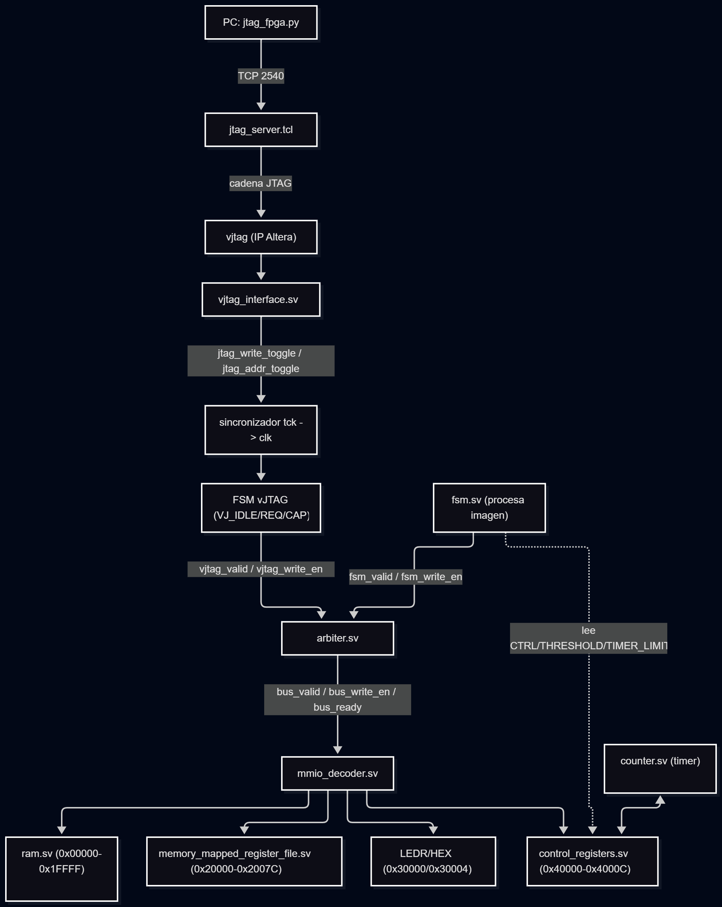
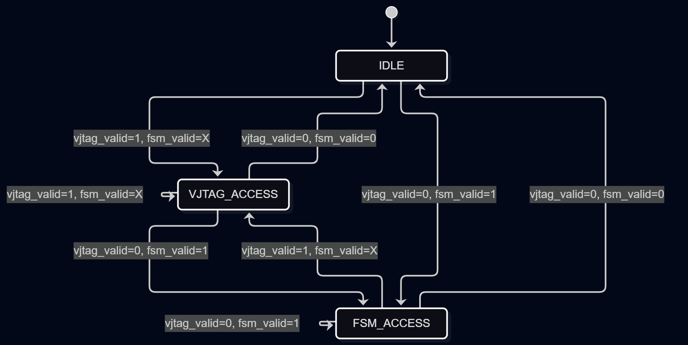
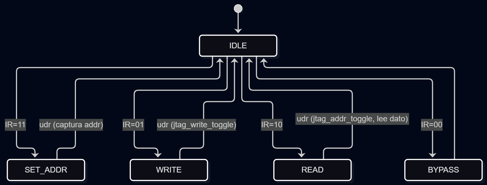
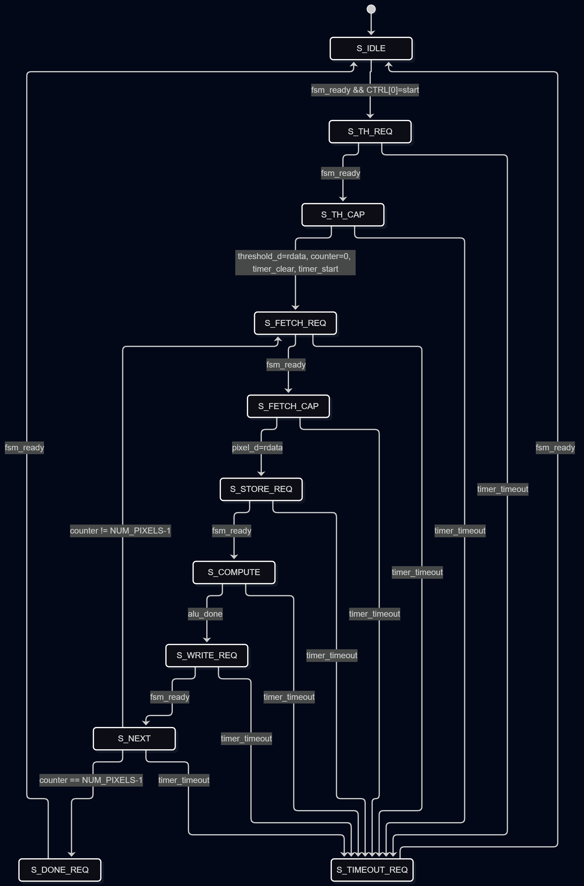
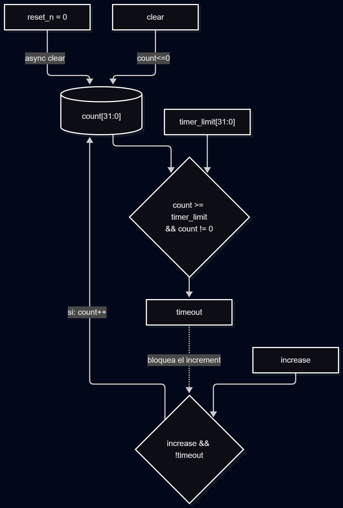
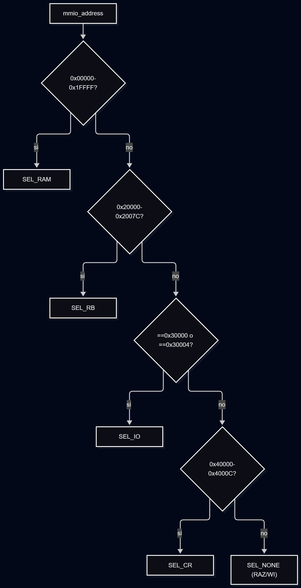
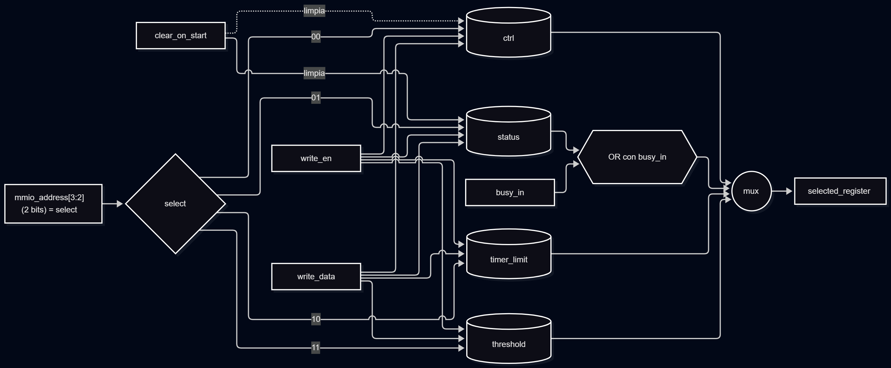
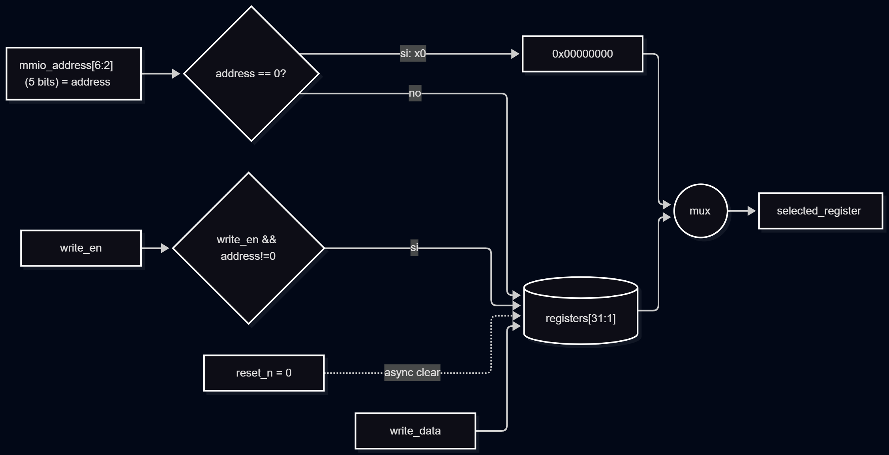
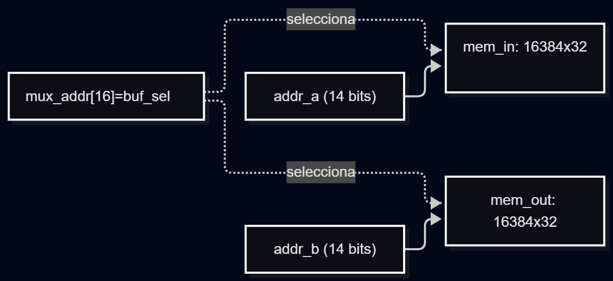

# Arquitectura (Sprint 3)

## 1. Diagrama general del sistema

## 2. `arbiter.sv`

### Señales
| Señal           | Dirección | Descripción                        |
|------------------|-----------|-------------------------------------|
| `fsm_valid`      | in        | Petición de bus de la FSM (prioridad baja) |
| `vjtag_valid`    | in        | Petición de bus de vJTAG (prioridad alta)  |
| `mux_valid`      | out       | Petición hacia `mmio_decoder`        |
| `fsm_ready`/`vjtag_ready` | out | Backpressure hacia cada solicitante |

### Regla de prioridad
Si ambos puertos solicitan el bus en el mismo ciclo, gana `vjtag_valid` (desde cualquier estado); `fsm_ready` permanece en 0 hasta que vJTAG libere el bus (backpressure, AC1).

## 3. `vjtag_interface.sv`

Convierte el protocolo serie JTAG (IR + DR shift registers) en pulsos de un ciclo (`jtag_write_toggle`, `jtag_addr_toggle`) mediante detección de flanco tras un sincronizador de 3 flip-flops (cruce de dominio `tck`→`clk`) implementado en `top_level.sv` (`addr_pulse`, `write_pulse`).

## 4. `fsm.sv`

10 estados: `S_IDLE, S_TH_REQ, S_TH_CAP, S_FETCH_REQ, S_FETCH_CAP, S_STORE_REQ, S_COMPUTE, S_WRITE_REQ, S_NEXT, S_DONE_REQ`. `NUM_PIXELS=16384`. No existe un estado dedicado para limpiar `CTRL`: al detectar `CTRL.start=1` en `S_IDLE`, la FSM emite el pulso `clear_on_start` (señal dedicada, fuera del bus) que `control_registers.sv` usa para limpiar `CTRL` y `STATUS` en el mismo ciclo, sin gastar una transacción de bus extra. Tampoco existe un estado `S_TIMEOUT_REQ` separado: tanto el fin normal como el timeout reportan en el mismo estado `S_DONE_REQ`, escribiendo `STATUS=0x2` (done) o `STATUS=0x4` (timeout) según la bandera interna `timed_out_q`. El timeout es global: interrumpe cualquier estado de trabajo salvo que haya una transacción de bus a medias (en cuyo caso espera a ganar el bus ese mismo ciclo antes de saltar a `S_DONE_REQ`, para no romper AC1 a medio camino).

## 5. `counter.sv` (temporizador de hardware, AC8)

Puertos: `clk`, `reset_n`, `clear`, `increase`, `timer_limit[31:0]`, `timeout` (combinacional: `count >= timer_limit && count != 0`). En `top_level.sv`, `increase` está conectado a un registro `timer_running_q` que se activa con `timer_start` (emitido por `fsm.sv` en `S_TH_CAP`) y se apaga con `timer_clear` (emitido en `S_DONE_REQ`).

## 6. `mmio_decoder.sv`

Decodificación combinacional; `ready = valid` siempre (aceptación en el mismo ciclo, satisface RAZ/WI sin generar stalls). `sel_q` se registra para el mux síncrono de datos de lectura (1 ciclo de latencia).

## 7. `control_registers.sv`

4 registros (`ctrl`, `status`, `timer_limit`, `threshold`), seleccionados por `mmio_address[3:2]`. A diferencia de una versión anterior del módulo, **sí tiene lógica especial de hardware**:
- `busy_in` (desde `fsm.sv`, `= state != S_IDLE`): se combina por OR con el bit 0 de `status` en la lectura — `STATUS.busy` es siempre 1 mientras la FSM procesa, sin importar lo escrito.
- `clear_on_start` (desde `fsm.sv`): limpia `ctrl` y `status` a 0 en el mismo ciclo en que la FSM detecta `CTRL.start=1`, sin pasar por el bus.

`TIMER_LIMIT`/`THRESHOLD` se sombrean también en `top_level.sv` (`timer_limit_q`, `threshold_q`) porque `control_registers.sv` solo expone su valor cuando es leído por el bus, y `counter.sv`/el display HEX necesitan acceso continuo.

## 8. `memory_mapped_register_file.sv`

31 registros físicos (`x1`-`x31`, `registers[31:1]`); `x0` no tiene componente físico, se fuerza a `0` combinacionalmente cuando `address==0` y las escrituras a esa dirección se ignoran. Salida: `selected_register`. Reset físico únicamente.

## 9. `ram.sv`

Dos memorias físicas separadas de 16384 palabras x 32 bits cada una (`mem_in` para `RAM_IN`, `mem_out` para `RAM_OUT`), dirección de 14 bits por puerto. `top_level.sv` selecciona el buffer con `buf_sel = mux_addr[16]` y usa el mismo índice (`mux_addr[15:2]`) para ambos puertos — no hay conflicto de prioridad entre puertos porque cada uno escribe en un arreglo físico distinto. Sin puerto de reset (ni físico ni por software); el contenido nunca se borra.

## 10. Reset e integración en `top_level.sv`

Dos mecanismos de reset, con alcance distinto:
- **Físico** (`KEY[0]`, sincronizado/liberado por `key_sync`) → `rst_n`: resetea todo el diseño, incluyendo RAM, banco de registros, `arbiter` y la FSM de vJTAG.
- **Por software** (`CTRL[1]=1` en una escritura) → pulso de 1 ciclo `soft_rst_q` → `core_rst_n = rst_n & ~soft_rst_q`: resetea solo `fsm.sv`, `counter.sv`, `control_registers.sv` y los registros sombra de `top_level` (timer/threshold/status/ledr/hex). **No** resetea la RAM, el banco x0-x31, el `arbiter` ni la FSM de vJTAG.

`top_level.sv` también integra un display de depuración en los `HEX0-5` (seleccionado por `SW[1:0]`: contador+estado, threshold, último píxel+resultado, o último valor escrito por MMIO) y refleja `busy`/`done`/`timeout` en `LEDR[2:0]` cuando `SW≠11`.