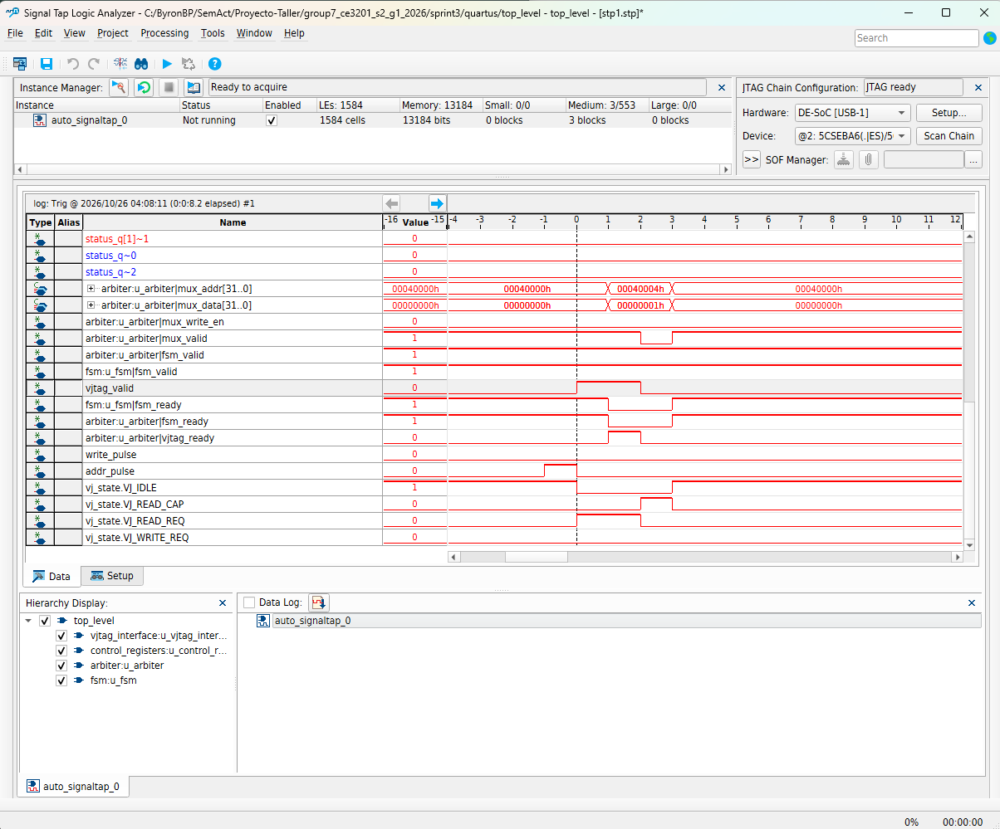
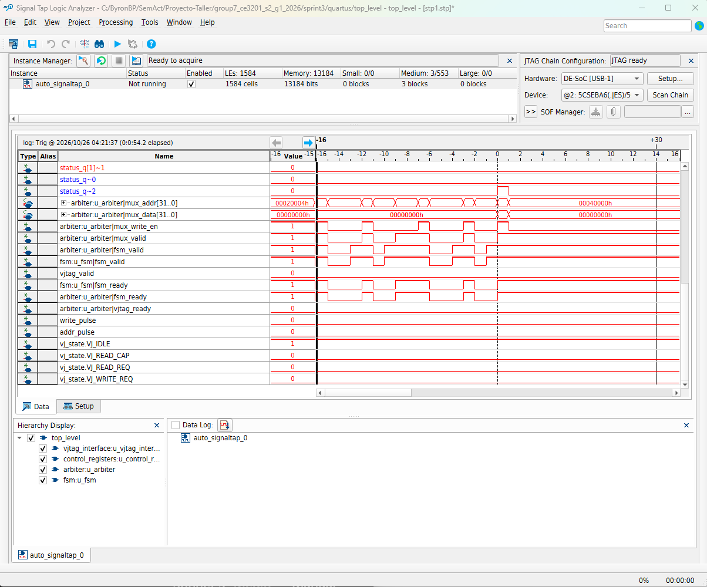

# Resultados (Sprint 3)

## 1. Simulación (Questa / cocotb)

Resumen generado por `parse_logs.py` (`questa_test_summary.log`), módulos verificados: `arbiter`, `fsm`, `counter`, `top_level`, `ram`, `mmio_decoder`, `control_registers`, `memory_mapped_register_file`.

```
ERRORS=0
WARNINGS=0
ALL_TESTS_PASSED
```

Evidencia: `.wlf` (Questa) por módulo y `results_top_level.xml` (cocotb) adjuntos en el repositorio (`sprint3/test/sv/*.wlf`, `sprint3/test/cocotb/results_top_level.xml`). Las formas de onda del `.wlf` de `top_level` muestran la serialización bit a bit del protocolo vJTAG: el `TCK` desplazando `TDI`/`TDO` por `DR_ADDR`/`DR1`/`DR2`, y los pulsos de un ciclo de `jtag_write_toggle`/`jtag_addr_toggle` tras el cruce de dominio.

## 2. Síntesis (Quartus)

Reportes `.flow.rpt`, `.map.rpt`, `.sta.rpt` adjuntos en `sprint3/quartus/output_files/`, todos con estado `Successful`.

Uso de recursos (post-integración completa de `fsm`/`counter`/`top_level`, desde `top_level.map.rpt`):

| Recurso         | Uso |
|-----------------|-----------------|
| ALMs            | 1,488 / 41,910 (4 %) |
| Memoria en bloques | 1,061,760 / 5,662,720 bits (19 %) — dominada por `ram.sv` (`mem_in` + `mem_out`, 16384×32 cada una = 1,048,576 bits en total) |
| Registros       | 3,033 |
| Fmax (`.sta.rpt`, peor caso 85 °C) | 80.15 MHz en `clk` — margen amplio sobre los 50 MHz de `CLOCK_50` |

## 3. Pruebas en hardware (DE10-Standard, 50 MHz)

Validado end-to-end vía JTAG (`jtag_server.tcl` + `jtag_fpga.py` + `pixel_image_app.py`):
- Lectura/escritura en cada bloque MMIO (`RAM_IN`, `RAM_OUT`, banco x0-x31, `LEDR`, `HEX`, `CTRL`, `STATUS`, `TIMER_LIMIT`, `THRESHOLD`).
- RAZ/WI en direcciones no mapeadas (fuera de los rangos decodificados por `mmio_decoder.sv`).
- `x0` protegido; `x1` usado por la FSM como scratch del ALU durante el procesamiento real de imagen.
- Dos mecanismos de reset verificados por separado: físico (`KEY0`, resetea todo el diseño) y por software (`CTRL[1]=1`, pulso `soft_rst_q` que resetea solo `fsm`/`counter`/`control_registers`/registros sombra, **sin** tocar RAM ni el banco x0-x31).
- `STATUS.busy` (bit 0) confirmado como señal **viva**: siempre lee 1 mientras la FSM procesa (`state != S_IDLE`), sin importar lo escrito, por el OR combinacional con `busy_in` en `control_registers.sv`. `STATUS` se limpia automáticamente a 0 al iniciar cada corrida (`clear_on_start`, emitido por la FSM al detectar `CTRL.start=1`) — no persiste entre corridas.
- Procesamiento de imagen completa con distintos `THRESHOLD` (incluyendo 0 y 255) y `TIMER_LIMIT` (incluyendo 0, que fuerza timeout inmediato).
Capturas SignalTap a 50 MHz (`stp1.stp`), requeridas por AC13 para aislar explícitamente el instante de colisión de arbitraje y el corte por temporizador:

**Captura 1 — Colisión de arbitraje (vJTAG vs. FSM)**



Se dispara el trigger sobre `vjtag_valid` (flanco de subida) mientras la FSM mantiene `fsm_valid`/`fsm_ready` en 1 de forma continua (procesando imagen); la transacción usada fue un `read` por JTAG (`addr_pulse`), sin necesidad de escritura. Se observa el instante exacto en que `vjtag_valid` se activa y, por la regla de prioridad de `arbiter.sv`, el arbitro transiciona a `VJTAG_ACCESS`: `mux_valid`/`mux_addr`/`mux_data` pasan a reflejar la transacción de vJTAG en lugar de la de la FSM, y `fsm_ready` cae a 0 ese mismo ciclo (backpressure), evidenciando que vJTAG tiene prioridad sobre la FSM tal como lo define `arbiter.sv`.

**Captura 2 — Corte por temporizador (timeout)**



Con `TIMER_LIMIT` configurado en un valor bajo y la FSM en medio del procesamiento, se dispara el trigger sobre `status_q~2` (flanco de subida) — el bit de timeout ya registrado en `STATUS` dentro de `top_level.sv`, usado en vez de `timer_timeout` directamente porque esa señal combinacional de `counter.sv` no estaba tapeada en el core SignalTap existente y añadirla hubiera exigido recompilar. Se observa cómo, justo antes del trigger, la FSM está activa (`fsm_valid`/`fsm_ready` pulsando), y en el mismo ciclo del trigger `mux_addr` pasa a `0x40004` (dirección de `STATUS`): la FSM abandona el estado de trabajo en curso, salta a `S_DONE_REQ` y escribe `STATUS <= 32'h4` por el bus antes de regresar a `S_IDLE`.

## 4. Discusión de resultados

El comportamiento observado en hardware (capturas SignalTap) coincide con el simulado en Questa/cocotb para los tres mecanismos críticos del diseño: (1) la prioridad de `arbiter.sv`, donde vJTAG siempre desplaza a la FSM del bus compartido en el mismo ciclo en que `vjtag_valid` se activa, sin estados intermedios de espera adicionales; (2) el corte por temporizador, que interrumpe cualquier estado de trabajo de la FSM (salvo que haya una transacción de bus a medias, en cuyo caso espera a ganarla) y siempre resulta en `STATUS=0x4` escrito desde `S_DONE_REQ`, nunca en `STATUS=0x2` cuando `timed_out_q=1`; y (3) el bit `busy` de `STATUS`, que se confirmó como una señal combinacional viva (`busy_in` de `fsm.sv` OR'd con el valor almacenado en `control_registers.sv`) — lee 1 todo el tiempo que la FSM está activa, y vuelve a reflejar el valor almacenado (0, tras `clear_on_start`) en cuanto la FSM regresa a `S_IDLE`.

La única diferencia relevante entre el `.wlf` de simulación y la captura SignalTap real es de escala temporal: Questa modela el protocolo vJTAG con un `vjtag_sim_stub` que inyecta los pulsos `jtag_write_toggle`/`jtag_addr_toggle` de forma casi inmediata, mientras que en hardware el cruce de dominio tck→clk (sincronizador de 3 flip-flops) introduce una latencia de 2-3 ciclos de `clk` visible en la captura real; esto no afecta la lógica funcional, solo el tiempo absoluto entre el comando JTAG y el pulso interno.

El uso de bloques de memoria (1,061,760 / 5,662,720 bits, 19 %) está dominado casi en su totalidad por `ram.sv`: dos memorias físicas separadas, `mem_in` y `mem_out`, de 16384×32 cada una (1,048,576 bits en total), que Quartus empaqueta automáticamente en bloques M10K (cada uno de 10 Kbits) por ser la forma más eficiente de implementar memorias de ese tamaño en Cyclone V; el resto de la huella de memoria (del orden de 13 Kbits) corresponde al buffer interno del core SignalTap añadido para esta validación, no al diseño propiamente dicho.

En cuanto a timing, el `Fmax` reportado por `.sta.rpt` para el dominio `clk` es de 80.15 MHz (peor caso, modelo lento a 85 °C), muy por encima de los 50 MHz a los que corre `CLOCK_50` en la placa. Esto deja un margen de timing de aproximadamente 60 %, por lo que el diseño no está cerca de violar restricciones de setup/hold en la esquina de proceso más desfavorable, y confirma que la arquitectura combinacional del `arbiter`/`mmio_decoder` (sin pipelining adicional) es suficientemente rápida para el reloj de 50 MHz usado en todo el sistema.