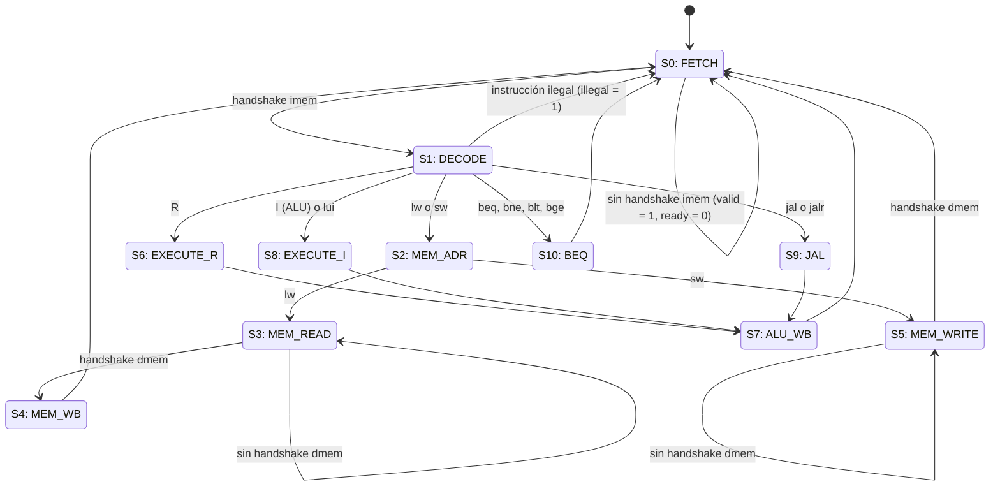
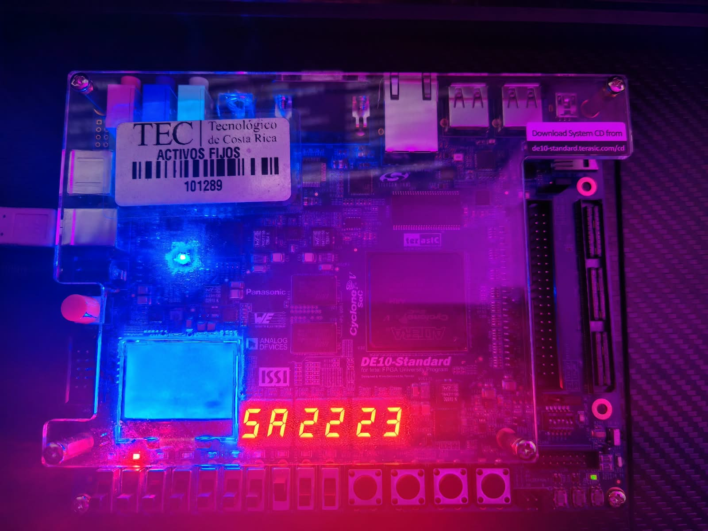
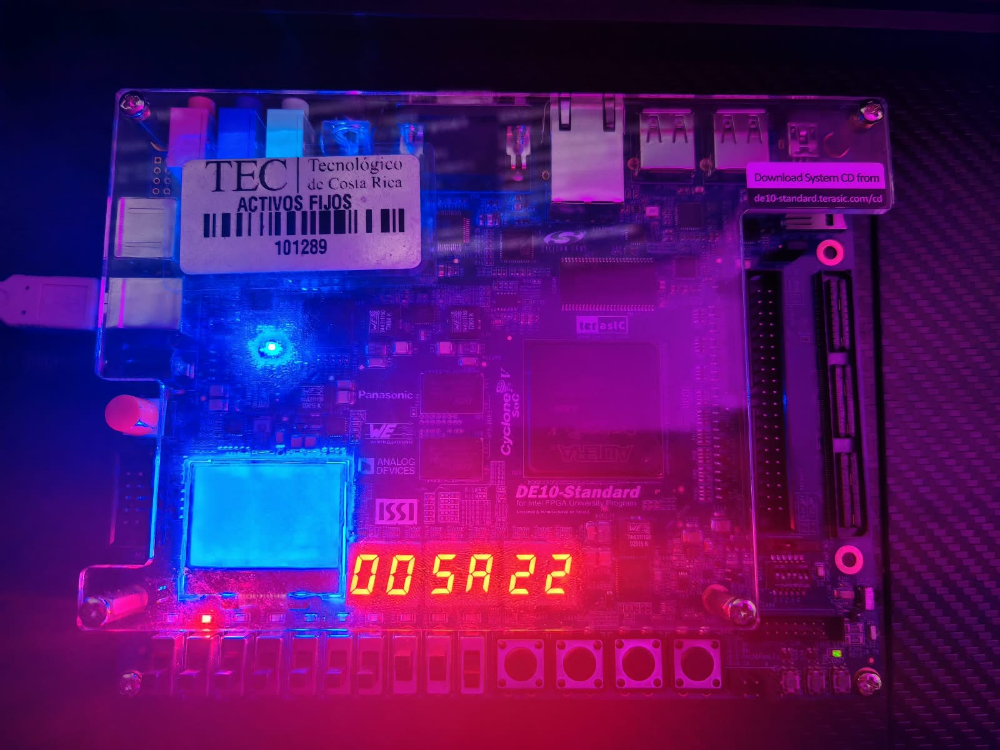
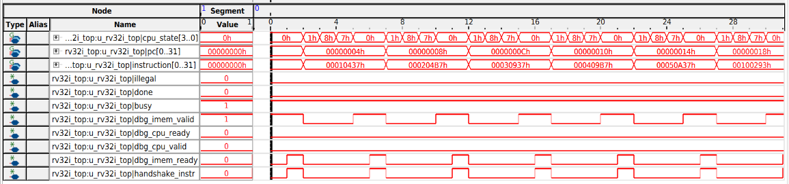

# Arquitectura: Procesador RV32I multiciclo Harvard (Sprint 4)

## 1. Estado del avance

| Área | Estado |
|---|---|
| FSM | Implementada |
| Datapath | Implementado |
| Interfaces ready-valid | Implementadas en la FSM |
| Enabler (`valid` con `enable`) | Implementado y verificado |
| Instrucciones de Tabla 1 | 28 de 28 pass (29/29 con `illegal`). `jalr` corregido |
| Mapa MMIO, árbitro, RAM y registros de control | Implementados y verificados (`rv32i_top`) |
| Testbench end-to-end | Implementado: 64 píxeles e imagen completa (16384), con y sin stalls |
| Top de placa (`top_level`) con vJTAG | Implementado; compila en Quartus (Fitter Successful) |
| Modo paso a paso (Epic 1) | Implementado en `top_level` y probado en la placa (22 nov; repetido con fotos el 24 nov, `results.md` sección 7.1) |
| Modo libre y reset (KEY[0]) en la placa | Fotografiados el 24 nov (`results.md`, secciones 7.2 y 7.3) |
| Carga por vJTAG y ejecución en la placa | Probada: histograma e imagen exactos con umbrales 0, 64, 128 y 255 |
| SignalTap | Capturas de inicio y fin a 50 MHz (23 nov, `results.md` sección 8) y análisis ciclo a ciclo de 1 499 instrucciones (24 nov, `results.md` secciones 8.1 y 8.2) |
| Justificación de decisiones y trazabilidad | Secciones 12 (AC 1 a 13), 13 (decisiones de diseño) y 14 (desviaciones justificadas) |

---

## 2. Vista general

Diagrama de estados de la Control FSM, elaborado a partir del RTL (`multicycle_rv_control_fsm.sv`). Incluye las esperas por `ready` (FETCH, MEM_READ y MEM_WRITE se mantienen en su estado hasta que ocurre el handshake) y los estados que usan bne, blt, bge (estado BEQ, la condición se resuelve en la unidad de control), lui (EXECUTE_I con operando A = 0) y jalr (estado JAL con rs1 reenviado desde el banco de registros).



El número de cada estado (S0 a S10) es el valor de `state_num[3:0]` y lo que muestran los LEDR[3:0] en el modo paso a paso. Si `enable = 0` la FSM no cambia de estado en ninguno de los casos anteriores; si `soft_reset_n = 0` (CTRL[0] = 0) vuelve a FETCH.


Diagrama interno del procesador realizado en el simulador open source Logic Circuit.

---

## 3. Interfaz del módulo `rv32i_cpu`
Este es el módulo implementado para probar el RV32I con las pruebas de cocotb provistas en el repositorio https://github.com/rgarciatec/rv32i_cocotb_template.

| Puerto | Dirección | Ancho | Función |
|---|---|---|---|
| `clk` | in | 1 | Reloj |
| `reset` | in | 1 | Reset activo en alto (internamente se invierte) |
| `imem_valid` | out | 1 | El CPU pide una lectura de instrucción |
| `imem_ready` | in | 1 | La memoria de instrucciones aceptó la transacción |
| `imem_addr` | out | 32 | Dirección de byte de la instrucción |
| `imem_rdata` | in | 32 | Instrucción leída |
| `dmem_valid` | out | 1 | El CPU pide una transacción de datos |
| `dmem_ready` | in | 1 | La memoria de datos aceptó la transacción |
| `dmem_addr` | out | 32 | Dirección de byte del dato |
| `dmem_we` | out | 1 | 1 = escritura, 0 = lectura |
| `dmem_wdata` | out | 32 | Dato a escribir |
| `dmem_rdata` | in | 32 | Dato leído |
| `illegal_instruction` | out | 1 | Pulso de un ciclo al decodificar una instrucción fuera de las 28 |

```systemverilog
    // Instantiate the actual multicycle rv32i.
    logic enable;
    assign enable = 1'b1;
    logic soft_reset_n;
    assign soft_reset_n = 1'b1;
    multicycle_rv32i dut
    (
        .clk(clk),
        .rst_n(~reset), // Invert reset because the testbench expects an active high reset.

        .enable(enable), 
        .soft_reset_n(soft_reset_n), 

        // Ready valid inputs
        .ready_in_instr_memory(imem_ready),
        .ready_in_data_memory(dmem_ready),

        // Ready valid outputs
        .valid_out_instr_memory(imem_valid),
        .valid_out_data_memory(dmem_valid),

        // Handshakes. Display these.
        .handshake_instr_memory(),
        .handshake_data_memory(),

        // Instruction memory
        .address_instr_memory(imem_addr),
        .read_data_instr_memory(imem_rdata),

        // Data memory
        .write_enable_data_memory(dmem_we),
        .address_data_memory(dmem_addr),
        .write_data_data_memory(dmem_wdata),
        .read_data_data_memory(dmem_rdata),

        // Display
        .instruction(),
        .state_num(),

        // Tests
        .illegal(illegal_instruction)
    );
```


---

## 4. FSM de control

La FSM tiene 11 estados; `state_num[3:0]` los expone en binario (4 bits) para los LEDR y SignalTap. Quartus extrae la FSM y la recodifica One-Hot: 11 registros, con FETCH como código de todos ceros (tabla "State Machine" del `.map.rpt`, `evidencia_atributos.md` sección 1.4.1).

Los estados `MEM_READ`, `MEM_WRITE` y `FETCH` llevan a sí mismos hasta que su handshake no haya ocurrido.

| Estado | valid out | Acción principal | Siguiente |
|---|---|---|---|
| FETCH | imem | Lee instrucción, PC = PC + 4 | DECODE al recibir handshake |
| DECODE | — | Decodifica `op`, calcula rs1 + imm (JALR) o PC + imm (JAL) | Según `op` (ver diagrama) |
| MEM_ADR | — | Calcula dirección rs1 + imm | MEM_READ (lw) o MEM_WRITE (sw) |
| MEM_READ | dmem | Lee dato | MEM_WB al recibir handshake |
| MEM_WB | — | Escribe dato leído en rd | FETCH |
| MEM_WRITE | dmem | Escribe rs2 en memoria | FETCH al recibir handshake |
| EXECUTE_R | — | ALU con rs1 y rs2 | ALU_WB |
| EXECUTE_I | — | ALU con rs1 e inmediato. LUI usa operando A = 0 | ALU_WB |
| JAL | — | Escribe el destino en PC y guarda PC + 4 para rd | ALU_WB |
| ALU_WB | — | Escribe resultado en rd | FETCH |
| BEQ | — | Compara rs1 y rs2; si la condición se cumple, PC = destino | FETCH |

### Ciclos por instrucción (teoría y medición)

Cada instrucción suma los ciclos de sus estados. FETCH dura 2 ciclos: `imem_ready` sube un ciclo después de `valid` (lectura síncrona de la M10K, `ram.sv`: `imem_ready <= imem_valid && !imem_ready`). En el bus de datos, MEM_WRITE dura 2 ciclos (concesión registrada del `arbiter` más el `ready` de escritura, que es inmediato) y MEM_READ 3 (concesión, latencia de 1 ciclo de la M10K y `ready`).

| Instrucciones | Camino de estados | Ciclos teóricos | Medido en SignalTap (capturas A + B) |
|---|---|---|---|
| Tipo I y `lui` (`addi`, `andi`, `slli`, `lui`, `li`, `mv`) | FETCH, FETCH, DECODE, EXECUTE_I, ALU_WB | 2 + 1 + 1 + 1 = 5 | 677 instrucciones, todas de 5 ciclos |
| Tipo R (`add`, `slt`) | FETCH, FETCH, DECODE, EXECUTE_R, ALU_WB | 5 | 172 instrucciones, todas de 5 ciclos |
| `bne` (tomado o no) | FETCH, FETCH, DECODE, BEQ | 2 + 1 + 1 = 4 | 152 instrucciones, todas de 4 ciclos |
| `sw` | FETCH, FETCH, DECODE, MEM_ADR, MEM_WRITE, MEM_WRITE | 2 + 1 + 1 + 2 = 6 | 326 instrucciones, todas de 6 ciclos |
| `lw` | FETCH, FETCH, DECODE, MEM_ADR, MEM_READ ×3, MEM_WB | 2 + 1 + 1 + 3 + 1 = 8 | 172 instrucciones, todas de 8 ciclos |
| `jal`, `jalr` | FETCH, FETCH, DECODE, JAL, ALU_WB | 2 + 1 + 1 + 1 = 5 | No hay en las capturas (el firmware solo usa `j halt`, que nunca se busca); camino deducido del RTL |

Coinciden 1 499 de 1 499 instrucciones (`results.md`, sección 8.2). Con estos ciclos el firmware sigue `T(N) = 3 920 + 83·N` ciclos para N píxeles (9 232 para 64 y 1 363 792 para 16 384).

Notas de diseño:

- Con instrucciones inválidas la FSM vuelve a FETCH. `illegal` vale 1 durante el ciclo de DECODE en el que el opcode no es válido (no pertenece a las 28 instrucciones de la Tabla 1).
- Salidas de control: se decodifican de `current_state` (`reg_write`, `mem_write`, `alu_src_*`, `result_src`). `ir_write` y `pc_update` en FETCH incluyen además el handshake de instrucción para que el IR y el PC se actualicen en el ciclo en que el dato es válido.

---

## 5. Protocolo ready/valid

- El CPU mantiene `valid` en alto mientras espera `ready`. La transacción ocurre cuando `valid & ready` son 1 en el flanco de reloj (handshake).
- Mientras no hay handshake, la FSM no cambia de estado. Las señales de dirección y datos se mantienen estables.
- En FETCH, `ir_write` y el avance del PC ocurren solo con handshake de instrucción.

Enabler: `valid_out_* = enable && soft_reset_n && (estado)`. Con `enable = 0` la FSM no cambia de estado y los `valid` de ambos buses valen 0.

¿Qué pasa si un `ready` llega mientras `enable = 0`? El handshake se define como `ready && valid_out`, y `valid_out` vale 0, por lo que no hay handshake: la transacción no se cuenta, la FSM permanece en FETCH, MEM_READ o MEM_WRITE y no se escribe `ir`, ni el PC, ni ningún registro. Al volver `enable = 1` el CPU repite la petición desde el mismo estado. Una escritura al bus de datos solo se completa si `valid = 1` en el mismo ciclo, por lo que con `enable = 0` no se escribe nada. En el modo paso a paso el CPU se congela con `cpu_hold` solo después de que `cpu_state` cambia, es decir, cuando la transacción en curso ya terminó, de modo que no se pierde ninguna.

Con la CPU congelada (`enable = 0`) el registro `read_data_reg` conserva su valor (`else if (enable)`); antes capturaba el bus en todos los ciclos y se perdía el dato de un `lw` congelado en `MEM_WB`.

La FSM expone su estado actual en `state_num[3:0]` (puerto del `multicycle_rv32i`), usado por el modo paso a paso y por las vistas de depuración.

---

## 6. Buses independientes y arbitraje (AC 3)

El módulo propuesto en `features.md` (9.2) para unir los buses del procesador **se descarta**: unir los buses contradice el AC 3, que exige dos buses físicos independientes (instrucciones y datos) hacia el exterior. En su lugar:

| Bus | Camino | Maestros | Se arbitra |
|---|---|---|---|
| Instrucciones (Fetch) | CPU -> filtro de rango en `rv32i_top` -> puerto de instrucciones de `ram` (lectura directa, sin árbitro ni decodificador) | CPU | No: es un bus dedicado solo de lectura |
| Datos (Memory) | CPU y Host vJTAG -> `arbiter` -> `mmio_decoder` -> RAM de datos y registros | CPU y Host | Sí: el `arbiter` concede el bus a uno de los dos |

- **Independencia.** El bus de instrucciones nunca pasa por el `arbiter`, por lo que un acceso del Host al bus de datos no frena el Fetch ni lo mezcla con las transacciones de datos. Cada bus tiene su propio par `valid`/`ready` (`imem_valid`/`imem_ready` y `cpu_valid`/`cpu_ready`) y su propio `ready` (la FSM espera por cada uno por separado).
- **Árbitro.** Tiene dos maestros, el Host vJTAG y el bus de datos de la CPU (no tres: el bus de instrucciones no entra). Prioridad fija al Host (AC 2 de Sprint 3); la CPU conserva el bus hasta completar su transacción (`FSM_ACCESS`) y entrega `mux_is_cpu` al decodificador para aplicar permisos por maestro.
- **Permisos del bus de instrucciones (AC 5, Tabla 2).** Este bus no tiene señal de escritura, por lo que es solo lectura (RO) para la CPU por construcción: no existe forma de que la CPU escriba la RAM de instrucciones por él. Además `rv32i_top` filtra el rango: si el PC cae fuera de 0x00000–0x01FFF (`imem_in_range = 0`), la CPU recibe 0 (Read-As-Zero) y `imem_ready` lo sigue entregando la RAM, de modo que no se bloquea. Una instrucción 0 decodifica como ilegal (`illegal = 1`) y la FSM vuelve a FETCH. El flag se registra junto al dato (`imem_in_range_q`) porque la lectura de la M10K tarda un ciclo. Las escrituras de la CPU a la RAM de instrucciones por el bus de datos las descarta el `mmio_decoder` (WI).
- **Acceso del Host a la RAM de instrucciones.** La RAM de instrucciones tiene dos puertos: uno de datos (Host R/W por el bus arbitrado) y uno de instrucciones (CPU RO). Esto permite que el Host cargue el firmware mientras la CPU está apagada, y que la CPU lea instrucciones sin pasar por el árbitro.

---

## 7. Mapa MMIO y permisos por maestro (Tabla 2)

El `mmio_decoder` aplica los permisos con la señal `is_cpu` que entrega el árbitro. Una escritura sin permiso se descarta (Write-Ignored, WI) sin bloquear el bus; la lectura de direcciones no mapeadas devuelve 0 (Read-As-Zero, RAZ).

| Rango (hex) | Destino | Host | CPU | Nota |
|---|---|---|---|---|
| 00000–01FFF | RAM de instrucciones (8 KB, 2048 palabras) | R/W | RO (WI) | `we_instr` solo si `is_cpu = 0` |
| 10000–1FFFF | RAM imagen de entrada (16384 palabras) | R/W | RO (WI) | `we_in` solo Host |
| 20000–2FFFF | RAM imagen de salida (16384 palabras) | RO | R/W | `we_out` solo CPU |
| 30000–303FC | RAM histograma (256 contadores de 32 bits) | RO | R/W | `we_hist` solo CPU |
| 40000 | LEDR (10 bits) | R/W | R/W | |
| 40004 | HEX (24 bits, un nibble por display) | R/W | R/W | |
| 50000 | CTRL (bit 0 = start) | R/W | RO | `we_ctrl` solo Host |
| 50004 | STATUS (bit 0 = busy, bit 1 = done) | RO | R/W | `we_status` solo CPU |
| 5000C | THRESHOLD (0 a 255) | R/W | RO | `we_threshold` solo Host |

### Mapeo RAZ/WI del bus de instrucciones
El bus de instrucciones de la CPU no pasa por el `mmio_decoder`: su permiso RO y la lectura de 0 fuera de 0x00000–0x01FFF se aplican en `rv32i_top` (sección 6). Las lecturas tardan un ciclo (M10K sincrónica): `ready` sube un ciclo después de `valid`.

La validación de la dirección de lectura (el PC) en `rv32i_top` es `pc[31:13] == 19'd0`, lo cual es lógicamente equivalente
a que el pc se encuentre en el rango [0x00000, 0x01FFF].

---

## 8. Arranque y fin del procesamiento (AC 7)

- **Arranque.** El Host escribe CTRL[0] = 1 (`start`). `start` es el nivel `soft_reset_n` de la CPU (no un pulso): mientras vale 0, el PC se mantiene en 0x0000_0000 y la FSM en FETCH; al ponerse en 1 la CPU comienza a ejecutar desde la dirección 0.
- **Fin.** El firmware escribe `STATUS = 0b10`, es decir, el bit 1 (`done`); el valor 1 en el bit 0 sería `busy`, que es de solo lectura y se calcula en hardware como `start && !done`.
- **Apagado de peticiones.** Con `done = 1`, `cpu_enable = start && !done` vale 0: la FSM deja de avanzar y `valid_out` de ambos buses vale 0 (el firmware termina en un bucle infinito `j halt`, pero la CPU ya no genera peticiones). El control regresa al Host, que puede leer STATUS, el histograma y la imagen de salida.
- **Re-armado.** El Host baja CTRL[0] a 0 (`done` se limpia solo) y lo vuelve a subir a 1.

---

## 9. Sistema completo: `rv32i_top` y `top_level`

```text
top_level (placa)
├─ key_sync x2 (reset desde KEY[0], paso desde KEY[1])
├─ vjtag (IP) + vjtag_interface + FSM de bus del Host (cruce tck -> clk)
├─ lógica del modo paso a paso
├─ rv32i_top
│   ├─ multicycle_rv32i (CPU)
│   ├─ arbiter (Host vJTAG tiene prioridad sobre la CPU)
│   ├─ mmio_decoder
│   ├─ ram (M10K: instrucciones, IN, OUT, histograma)
│   └─ control_registers (LEDR, HEX, CTRL, STATUS, THRESHOLD)
└─ seven_segment_adapter x6 (HEX0..HEX5)
```

Mapa de memoria (Tabla 2): instrucciones 0x00000–0x01FFF, IN 0x10000–0x1FFFF, OUT 0x20000–0x2FFFF, histograma 0x30000–0x303FC, LEDR 0x40000, HEX 0x40004, CTRL 0x50000 (bit 0 = start), STATUS 0x50004 (bit 0 = busy, bit 1 = done), THRESHOLD 0x5000C.

La CPU corre con `cpu_enable = start && !done`, donde `start` es CTRL[0] (`soft_reset_n`). `busy` se calcula en hardware como `start && !done`.

### Modo paso a paso

- SW[0] = 0: la CPU corre a 50 MHz. SW[0] = 1: avance manual con KEY[1].
- Un solo ciclo de `enable` no completa un FETCH ni un handshake de datos, por lo que un paso deja correr la FSM hasta que `cpu_state` cambie.
- Implementación: `cpu_hold = step_mode & ~(step_active_q & (cpu_state == step_ref_q))`. Al pulsar KEY[1] se activa `step_active_q` y se guarda el estado actual en `step_ref_q`; cuando `cpu_state` cambia, `step_active_q` se limpia y la CPU vuelve a congelarse. `step_active_q` también se limpia si `busy` vale 0.
- `rv32i_top` recibe `cpu_hold` y lo combina como `enable(cpu_enable && !cpu_hold)`. Sin conectar, `cpu_hold` vale 0, por lo que el testbench de simulación no cambia.

**Verificación en la placa (24 nov).** Con SW[0] = 1 y SW[2:1] = 01, cada pulsación de KEY[1] avanzó un estado de la FSM. Para `lui s0, 0x10` (`0x00010437`) se fotografió DECODE (1), EXECUTE_I (8), ALU_WB (7) y FETCH (0) de la siguiente instrucción, con el PC en `0x04` durante toda la instrucción (se incrementa en FETCH). Es el camino de `lui` del diagrama de la sección 2. Detalle y las 10 fotos en `results.md`, sección 7.1.

| DECODE (1), PC `0x04` | EXECUTE_I (8) | ALU_WB (7) | FETCH (0), PC `0x04` |
|---|---|---|---|
|  |  |  |  |

### Vistas de depuración (SW[2:1])

| SW[2:1] | HEX | LEDR |
|---|---|---|
| 00 | Registro `hex` | Registro `ledr` |
| 01 | PC[23:0] | `{step_mode, done, busy, illegal, 2'b00, cpu_state}` |
| 10 | Instrucción[23:0] | igual que arriba |
| 11 | Instrucción[31:8] | igual que arriba |

En modo libre, al terminar la ejecución, las vistas muestran el estado final: PC `0x84`, instrucción `0x005A2223` (`sw t0, 4(s4)` a STATUS), LEDR[8] (`done`) encendido y, en la vista 00, HEX = `0x4000`. Las fotos están en `results.md`, sección 7.2.

| Vista 00 | Vista 01 | Vista 10 | Vista 11 |
|---|---|---|---|
|  |  |  |  |

### Reset (KEY[0])

`key_sync` activa `rst_n` de forma asíncrona y lo libera de forma síncrona. Con `rst_n = 0` se reinician la FSM (a FETCH), el PC (a 0), los registros de control (`start`, `done`, THRESHOLD, LEDR y HEX), el banco de registros, los registros del datapath y la lógica del paso a paso. `busy = start && !done` pasa a 0 y la CPU deja de pedir buses. Las memorias (`ram.sv`) no se reinician: el firmware y las imágenes siguen cargados (deducido del RTL, no verificado en la placa). En las vistas de depuración LEDR[9] (`step_mode`) sigue reflejando SW[0] porque el reset solo reinicia su sincronizador y este vuelve a leer el interruptor. En la placa, al pulsar KEY[0], HEX y LEDR pasan a 0 (`results.md`, sección 7.3; foto en paso a paso: `evidencia/paso_a_paso/01_reset_key0_todo_en_cero.jpeg`).


### Señales para SignalTap

`top_level` marca con `(* keep *)` `tap_imem_valid`, `tap_imem_ready`, `tap_cpu_valid`, `tap_cpu_ready` y `tap_handshake_instr`, junto con `cpu_state`, el PC, la instrucción y `done`. El `.qsf` de la entrega final tiene SignalTap encendido (`ENABLE_SIGNALTAP ON`, instancia `stp_rv32i.stp`: 8K muestras, 76 bits, `CLOCK_50`). Para un bitstream de uso normal puede apagarse: el costo directo de la instancia es de 469,4 ALMs, 1 454 registros, 76 M10K y 622 592 bits, y la diferencia de Fmax entre las dos compilaciones (−3,80 MHz) no se puede atribuir solo a la instrumentación (`evidencia_atributos.md`, secciones 1.4.5 y 1.5). La compilación sin SignalTap del 19 nov (1 609 ALMs) es de un RTL anterior a los commits `0089c94` y `0782064`, por lo que no es exactamente la resta de la compilación final (`results.md`, sección 6).

---

## 10. Clasificación de módulos

| Módulo | Origen | Estado en Sprint 4 | Cambios |
|---|---|---|---|
| `alu_param.sv`, `alu_types_pkg.sv` | Sprint 1 | Reutilizado sin cambios | — |
| `decoder_4x16.sv`, `seven_segment_adapter.sv` | Sprint 1 | Reutilizado sin cambios | Se usan 6 `seven_segment_adapter` para HEX0 a HEX5 |
| `key_sync.sv` | Sprint 2 | Reutilizado sin cambios | Dos instancias: reset (KEY[0]) y paso (KEY[1]) |
| `binary_to_bcd_converter.sv`, `toggle.sv` | Sprint 2 | No se usan | — |
| `vjtag_interface.sv`, IP `vjtag` | Sprint 3 | Reutilizado sin cambios | — |
| `arbiter.sv` | Sprint 3 | Modificado | Maestros: Host y bus de datos de la CPU; la CPU conserva el bus hasta `ready`; nueva salida `mux_is_cpu` |
| `mmio_decoder.sv` | Sprint 3 | Modificado | Direcciones de la Tabla 2; permisos por maestro; RAZ/WI; `ready` de lectura con 1 ciclo |
| `control_registers.sv` | Sprint 3 | Modificado | Registros LEDR, HEX, CTRL, STATUS y THRESHOLD; salidas `start`, `cpu_enable`, `busy`, `done`, `ledr`, `hex`, `threshold` |
| `ram.sv` | Sprint 3 | Modificado | Cuatro memorias (instrucciones, entrada, salida, histograma); segundo puerto de lectura para el bus de instrucciones con `imem_ready` |
| `rv_register_file.sv` | Nuevo | Banco x0–x31 interno del procesador (sin x0 instanciado) | Ya no es un periférico MMIO como en Sprint 3 |
| `multicycle_rv32i.sv`, `multicycle_rv_control_unit.sv`, `multicycle_rv_control_fsm.sv`, `alu_decoder.sv`, `immediate_decoder.sv` | Nuevo | Procesador RV32I multiciclo | — |
| `rv32i_top.sv`, `top_level.sv` | Nuevo | Integración y top de placa | `rv32i_top`: filtro de rango del bus de instrucciones (`imem_in_range`, `imem_in_range_q`, `ram_imem_rdata`): fuera de 0x00000–0x01FFF la CPU lee 0 |

---

## 11. Infraestructura

- **Firmware.** `firmware.hex` se genera desde `firmware.s` con la toolchain `gcc-riscv64-unknown-elf` en `sprint4/firmware/`:

```bash
riscv64-unknown-elf-as -march=rv32i -mabi=ilp32 firmware.s -o firmware.o
riscv64-unknown-elf-objcopy -O binary -j .text firmware.o firmware.bin
xxd -e -c4 firmware.bin | awk '{print $2}' > firmware.hex
```

  Solo `firmware.s` y `firmware.hex` se versionan.
- **CI.** El gatekeeper, en cada PR que toque `sprint4`, ejecuta `make -C sprint4/test/cocotb` (pruebas unitarias y de sistema) y las pruebas del profesor en `sprint4/test/rv32i_cocotb`: `make test_cpu` y `make test_programs`, ambas con `SV_FILELIST=files.f TOPLEVEL=rv32i_cpu` (sin esos parámetros el Makefile compila el mock del profesor). Si cualquier `make` falla, el job falla. El `Dockerfile` instala `pytest-html`, que usa el dashboard de `test_cpu`. La evidencia de las corridas locales se guarda en `docs/evidencia/`.
- **Estructura de `sprint4/`.** `src/`, `test/cocotb/` (unitarias y sistema), `test/rv32i_cocotb/` (repo del profesor con los wrappers `rv32i_cpu*.sv`), `firmware/`, `scripts/`, `quartus/` y `docs/`. Los cambios a la estructura se documentan en `README.md`.

---

## 12. Requisitos del enunciado (AC 1 a 13): trazabilidad

| AC | Requisito (enunciado) | Implementación (módulo y señales) | Pruebas (`testplan.md`) | Resultados (`results.md`) |
|---|---|---|---|---|
| 1 | 28 instrucciones de la Tabla 1; accesos de píxel solo con `lw` y `sw` de palabra | `multicycle_rv_control_unit`, `alu_decoder` e `immediate_decoder`; `illegal = 1` fuera de las 28; no hay `lb`, `lh`, `sb` ni `sh` | TP-02, TP-17, TP-13 | 2, 9.1 |
| 2 | `lui` y pseudoinstrucciones permitidas | EXECUTE_I con `alu_src_a = 2'b11` (A = 0) e inmediato U; `firmware.s` usa `li`, `mv` y `j`, que se ensamblan a `addi` y `jal` | TP-02 (cinco inmediatos), TP-17 | 5, 9.4 |
| 3 | Multiciclo, Harvard, dos buses `ready`/`valid` independientes; congelar con `ready = 0` | FSM de 11 estados (sección 4); `imem_valid`/`imem_ready` hacia el puerto de instrucciones de `ram` y `cpu_valid`/`cpu_ready` hacia el `arbiter` (sección 6) | TP-12, TP-18, TP-21 | 4, 8.2, 9.1 |
| 4 | Modo paso a paso (SW[0] y KEY[1]) | `cpu_hold`, `step_mode`, `step_active_q` y `step_ref_q` en `top_level` (sección 9) | TP-11 | 7.1 |
| 5 | RAM de instrucciones: Host R/W con la CPU parada; CPU solo lectura (WI) | Puerto de instrucciones de `ram` sin escritura; `we_instr` solo con `is_cpu = 0`; filtro de rango `imem_in_range` en `rv32i_top` | TP-06, TP-07, TP-18, TP-16 | 3, 7, 9.7 |
| 6 | Partición de datos (Tabla 2), RAZ y WI | `mmio_decoder` (rangos y permisos por maestro) y las tres memorias de datos de `ram` | TP-06, TP-07, TP-16 | 3, 7 |
| 7 | `start` inicia en PC = 0; el firmware marca `done` y la CPU apaga sus `valid` | `control_registers`: `start`, `done`, `busy`, `cpu_enable = start && !done`; sección 8 | TP-08, TP-10, TP-13, TP-15 | 3, 8, 8.1 |
| 8 | Firmware: limpia el histograma, lo calcula, binariza, actualiza HEX y marca `done` | `firmware.s` y `firmware.hex` (34 palabras) | TP-13, TP-16, TP-22 | 4, 7, 8.2 |
| 9 | Python vía vJTAG sobre `jtag_server.tcl` | `pixel_image_app.py`, `vjtag_interface` y el cruce `tck` a `clk` de `top_level` | TP-16 | 7 |
| 10 | Plan de pruebas y banco del profesor (obligatorio) | `testplan.md`; repo `rv32i_cocotb_template` en `sprint4/test/rv32i_cocotb` | TP-01, TP-02, TP-17 | 1, 2 |
| 11 | Prueba de sistema con retención de instrucciones ante stalls y exactitud de histograma e imagen | `tb_top.py` (`make top`) sobre `rv32i_top` | TP-12, TP-13, TP-18 | 4, 4.1 |
| 12 | SignalTap a 50 MHz: estados de la FSM, PC, instrucción, `valid`/`ready` y `done` | `stp_rv32i.stp` y señales `(* keep *)` de `top_level` (sección 9) | TP-15, TP-21 | 8, 8.1, 8.2 |
| 13 | DI y HI con métricas de `.map.rpt` y `.sta.rpt` | `evidencia_atributos.md` | TP-14 | 6 |

Detalle de los requisitos que pide el enunciado y no son obvios en el RTL:

- **Solo `lw` y `sw` (AC 1).** Los píxeles se leen y escriben por palabras de 32 bits (un píxel por palabra). No se implementan lb, lh, sb ni sh.
- **`lui` (AC 2).** Se ejecuta en EXECUTE_I con el operando A en 0 y el inmediato tipo U (`{instruction[31:12], 12'b0}`); `firmware.s` lo usa (directamente o por `li`) para cargar las bases del mapa MMIO.
- **Latencia de las M10K.** La lectura sincrónica tarda un ciclo, por eso `ready` de lectura sube un ciclo después de `valid`, y el bus de instrucciones entrega una instrucción cada 2 ciclos (`imem_ready` alterna 1, 0, 1, 0). La FSM mantiene `valid` hasta recibir `ready`.

La captura A de SignalTap lo muestra en hardware: cada instrucción de tipo I ocupa 5 muestras de 20 ns, porque FETCH (estado 0) dura 2 ciclos y los estados 1, 8 y 7 un ciclo cada uno; el análisis de las 1 499 instrucciones capturadas está en `results.md`, secciones 8.1 y 8.2.



---

## 13. Decisiones de diseño y justificación

Cada fila da la decisión (y la alternativa descartada), el fundamento de diseño digital, las señales RTL que la implementan y la evidencia medida. Fuentes teóricas: Patterson y Hennessy [1] y Harris y Harris [2] (CPU multiciclo, ruta de datos y FSM), el protocolo `valid`/`ready` [3, 6] y la guía del analizador lógico [7] (referencias del enunciado). Las cifras de síntesis son de `evidencia_atributos.md`; las de ciclos, de `results.md`, sección 8.2. Lo que no se midió se marca "(suposición)" o "(calculado)".

| # | Decisión (alternativa descartada) | Fundamento de diseño digital | Señales y módulos RTL | Evidencia |
|---|---|---|---|---|
| 1 | CPU multiciclo con una sola ALU (monociclo, segmentado) | En un monociclo el periodo de reloj es el retardo de la instrucción más larga (búsqueda, lectura de registros, ALU, memoria y escritura) y hacen falta sumadores aparte para PC + 4 y los destinos de salto. El multiciclo divide la instrucción en pasos, reutiliza una ALU y una interfaz de memoria por paso y cambia CPI > 1 por un ciclo corto y menos hardware. El segmentado exigiría detectar riesgos RAW (el histograma hace `lw`, `addi`, `sw` sobre la misma posición) y reenvíos; además el AC 3 pide multiciclo | `alu_src_a`, `alu_src_b` y `result_src` cambian las entradas de `rv32i_alu` por estado: FETCH calcula `pc + 4`, DECODE el destino `old_pc + imm`, MEM_ADR `rs1 + imm`, EXECUTE_* la operación; siete registros de 32 bits entre pasos (`pc`, `old_pc`, `instruction`, `read_data_reg`, `rs1_data_reg`, `rs2_data_reg`, `alu_result_reg`) | CPI 5,53 con 1 499 de 1 499 instrucciones en 4 a 8 ciclos; una ALU (319,1 ALMs); Fmax 67,33 MHz sin SignalTap |
| 2 | FSM de 11 estados con `ready` como condición de transición | Las salidas decodifican el registro de estado (tipo Moore): son estables todo el ciclo y no dependen de entradas asíncronas como `ready`. La función de siguiente estado sí depende de `ready`: la FSM espera en el mismo estado hasta el handshake (contrapresión). Las excepciones son `ir_write` y `pc_update`, que incluyen el handshake para capturar el dato en el ciclo en que es válido | `current_state`, `next_state`, `pc_update`, `ir_write`, `reg_write`, `mem_write`; `valid_out_instr_memory` = `enable` AND `soft_reset_n` AND FETCH | Quartus la recodifica One-Hot: 11 registros (14 tras el ajuste); decodificar un estado lee un solo bit |
| 3 | Interfaz `valid`/`ready` en ambos buses (latencia fija supuesta) | Interfaz insensible a la latencia: la transferencia ocurre en el flanco con `valid` AND `ready`; `valid` no depende combinacionalmente de `ready` (evita lazos combinacionales e interbloqueos) y dirección y dato se mantienen mientras haya `valid` sin `ready`. Absorbe la latencia de la M10K y el arbitraje | `handshake_* = ready_in_* && valid_out_*`; `alu_result_reg` solo se carga con `enable && (handshake_data_memory \|\| !valid_out_data_memory)`, así la dirección no cambia durante la espera | `test_firmware_with_bus_stalls` PASS con 64 y 16 384 píxeles; SignalTap: `cpu_valid` dura 2 ciclos en `sw` y 3 en `lw`, con `cpu_ready` solo en el último |
| 4 | Dos buses (Harvard); el árbitro solo en el de datos (un bus unificado con árbitro de tres maestros, módulo de `features.md` 9.2) | Harvard separa los caminos de instrucciones y datos. El bus de instrucciones tiene un solo maestro (la CPU) y solo lectura, por lo que no necesita árbitro y es de solo lectura por construcción (no existe señal de escritura: AC 5). En un multiciclo la búsqueda y el acceso a datos no se solapan; la ganancia es que los 2 ciclos de búsqueda de cada instrucción (30 de los 83 ciclos de un píxel) nunca esperan al Host. Si la búsqueda compartiera el bus arbitrado quedarían expuestos 42 de 83 ciclos a colisiones (calculado: 30 + 12; no se implementó) | `imem_valid`, `imem_ready` e `imem_rdata` con el segundo puerto de lectura de `ram`; `cpu_valid` y `cpu_ready` con el `arbiter` | `test_host_and_cpu_instr_ports_coexist` PASS; el costo medido de colisión es 0,34 ciclos por lectura del Host; costo en memoria: la RAM de instrucciones sale duplicada (2 × 7 M10K) |
| 5 | Árbitro de prioridad fija al Host, no expropiativo, con concesión registrada (rotativo, expropiativo, combinacional) | La prioridad fija es la lógica más simple. No expropiativo porque `valid` y dirección de la CPU deben mantenerse hasta `ready` (protocolo); expropiar rompería la transacción. La concesión registrada separa la petición de la selección del subordinado y acorta el camino, a costa de 1 ciclo por transacción. Riesgo: inanición de la CPU si el Host pidiera sin parar; se acepta porque el Host carga con la CPU parada (CTRL[0] = 0) | `arbiter.state` en IDLE, VJTAG_ACCESS y FSM_ACCESS; en FSM_ACCESS la CPU conserva el bus mientras `fsm_valid && !subordinate_ready`; `mux_is_cpu` | `arbiter` 8/8; 29,3 ALMs; con el Host leyendo al azar el firmware tarda +5,6 % y termina exacto (sin inanición) |
| 6 | Decodificador MMIO con selección por rango, `sel_q` registrado y `pending_q` | La M10K entrega el dato un ciclo después de la dirección, así que el mux de lectura debe usar la selección registrada con la misma latencia (`sel_q`); con la selección combinacional se elegiría por la dirección de la transacción siguiente. La escritura termina en el mismo ciclo; la lectura, un ciclo después. Permisos: el habilitador de escritura se combina con el maestro (`is_cpu`, `is_host`), de modo que lo prohibido se descarta sin bloquear (WI); fuera de rango, `SEL_NONE` devuelve 0 (RAZ) | `sel`, `sel_q`, `pending_q`, `ready = valid && (write_en o pending_q)`, `we_*` con `is_cpu`/`is_host` | `mmio_decoder` 7/7; TP-18 (RAZ del bus de instrucciones); MEM_READ de 3 ciclos medido |
| 7 | Memorias en M10K sin reset, lectura síncrona, un píxel por palabra (arreglos en FF; cuatro píxeles por palabra) | La M10K es una RAM síncrona sin reinicio de contenido; un arreglo con reset se implementaría en registros (1 187 840 bits frente a 3 256 registros del diseño). AC 1 permite solo accesos de palabra, así que un píxel por palabra evita lógica de extracción de bytes, a costa de 4 veces más memoria que el empaquetado (524 288 bits por imagen contra 131 072, calculado) | arreglos `mem_instr`, `mem_in`, `mem_out` y `mem_hist` de `ram.sv` sin reset (solo `imem_ready` lo tiene); direcciones `img_addr[13:0]` | 1 187 840 bits y 143 M10K exactos contra la teoría de modos de la M10K; el contenido sobrevive a KEY[0] (deducido del RTL, no verificado en la placa) |
| 8 | Banco de registros en registros (FF) con dos lecturas combinacionales y una escritura; `x0` sin instanciar (M10K; reutilizar el módulo de Sprint 3) | DECODE necesita `rs1` y `rs2` a la vez. Una M10K con lectura síncrona añadiría un ciclo a cada instrucción (15 por iteración: 83 pasan a 98, +18,1 %, calculado, no implementado) y necesitaría una copia por puerto. El módulo de Sprint 3 tiene una sola dirección para lectura y escritura (un puerto de lectura), por lo que no sirve (sección 14, fila 1) | `rv_register_file`: `registers[31:1]`, `rs1_data` y `rs2_data` con `rs == 0` forzado a 0 | 992 registros (1 115 con duplicados del fitter); 741 ALUT contra 704 estimados; 757,1 ALMs, el bloque más grande |
| 9 | Una sola ALU para `lui`, comparaciones y saltos (sumadores y comparadores aparte) | Compartir el recurso combinacional más caro. `lui` es 0 + inmediato U. En complemento a dos, a < b con signo equivale a N xor V de a − b, y sin signo a que no haya acarreo de salida. La decisión del salto se toma en BEQ con las banderas. Los desplazamientos usan solo `b[4:0]` | `alu_src_a = 2'b11`; `alu_result_slt = {31'b0, negative ^ overflow}`; `alu_result_sltu = {31'b0, !carry}`; `alu_operand_b_shifts` | 29/29 del profesor (`slt`, `sltu`, `blt`, `bge`) y 2/2 programas; el error de LUI (usaba bits del inmediato como `funct3` y `funct7`) lo halló `xorshift` y se corrigió en `0089c94` |
| 10 | PC con PC + 4 en FETCH, `old_pc` y bit 0 forzado a 0 (estado extra para PC + 4) | Calcular PC + 4 con la ALU en el ciclo del handshake ahorra un estado. Como el PC ya avanzó, los destinos de salto y el enlace necesitan la dirección de la instrucción en curso: `old_pc`. Sin extensión C las instrucciones están alineadas y JALR exige poner a 0 el bit 0 de rs1 + imm, así que forzarlo es barato y la síntesis elimina `pc[0]` y `old_pc[0]` | `pc <= {wb_mux[31:1], 1'b0}`; `old_pc <= pc` con `ir_write`; `alu_src_a = pc` en FETCH | 224 − 2 = 222 registros propios más 4 duplicados del fitter = 226, igual al reporte; las búsquedas salen 0x0, 0x4, 0x8… (`test_fetch_secuencial`); dos errores hallados y corregidos: FETCH sumaba a `old_pc` y JALR no limpiaba el bit 0 (`results.md`, sección 5). Consecuencia en timing: la rama `result_src = 2'b10` de `wb_mux` (`alu_result` combinacional) abre el camino crítico medido hacia el write enable de las M10K (`evidencia_atributos.md`, sección 1.5) |
| 11 | Reenvío `forward_rs1` para JALR (estado adicional) | El destino de JALR (rs1 + imm) se calcula en DECODE, pero `rs1_data_reg` solo se carga al final de ese estado: es un riesgo de datos dentro de la misma etapa. Un multiplexor que toma rs1 directo del banco lo resuelve sin ciclo extra por JALR | `forward_rs1` (solo con `op == I_JUMP_OP` en DECODE) en `alu_operand_a` | El primer `jalr` fallaba con el banco del profesor (commit `0a680d7`); `3b4d818` lo corrigió; 29/29 |
| 12 | Habilitación síncrona (`enable`) en vez de compuerta de reloj | En una FPGA, compuertar el reloj crea un reloj derivado fuera de la red global, con sesgo, riesgo de glitches y un dominio más para el análisis de tiempos. Con habilitación síncrona todo el diseño usa `clk` | `if (enable && ...)` en los registros del datapath y en `current_state`; `cpu_enable = start && !done`; `enable(cpu_enable && !cpu_hold)` en `rv32i_top` | Un solo reloj de 20 ns en el SDC (más `altera_reserved_tck`); TNS 0,000; TP-10: con `enable = 0` los 29 casos terminan en timeout |
| 13 | Paso a paso hasta el siguiente cambio de `cpu_state` (un ciclo de reloj por pulsación) | Un ciclo de `enable` no completa un FETCH (2 ciclos) ni un handshake de datos (2 o 3), y dejaría una transacción a medias. Se avanza hasta que el estado cambia; KEY[1] entra por `key_sync` (dos FF de sincronización y un tercero para el flanco: `key_pulse = sync_ff2 & ~sync_ff3`, un pulso de un ciclo) y SW[0] por un sincronizador de 2 FF | `cpu_hold = step_mode & ~(step_active_q & (cpu_state == step_ref_q))`, `step_ref_q`, `step_mode_sync_q` | Fotos: 1, 8, 7, 0, 1 con una pulsación por estado (`results.md`, 7.1); `read_data_reg` solo captura con `enable` para no corromper un `lw` congelado |
| 14 | Reset asíncrono con liberación síncrona y `soft_reset_n` por nivel (reset síncrono total) | La activación asíncrona deja el estado seguro sin reloj; la liberación debe sincronizarse para cumplir los tiempos de recuperación y remoción y evitar metaestabilidad. `soft_reset_n` (CTRL[0]) es un reinicio funcional de PC y FSM que controla el Host; las memorias no se reinician | `always_ff @(posedge clk or negedge rst_n)`; `key_sync` en KEY[0] (`reset_ff1` y `reset_ff2`: activación asíncrona con `key0_raw`, liberación por dos FF); `pc` y `current_state` con `~soft_reset_n` | Foto del reset (HEX y LEDR en 0, `results.md`, 7.3); TP-20; el `.sta.rpt` incluye los resúmenes Recovery y Removal |
| 15 | Cruce `tck` a `clk` del vJTAG con toggle y sincronizador (sincronizar el bus bit a bit) | Los bits de un bus multibit sincronizados por separado pueden muestrearse en ciclos distintos. Se cruza un toggle de 1 bit por sincronizador (≥ 2 FF para reducir la probabilidad de metaestabilidad) mientras el dato se mantiene estable; el pulso es el cambio entre las dos últimas etapas | `addr_sync_q[2:0]`, `write_sync_q[2:0]`, `addr_pulse = addr_sync_q[2] ^ addr_sync_q[1]`, FSM `vj_state` | 16 384 palabras cargadas y leídas con histograma e imagen exactos (`results.md`, sección 7) |
| 16 | `busy` y `cpu_enable` derivados de `start` y `done` (un FF de `busy` independiente) | Un estado derivable no se guarda: una sola fuente de verdad evita que `busy` y `start`/`done` se contradigan. `done` se limpia mientras `start = 0`, de modo que bajar y subir CTRL[0] re-arma sin otro mecanismo | `busy = start && !done`, `cpu_enable = start && !done` y `done` condicionado por `!start` en `control_registers` | `control_registers` 10/10; re-arranque sin reprogramar la FPGA (`results.md`, 9.7) |
| 17 | SignalTap a 50 MHz con señales `(* keep *)` (solo simulación) | Mide el bitstream real con la resolución del reloj del diseño (20 ns). `(* keep *)` evita que la síntesis elimine o renombre los nodos observados. Con 8 192 muestras de 76 bits (622 592 bits, 76 M10K) la ventana es de 163,84 µs de una ejecución de 27,3 ms (calculado), por eso se dispara en `busy` (inicio) y en `done` (fin) | `tap_imem_valid`, `tap_imem_ready`, `tap_cpu_valid`, `tap_cpu_ready`, `tap_handshake_instr`, `cpu_state`, PC, instrucción, `done` | 2 ciclos de FETCH y 1 499 de 1 499 instrucciones con los ciclos teóricos (`results.md`, 8.2) |

---

## 14. Desviaciones respecto del enunciado y de `features.md`

| # | Fuente | Desviación o interpretación | Justificación | Efecto en la verificación |
|---|---|---|---|---|
| 1 | Enunciado, sección 3 (reutilizar el banco de 32 registros de Sprint 3) | Banco nuevo `rv_register_file`, con el mismo almacenamiento (31 × 32 FF, sin `x0`) pero con dos lecturas y una escritura simultáneas | El módulo de Sprint 3 (`memory_mapped_register_file`) tiene una sola dirección para lectura y escritura, es decir, un puerto de lectura: no entrega `rs1` y `rs2` en DECODE (decisión 8). Deja de ser un periférico MMIO | La Tabla 2 no mapea los registros de la CPU, así que el Host no los ve; no afecta a ningún AC |
| 2 | AC 7: "un pulso lógico alto en el bit 0 (start)" | `start` es un nivel: CTRL[0] guarda `write_data[0]` y es el `soft_reset_n` de la CPU | CTRL es R/W (Tabla 2) y se lee de vuelta; el nivel mantiene PC = 0 y FSM en FETCH mientras vale 0 y evita un detector de pulso. Escribir 1 inicia desde PC = 0, que es lo que pide el AC | Para volver a ejecutar se escribe 0 y luego 1 (probado el 22 y 23 nov) |
| 3 | `features.md` 1.2 (avanzar por reloj o por pulso) | El pulso de KEY[1] dura un ciclo, pero no avanza un ciclo de reloj: la CPU corre hasta que cambia `cpu_state` | Decisión 13: un ciclo no completa FETCH ni un handshake de datos | Un paso es un estado visible (fotos de `results.md`, 7.1) |
| 4 | `features.md` 9.2 (módulo que une los buses) | Descartado | Contradice el AC 3 (dos buses independientes); sección 6 | Ninguno |
| 5 | `features.md` 4.3 ("lo primero debe ser `STATUS[1] = 0`") | El firmware carga primero las cinco bases con `lui` y su primera escritura es `STATUS = 1` (bit 1 en 0) | `done` ya se limpia mientras `start = 0` (sección 8); el bit 0 escrito se ignora porque `busy` se calcula en hardware | Ninguno |
| 6 | `features.md` 15.2 y enunciado, secciones 7 y 8 (falla inyectada) | No hay ensayo propio de una falla inyectada | La falla la inyecta el profesor en la defensa; no es un entregable del AC 12 | Quedan las capturas A y B y la tabla de ciclos por instrucción (`results.md`, 8.2) para diagnosticarla |
| 7 | AC 10 y `features.md` 11.1 (Questa y Cocotb) | Sprint 4 se verifica con Verilator y cocotb | Questa no corre en WSL | Las pruebas corren con Verilator y cocotb; las suites de Questa de Sprint 3 se conservan |

---

---

## 15. Estado final

Hecho: CPU verificada con el repo del profesor (29/29 y programas 2/2), sistema completo en simulación (64 y 16384 píxeles) y en la placa con carga por vJTAG, modo paso a paso y SignalTap. Los resultados están en `results.md` y el plan en `testplan.md`.

Actions en verde en el PR #82 (https://github.com/itsbybp/group7_ce3201_s2_g1_2026/actions/runs/45310486302). El bus de instrucciones es independiente y solo el de datos pasa por el árbitro (sección 6).

Limitaciones conocidas: ninguna prueba verifica el valor de enlace (`rd = pc + 4`) de `jal` y `jalr`; ninguna prueba automática congela la CPU a mitad de un `lw` (el arreglo de `read_data_reg` solo se ejerce en la placa); el camino crítico de tiempo (instrucción → ALU → decodificador MMIO → write enable de una M10K, 15,908 ns) es estructural y el funcionamiento no lo activa; el siguiente camino es el de `pc` (condición de salto, 4,677 ns de holgura, 65,26 MHz), y con dos excepciones de análisis el peor camino restante es `instruction` → `pc` (4,989 ns, 66,62 MHz), que tampoco se activa. El límite real de la CPU no se midió: el reporte da 63,53 MHz y, con esas excepciones, se acota en ≥ 66,83 MHz (suposición); `assign address_data_memory = alu_result_reg;` eliminaría el primero (la Fmax reportada subiría a unos 65,26 MHz, suposición) y no se aplicó para no recompilar ni repetir las pruebas antes de la entrega (`evidencia_atributos.md`, sección 1.5).