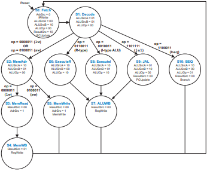

# Arquitectura: Procesador RV32I multiciclo Harvard (Sprint 4)

## 1. Estado del avance

| Área | Estado |
|---|---|
| FSM | Implementada |
| Datapath | Implementado |
| Interfaces ready-valid | Implementadas en la FSM |
| Enabler (`valid` con `enable`) | Implementado y verificado |
| Instrucciones de Tabla 1 | 28 de 28 pass (29/29 con `illegal`). `jalr` corregido |
| Mapa MMIO, árbitro, RAM y registros de control | Implementados y verificados (`rv32i_top`) |
| Testbench end-to-end | Implementado: 64 píxeles e imagen completa (16384), con y sin stalls |
| Top de placa (`top_level`) con vJTAG | Implementado; compila en Quartus (Fitter Successful) |
| Modo paso a paso (Epic 1) | Implementado en `top_level`; sin simular ni probar en la placa |
| SignalTap | Pendiente |

---

## 2. Vista general



Diagrama de estados de la Control FSM. Se conserva el mismo orden usado en Digital Design and Computer Architecture RISC-V Edition
(Sarah L Harris; David Money Harris)


Diagrama interno del procesador realizado en el simulador open source Logic Circuit.

---

## 3. Interfaz del módulo `rv32i_cpu`
Este es el módulo implementado para provar el RV32I con las pruebas de cocotb provistas en el repositorio https://github.com/rgarciatec/rv32i_cocotb_template.

| Puerto | Dirección | Ancho | Función |
|---|---|---|---|
| `clk` | in | 1 | Reloj |
| `reset` | in | 1 | Reset activo en alto (internamente se invierte) |
| `imem_valid` | out | 1 | El CPU pide una lectura de instrucción |
| `imem_ready` | in | 1 | La memoria de instrucciones aceptó la transacción |
| `imem_addr` | out | 32 | Dirección de byte de la instrucción |
| `imem_rdata` | in | 32 | Instrucción leída |
| `dmem_valid` | out | 1 | El CPU pide una transacción de datos |
| `dmem_ready` | in | 1 | La memoria de datos aceptó la transacción |
| `dmem_addr` | out | 32 | Dirección de byte del dato |
| `dmem_we` | out | 1 | 1 = escritura, 0 = lectura |
| `dmem_wdata` | out | 32 | Dato a escribir |
| `dmem_rdata` | in | 32 | Dato leído |
| `illegal_instruction` | out | 1 | Pulso de un ciclo al decodificar una instrucción fuera de las 28 |

```systemverilog
    // Instantiate the actual multicycle rv32i.
    logic enable;
    assign enable = 1'b1;
    logic soft_reset_n;
    assign soft_reset_n = 1'b1;
    multicycle_rv32i dut
    (
        .clk(clk),
        .rst_n(~reset), // Invert reset because the testbench expects an active high reset.

        .enable(enable), 
        .soft_reset_n(soft_reset_n), 

        // Ready valid inputs
        .ready_in_instr_memory(imem_ready),
        .ready_in_data_memory(dmem_ready),

        // Ready valid outputs
        .valid_out_instr_memory(imem_valid),
        .valid_out_data_memory(dmem_valid),

        // Handshakes. Display these.
        .handshake_instr_memory(),
        .handshake_data_memory(),

        // Instruction memory
        .address_instr_memory(imem_addr),
        .read_data_instr_memory(imem_rdata),

        // Data memory
        .write_enable_data_memory(dmem_we),
        .address_data_memory(dmem_addr),
        .write_data_data_memory(dmem_wdata),
        .read_data_data_memory(dmem_rdata),

        // Display
        .instruction(),
        .state_num(),

        // Tests
        .illegal(illegal_instruction)
    );
```


---

## 4. FSM de control

La FSM tiene 11 estados codificados en 4 bits.

Los estados `MEM_READ`, `MEM_WRITE` y `FETCH` llevan a sí mismos hasta que su handshake no haya ocurrido.

| Estado | valid out | Acción principal | Siguiente |
|---|---|---|---|
| FETCH | imem | Lee instrucción, PC = PC + 4 | DECODE al recibir handshake |
| DECODE | — | Decodifica `op`, calcula rs1 + imm (JALR) o PC + imm (JAL) | Según `op` (ver diagrama) |
| MEM_ADR | — | Calcula dirección rs1 + imm | MEM_READ (lw) o MEM_WRITE (sw) |
| MEM_READ | dmem | Lee dato | MEM_WB al recibir handshake |
| MEM_WB | — | Escribe dato leído en rd | FETCH |
| MEM_WRITE | dmem | Escribe rs2 en memoria | FETCH al recibir handshake |
| EXECUTE_R | — | ALU con rs1 y rs2 | ALU_WB |
| EXECUTE_I | — | ALU con rs1 e inmediato. LUI usa operando A = 0 | ALU_WB |
| JAL | — | Escribe el destino en PC y guarda PC + 4 para rd | ALU_WB |
| ALU_WB | — | Escribe resultado en rd | FETCH |
| BEQ | — | Compara rs1 y rs2; si la condición se cumple, PC = destino | FETCH |

Nota de diseño:

- Con instrucciones inválidas la FSM vuelve a FETCH. `illegal` vale 1 durante el ciclo de DECODE en el que opcode no es inválido.

---

## 5. Protocolo ready/valid

- El CPU mantiene `valid` en alto mientras espera `ready`. La transacción ocurre cuando `valid & ready` son 1 en el flanco de reloj (handshake).
- Mientras no hay handshake, la FSM no cambia de estado. Las señales de dirección y datos se mantienen estables.
- En FETCH, `ir_write` y el avance del PC ocurren solo con handshake de instrucción.

Enabler: `valid_out_* = enable && soft_reset_n && (estado)`. Con `enable = 0` la FSM no cambia de estado y los `valid` de ambos buses valen 0.

Con la CPU congelada (`enable = 0`) el registro `read_data_reg` conserva su valor (`else if (enable)`); antes capturaba el bus en todos los ciclos y se perdía el dato de un `lw` congelado en `MEM_WB`.

La FSM expone su estado actual en `state_num[3:0]` (puerto del `multicycle_rv32i`), usado por el modo paso a paso y por las vistas de depuración.

---

## 6. Sistema completo: `rv32i_top` y `top_level`

```text
top_level (placa)
├─ key_sync x2 (reset desde KEY[0], paso desde KEY[1])
├─ vjtag (IP) + vjtag_interface + FSM de bus del Host (cruce tck -> clk)
├─ lógica del modo paso a paso
├─ rv32i_top
│   ├─ multicycle_rv32i (CPU)
│   ├─ arbiter (Host vJTAG tiene prioridad sobre la CPU)
│   ├─ mmio_decoder
│   ├─ ram (M10K: instrucciones, IN, OUT, histograma)
│   └─ control_registers (LEDR, HEX, CTRL, STATUS, THRESHOLD)
└─ seven_segment_adapter x6 (HEX0..HEX5)
```

Mapa de memoria (Tabla 2): instrucciones 0x00000–0x01FFF, IN 0x10000–0x1FFFF, OUT 0x20000–0x2FFFF, histograma 0x30000–0x303FC, LEDR 0x40000, HEX 0x40004, CTRL 0x50000 (bit 0 = start), STATUS 0x50004 (bit 0 = busy, bit 1 = done), THRESHOLD 0x5000C.

La CPU corre con `cpu_enable = start && !done`, donde `start` es CTRL[0] (`soft_reset_n`). `busy` se calcula en hardware como `start && !done`.

### Modo paso a paso

- SW[0] = 0: la CPU corre a 50 MHz. SW[0] = 1: avance manual con KEY[1].
- Un solo ciclo de `enable` no completa un FETCH ni un handshake de datos, por lo que un paso deja correr la FSM hasta que `cpu_state` cambie.
- Implementación: `cpu_hold = step_mode & ~(step_active_q & (cpu_state == step_ref_q))`. Al pulsar KEY[1] se activa `step_active_q` y se guarda el estado actual en `step_ref_q`; cuando `cpu_state` cambia, `step_active_q` se limpia y la CPU vuelve a congelarse. `step_active_q` también se limpia si `busy` vale 0.
- `rv32i_top` recibe `cpu_hold` y lo combina como `enable(cpu_enable && !cpu_hold)`. Sin conectar, `cpu_hold` vale 0, por lo que el testbench de simulación no cambia.

### Vistas de depuración (SW[2:1])

| SW[2:1] | HEX | LEDR |
|---|---|---|
| 00 | Registro `hex` | Registro `ledr` |
| 01 | PC[23:0] | `{step_mode, done, busy, illegal, 2'b00, cpu_state}` |
| 10 | Instrucción[23:0] | igual que arriba |
| 11 | Instrucción[31:8] | igual que arriba |

### Señales para SignalTap

`top_level` marca con `(* keep *)` `tap_imem_valid`, `tap_imem_ready`, `tap_cpu_valid`, `tap_cpu_ready` y `tap_handshake_instr`, junto con `cpu_state`, el PC, la instrucción y `done`. SignalTap está apagado en el `.qsf` actual.

---

## 7. Próximos pasos

1. Programar la DE10-Standard y probar la carga por vJTAG (`jtag_server.tcl` y `pixel_image_app.py`).
2. Probar el modo paso a paso en la placa y revisar la orientación de los dígitos HEX.
3. Captura en SignalTap de la FSM, PC, instrucción, `valid`/`ready` y `done`.