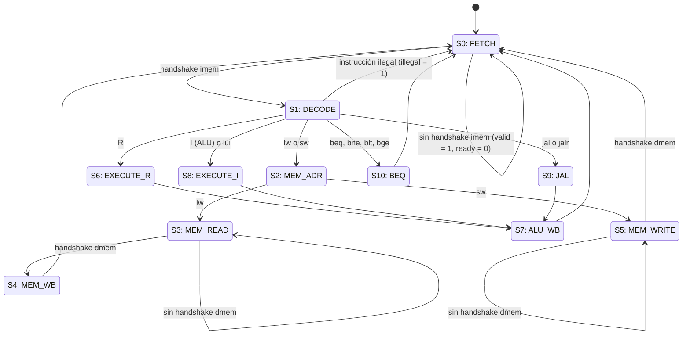
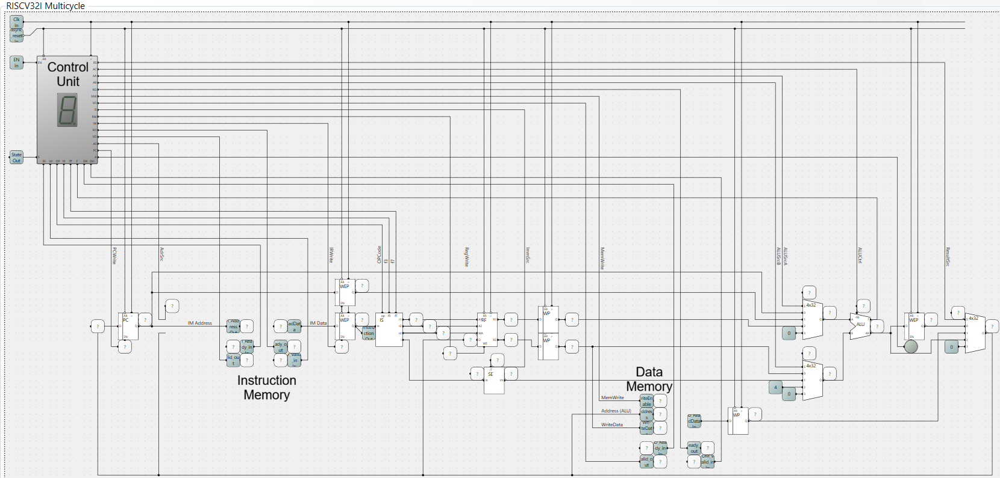

# Arquitectura: Procesador RV32I multiciclo Harvard (Sprint 4)

## 1. Estado del avance

| Área | Estado |
|---|---|
| FSM | Implementada |
| Datapath | Implementado |
| Interfaces ready-valid | Implementadas en la FSM |
| Enabler (`valid` con `enable`) | Implementado y verificado |
| Instrucciones de Tabla 1 | 28 de 28 pass (29/29 con `illegal`). `jalr` corregido |
| Mapa MMIO, árbitro, RAM y registros de control | Implementados y verificados (`rv32i_top`) |
| Testbench end-to-end | Implementado: 64 píxeles e imagen completa (16384), con y sin stalls |
| Top de placa (`top_level`) con vJTAG | Implementado; compila en Quartus (Fitter Successful) |
| Modo paso a paso (Epic 1) | Implementado en `top_level`; sin simular ni probar en la placa |
| SignalTap | Pendiente |

---

## 2. Vista general

Diagrama de estados de la Control FSM, elaborado a partir del RTL (`multicycle_rv_control_fsm.sv`). Incluye las esperas por `ready` (FETCH, MEM_READ y MEM_WRITE se mantienen en su estado hasta que ocurre el handshake) y los estados que usan bne, blt, bge (estado BEQ, la condición se resuelve en la unidad de control), lui (EXECUTE_I con operando A = 0) y jalr (estado JAL con rs1 reenviado desde el banco de registros).



El número de cada estado (S0 a S10) es el valor de `state_num[3:0]` y lo que muestran los LEDR[3:0] en el modo paso a paso. Si `enable = 0` la FSM no cambia de estado en ninguno de los casos anteriores; si `soft_reset_n = 0` (CTRL[0] = 0) vuelve a FETCH.



Diagrama interno del procesador realizado en el simulador open source Logic Circuit.

---

## 3. Interfaz del módulo `rv32i_cpu`
Este es el módulo implementado para provar el RV32I con las pruebas de cocotb provistas en el repositorio https://github.com/rgarciatec/rv32i_cocotb_template.

| Puerto | Dirección | Ancho | Función |
|---|---|---|---|
| `clk` | in | 1 | Reloj |
| `reset` | in | 1 | Reset activo en alto (internamente se invierte) |
| `imem_valid` | out | 1 | El CPU pide una lectura de instrucción |
| `imem_ready` | in | 1 | La memoria de instrucciones aceptó la transacción |
| `imem_addr` | out | 32 | Dirección de byte de la instrucción |
| `imem_rdata` | in | 32 | Instrucción leída |
| `dmem_valid` | out | 1 | El CPU pide una transacción de datos |
| `dmem_ready` | in | 1 | La memoria de datos aceptó la transacción |
| `dmem_addr` | out | 32 | Dirección de byte del dato |
| `dmem_we` | out | 1 | 1 = escritura, 0 = lectura |
| `dmem_wdata` | out | 32 | Dato a escribir |
| `dmem_rdata` | in | 32 | Dato leído |
| `illegal_instruction` | out | 1 | Pulso de un ciclo al decodificar una instrucción fuera de las 28 |

```systemverilog
    // Instantiate the actual multicycle rv32i.
    logic enable;
    assign enable = 1'b1;
    logic soft_reset_n;
    assign soft_reset_n = 1'b1;
    multicycle_rv32i dut
    (
        .clk(clk),
        .rst_n(~reset), // Invert reset because the testbench expects an active high reset.

        .enable(enable), 
        .soft_reset_n(soft_reset_n), 

        // Ready valid inputs
        .ready_in_instr_memory(imem_ready),
        .ready_in_data_memory(dmem_ready),

        // Ready valid outputs
        .valid_out_instr_memory(imem_valid),
        .valid_out_data_memory(dmem_valid),

        // Handshakes. Display these.
        .handshake_instr_memory(),
        .handshake_data_memory(),

        // Instruction memory
        .address_instr_memory(imem_addr),
        .read_data_instr_memory(imem_rdata),

        // Data memory
        .write_enable_data_memory(dmem_we),
        .address_data_memory(dmem_addr),
        .write_data_data_memory(dmem_wdata),
        .read_data_data_memory(dmem_rdata),

        // Display
        .instruction(),
        .state_num(),

        // Tests
        .illegal(illegal_instruction)
    );
```


---

## 4. FSM de control

La FSM tiene 11 estados codificados en 4 bits.

Los estados `MEM_READ`, `MEM_WRITE` y `FETCH` llevan a sí mismos hasta que su handshake no haya ocurrido.

| Estado | valid out | Acción principal | Siguiente |
|---|---|---|---|
| FETCH | imem | Lee instrucción, PC = PC + 4 | DECODE al recibir handshake |
| DECODE | — | Decodifica `op`, calcula rs1 + imm (JALR) o PC + imm (JAL) | Según `op` (ver diagrama) |
| MEM_ADR | — | Calcula dirección rs1 + imm | MEM_READ (lw) o MEM_WRITE (sw) |
| MEM_READ | dmem | Lee dato | MEM_WB al recibir handshake |
| MEM_WB | — | Escribe dato leído en rd | FETCH |
| MEM_WRITE | dmem | Escribe rs2 en memoria | FETCH al recibir handshake |
| EXECUTE_R | — | ALU con rs1 y rs2 | ALU_WB |
| EXECUTE_I | — | ALU con rs1 e inmediato. LUI usa operando A = 0 | ALU_WB |
| JAL | — | Escribe el destino en PC y guarda PC + 4 para rd | ALU_WB |
| ALU_WB | — | Escribe resultado en rd | FETCH |
| BEQ | — | Compara rs1 y rs2; si la condición se cumple, PC = destino | FETCH |

Nota de diseño:

- Con instrucciones inválidas la FSM vuelve a FETCH. `illegal` vale 1 durante el ciclo de DECODE en el que opcode no es inválido.

---

## 5. Protocolo ready/valid

- El CPU mantiene `valid` en alto mientras espera `ready`. La transacción ocurre cuando `valid & ready` son 1 en el flanco de reloj (handshake).
- Mientras no hay handshake, la FSM no cambia de estado. Las señales de dirección y datos se mantienen estables.
- En FETCH, `ir_write` y el avance del PC ocurren solo con handshake de instrucción.

Enabler: `valid_out_* = enable && soft_reset_n && (estado)`. Con `enable = 0` la FSM no cambia de estado y los `valid` de ambos buses valen 0.

¿Qué pasa si un `ready` llega mientras `enable = 0`? El handshake se define como `ready && valid_out`, y `valid_out` vale 0, por lo que no hay handshake: la transacción no se cuenta, la FSM permanece en FETCH, MEM_READ o MEM_WRITE y no se escribe `ir`, ni el PC, ni ningún registro. Al volver `enable = 1` el CPU repite la petición desde el mismo estado. Una escritura al bus de datos solo se completa si `valid = 1` en el mismo ciclo, por lo que con `enable = 0` no se escribe nada. En el modo paso a paso el CPU se congela con `cpu_hold` solo después de que `cpu_state` cambia, es decir, cuando la transacción en curso ya terminó, de modo que no se pierde ninguna.

Con la CPU congelada (`enable = 0`) el registro `read_data_reg` conserva su valor (`else if (enable)`); antes capturaba el bus en todos los ciclos y se perdía el dato de un `lw` congelado en `MEM_WB`.

La FSM expone su estado actual en `state_num[3:0]` (puerto del `multicycle_rv32i`), usado por el modo paso a paso y por las vistas de depuración.

---

## 6. Buses independientes y arbitraje (AC 3)

El módulo propuesto en `features.md` (9.2) para unir los buses del procesador **se descarta**: unir los buses contradice el AC 3, que exige dos buses físicos independientes (instrucciones y datos) hacia el exterior. En su lugar:

| Bus | Camino | Maestros | Se arbitra |
|---|---|---|---|
| Instrucciones (Fetch) | CPU -> filtro de rango en `rv32i_top` -> puerto de instrucciones de `ram` (lectura directa, sin árbitro ni decodificador) | CPU | No: es un bus dedicado solo de lectura |
| Datos (Memory) | CPU y Host vJTAG -> `arbiter` -> `mmio_decoder` -> RAM de datos y registros | CPU y Host | Sí: el `arbiter` concede el bus a uno de los dos |

- **Independencia.** El bus de instrucciones nunca pasa por el `arbiter`, por lo que un acceso del Host al bus de datos no frena el Fetch ni lo mezcla con las transacciones de datos. Cada bus tiene su propio par `valid`/`ready` (`imem_valid`/`imem_ready` y `cpu_valid`/`cpu_ready`) y su propio `ready` (la FSM espera por cada uno por separado).
- **Árbitro.** Tiene dos maestros, el Host vJTAG y el bus de datos de la CPU (no tres: el bus de instrucciones no entra). Prioridad fija al Host (AC 2 de Sprint 3); la CPU conserva el bus hasta completar su transacción (`FSM_ACCESS`) y entrega `mux_is_cpu` al decodificador para aplicar permisos por maestro.
- **Permisos del bus de instrucciones (AC 5, Tabla 2).** Este bus no tiene señal de escritura, por lo que es solo lectura (RO) para la CPU por construcción: no existe forma de que la CPU escriba la RAM de instrucciones por él. Además `rv32i_top` filtra el rango: si el PC cae fuera de 0x00000–0x01FFF (`imem_in_range = 0`), la CPU recibe 0 (Read-As-Zero) y `imem_ready` lo sigue entregando la RAM, de modo que no se bloquea. Una instrucción 0 decodifica como ilegal (`illegal = 1`) y la FSM vuelve a FETCH. El flag se registra junto al dato (`imem_in_range_q`) porque la lectura de la M10K tarda un ciclo. Las escrituras de la CPU a la RAM de instrucciones por el bus de datos las descarta el `mmio_decoder` (WI).
- **Acceso del Host a la RAM de instrucciones.** La RAM de instrucciones tiene dos puertos: uno de datos (Host R/W por el bus arbitrado) y uno de instrucciones (CPU RO). Esto permite que el Host cargue el firmware mientras la CPU está apagada, y que la CPU lea instrucciones sin pasar por el árbitro.

---

## 7. Mapa MMIO y permisos por maestro (Tabla 2)

El `mmio_decoder` aplica los permisos con la señal `is_cpu` que entrega el árbitro. Una escritura sin permiso se descarta (Write-Ignored, WI) sin bloquear el bus; la lectura de direcciones no mapeadas devuelve 0 (Read-As-Zero, RAZ).

| Rango (hex) | Destino | Host | CPU | Nota |
|---|---|---|---|---|
| 00000–01FFF | RAM de instrucciones (8 KB, 2048 palabras) | R/W | RO (WI) | `we_instr` solo si `is_cpu = 0` |
| 10000–1FFFF | RAM imagen de entrada (16384 palabras) | R/W | RO (WI) | `we_in` solo Host |
| 20000–2FFFF | RAM imagen de salida (16384 palabras) | RO | R/W | `we_out` solo CPU |
| 30000–303FC | RAM histograma (256 contadores de 32 bits) | RO | R/W | `we_hist` solo CPU |
| 40000 | LEDR (10 bits) | R/W | R/W | |
| 40004 | HEX (24 bits, un nibble por display) | R/W | R/W | |
| 50000 | CTRL (bit 0 = start) | R/W | RO | `we_ctrl` solo Host |
| 50004 | STATUS (bit 0 = busy, bit 1 = done) | RO | R/W | `we_status` solo CPU |
| 5000C | THRESHOLD (0 a 255) | R/W | RO | `we_threshold` solo Host |

Resto: no mapeado (RAZ/WI; p. ej. 0x50008 lee 0). El bus de instrucciones de la CPU no pasa por el `mmio_decoder`: su permiso RO y la lectura de 0 fuera de 0x00000–0x01FFF se aplican en `rv32i_top` (sección 6). Las lecturas tardan un ciclo (M10K sincrónica): `ready` sube un ciclo después de `valid` en lecturas y en el mismo ciclo en escrituras.

---

## 8. Arranque y fin del procesamiento (AC 7)

- **Arranque.** El Host escribe CTRL[0] = 1 (`start`). `start` es el nivel `soft_reset_n` de la CPU (no un pulso): mientras vale 0, el PC se mantiene en 0x0000_0000 y la FSM en FETCH; al ponerse en 1 la CPU comienza a ejecutar desde la dirección 0.
- **Fin.** El firmware escribe `STATUS = 0b10`, es decir, el bit 1 (`done`); el valor 1 en el bit 0 sería `busy`, que es de solo lectura y se calcula en hardware como `start && !done`.
- **Apagado de peticiones.** Con `done = 1`, `cpu_enable = start && !done` vale 0: la FSM deja de avanzar y `valid_out` de ambos buses vale 0 (el firmware termina en un bucle infinito `j halt`, pero la CPU ya no genera peticiones). El control regresa al Host, que puede leer STATUS, el histograma y la imagen de salida.
- **Re-armado.** El Host baja CTRL[0] a 0 (`done` se limpia solo) y lo vuelve a subir a 1.

---

## 9. Sistema completo: `rv32i_top` y `top_level`

```text
top_level (placa)
├─ key_sync x2 (reset desde KEY[0], paso desde KEY[1])
├─ vjtag (IP) + vjtag_interface + FSM de bus del Host (cruce tck -> clk)
├─ lógica del modo paso a paso
├─ rv32i_top
│   ├─ multicycle_rv32i (CPU)
│   ├─ arbiter (Host vJTAG tiene prioridad sobre la CPU)
│   ├─ mmio_decoder
│   ├─ ram (M10K: instrucciones, IN, OUT, histograma)
│   └─ control_registers (LEDR, HEX, CTRL, STATUS, THRESHOLD)
└─ seven_segment_adapter x6 (HEX0..HEX5)
```

Mapa de memoria (Tabla 2): instrucciones 0x00000–0x01FFF, IN 0x10000–0x1FFFF, OUT 0x20000–0x2FFFF, histograma 0x30000–0x303FC, LEDR 0x40000, HEX 0x40004, CTRL 0x50000 (bit 0 = start), STATUS 0x50004 (bit 0 = busy, bit 1 = done), THRESHOLD 0x5000C.

La CPU corre con `cpu_enable = start && !done`, donde `start` es CTRL[0] (`soft_reset_n`). `busy` se calcula en hardware como `start && !done`.

### Modo paso a paso

- SW[0] = 0: la CPU corre a 50 MHz. SW[0] = 1: avance manual con KEY[1].
- Un solo ciclo de `enable` no completa un FETCH ni un handshake de datos, por lo que un paso deja correr la FSM hasta que `cpu_state` cambie.
- Implementación: `cpu_hold = step_mode & ~(step_active_q & (cpu_state == step_ref_q))`. Al pulsar KEY[1] se activa `step_active_q` y se guarda el estado actual en `step_ref_q`; cuando `cpu_state` cambia, `step_active_q` se limpia y la CPU vuelve a congelarse. `step_active_q` también se limpia si `busy` vale 0.
- `rv32i_top` recibe `cpu_hold` y lo combina como `enable(cpu_enable && !cpu_hold)`. Sin conectar, `cpu_hold` vale 0, por lo que el testbench de simulación no cambia.

### Vistas de depuración (SW[2:1])

| SW[2:1] | HEX | LEDR |
|---|---|---|
| 00 | Registro `hex` | Registro `ledr` |
| 01 | PC[23:0] | `{step_mode, done, busy, illegal, 2'b00, cpu_state}` |
| 10 | Instrucción[23:0] | igual que arriba |
| 11 | Instrucción[31:8] | igual que arriba |

### Señales para SignalTap

`top_level` marca con `(* keep *)` `tap_imem_valid`, `tap_imem_ready`, `tap_cpu_valid`, `tap_cpu_ready` y `tap_handshake_instr`, junto con `cpu_state`, el PC, la instrucción y `done`. SignalTap está apagado en el `.qsf` actual.

---

## 10. Clasificación de módulos

| Módulo | Origen | Estado en Sprint 4 | Cambios |
|---|---|---|---|
| `alu_param.sv`, `alu_types_pkg.sv` | Sprint 1 | Reutilizado sin cambios | — |
| `decoder_4x16.sv`, `seven_segment_adapter.sv` | Sprint 1 | Reutilizado sin cambios | Se usan 6 `seven_segment_adapter` para HEX0 a HEX5 |
| `key_sync.sv` | Sprint 2 | Reutilizado sin cambios | Dos instancias: reset (KEY[0]) y paso (KEY[1]) |
| `binary_to_bcd_converter.sv`, `toggle.sv` | Sprint 2 | No se usan | — |
| `vjtag_interface.sv`, IP `vjtag` | Sprint 3 | Reutilizado sin cambios | — |
| `arbiter.sv` | Sprint 3 | Modificado | Maestros: Host y bus de datos de la CPU; la CPU conserva el bus hasta `ready`; nueva salida `mux_is_cpu` |
| `mmio_decoder.sv` | Sprint 3 | Modificado | Direcciones de la Tabla 2; permisos por maestro; RAZ/WI; `ready` de lectura con 1 ciclo |
| `control_registers.sv` | Sprint 3 | Modificado | Registros LEDR, HEX, CTRL, STATUS y THRESHOLD; salidas `start`, `cpu_enable`, `busy`, `done`, `ledr`, `hex`, `threshold` |
| `ram.sv` | Sprint 3 | Modificado | Cuatro memorias (instrucciones, entrada, salida, histograma); segundo puerto de lectura para el bus de instrucciones con `imem_ready` |
| `rv_register_file.sv` | Nuevo | Banco x0–x31 interno del procesador (sin x0 instanciado) | Ya no es un periférico MMIO como en Sprint 3 |
| `multicycle_rv32i.sv`, `multicycle_rv_control_unit.sv`, `multicycle_rv_control_fsm.sv`, `alu_decoder.sv`, `immediate_decoder.sv` | Nuevo | Procesador RV32I multiciclo | — |
| `rv32i_top.sv`, `top_level.sv` | Nuevo | Integración y top de placa | `rv32i_top`: filtro de rango del bus de instrucciones (`imem_in_range`, `imem_in_range_q`, `ram_imem_rdata`): fuera de 0x00000–0x01FFF la CPU lee 0 |

---

## 11. Infraestructura

- **Firmware.** `firmware.hex` se genera desde `firmware.s` con la toolchain `gcc-riscv64-unknown-elf` en `sprint4/firmware/`:

```bash
riscv64-unknown-elf-as -march=rv32i -mabi=ilp32 firmware.s -o firmware.o
riscv64-unknown-elf-objcopy -O binary -j .text firmware.o firmware.bin
xxd -e -c4 firmware.bin | awk '{print $2}' > firmware.hex
```

  Solo `firmware.s` y `firmware.hex` se versionan.
- **CI.** El gatekeeper, en cada PR que toque `sprint4`, ejecuta `make -C sprint4/test/cocotb` (pruebas unitarias y de sistema) y las pruebas del profesor en `sprint4/test/rv32i_cocotb`: `make test_cpu` y `make test_programs`, ambas con `SV_FILELIST=files.f TOPLEVEL=rv32i_cpu` (sin esos parámetros el Makefile compila el mock del profesor). Si cualquier `make` falla, el job falla. El `Dockerfile` instala `pytest-html`, que usa el dashboard de `test_cpu`. La evidencia de las corridas locales se guarda en `docs/evidencia/`.
- **Estructura de `sprint4/`.** `src/`, `test/cocotb/` (unitarias y sistema), `test/rv32i_cocotb/` (repo del profesor con los wrappers `rv32i_cpu*.sv`), `firmware/`, `scripts/`, `quartus/` y `docs/`. Los cambios a la estructura se documentan en `README.md`.

---

## 12. Requisitos del enunciado

- **Solo `lw` y `sw` (AC 1).** Los píxeles se leen y escriben por palabras de 32 bits (un píxel por palabra). No se implementan lb, lh, sb ni sh.
- **`lui` (AC 2).** Se ejecuta en EXECUTE_I con el operando A en 0 y el inmediato tipo U (`{instruction[31:12], 12'b0}`); `firmware.s` lo usa (directamente o por `li`) para cargar las bases del mapa MMIO.
- **Latencia de las M10K.** La lectura sincrónica tarda un ciclo, por eso `ready` de lectura sube un ciclo después de `valid`, y el bus de instrucciones entrega una instrucción cada 2 ciclos (`imem_ready` alterna 1, 0, 1, 0). La FSM mantiene `valid` hasta recibir `ready`.

---

## 13. Próximos pasos

1. Programar la DE10-Standard y probar la carga por vJTAG (`jtag_server.tcl` y `pixel_image_app.py`).
2. Probar el modo paso a paso en la placa y revisar la orientación de los dígitos HEX.
3. Captura en SignalTap de la FSM, PC, instrucción, `valid`/`ready` y `done`.