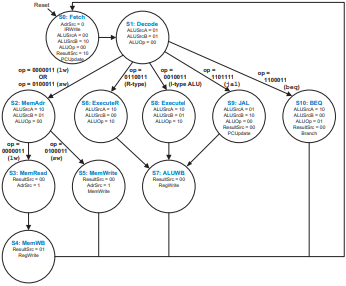
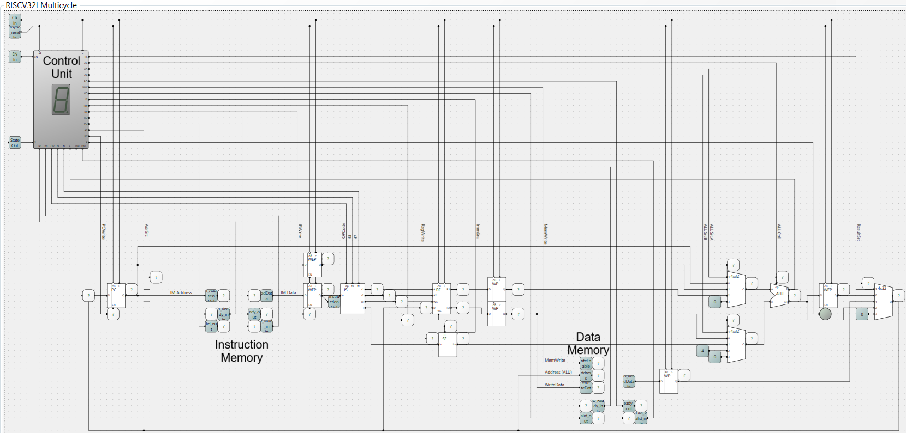

# Arquitectura: Procesador RV32I multiciclo Harvard (Sprint 4)

## 1. Estado del avance

| Área | Estado |
|---|---|
| FSM | Implementada |
| Datapath | Implementado |
| Interfaces ready-valid | Implementadas en la FSM |
| Enabler (`valid` con `enable`) | Implementado y verificado |
| Instrucciones de Tabla 1 | 28 de 28 pass (29/29 con `illegal`). `jalr` corregido |
| Modo stepping (Epic 1) | Pendiente |
| Top de Quartus para Sprint 4 | Pendiente |
| Testbench end-to-end | Pendiente |
| SignalTap | Pendiente |

---

## 2. Vista general



Diagrama de estados de la Control FSM. Se conserva el mismo orden usado en Digital Design and Computer Architecture RISC-V Edition
(Sarah L Harris; David Money Harris)



Diagrama interno del procesador realizado en el simulador open source Logic Circuit.

---

## 3. Interfaz del módulo `rv32i_cpu`
Este es el módulo implementado para provar el RV32I con las pruebas de cocotb provistas en el repositorio https://github.com/rgarciatec/rv32i_cocotb_template.

| Puerto | Dirección | Ancho | Función |
|---|---|---|---|
| `clk` | in | 1 | Reloj |
| `reset` | in | 1 | Reset activo en alto (internamente se invierte) |
| `imem_valid` | out | 1 | El CPU pide una lectura de instrucción |
| `imem_ready` | in | 1 | La memoria de instrucciones aceptó la transacción |
| `imem_addr` | out | 32 | Dirección de byte de la instrucción |
| `imem_rdata` | in | 32 | Instrucción leída |
| `dmem_valid` | out | 1 | El CPU pide una transacción de datos |
| `dmem_ready` | in | 1 | La memoria de datos aceptó la transacción |
| `dmem_addr` | out | 32 | Dirección de byte del dato |
| `dmem_we` | out | 1 | 1 = escritura, 0 = lectura |
| `dmem_wdata` | out | 32 | Dato a escribir |
| `dmem_rdata` | in | 32 | Dato leído |
| `illegal_instruction` | out | 1 | Pulso de un ciclo al decodificar una instrucción fuera de las 28 |

```systemverilog
    // Instantiate the actual multicycle rv32i.
    logic enable;
    assign enable = 1'b1;
    logic soft_reset_n;
    assign soft_reset_n = 1'b1;
    multicycle_rv32i dut
    (
        .clk(clk),
        .rst_n(~reset), // Invert reset because the testbench expects an active high reset.

        .enable(enable), 
        .soft_reset_n(soft_reset_n), 

        // Ready valid inputs
        .ready_in_instr_memory(imem_ready),
        .ready_in_data_memory(dmem_ready),

        // Ready valid outputs
        .valid_out_instr_memory(imem_valid),
        .valid_out_data_memory(dmem_valid),

        // Handshakes. Display these.
        .handshake_instr_memory(),
        .handshake_data_memory(),

        // Instruction memory
        .address_instr_memory(imem_addr),
        .read_data_instr_memory(imem_rdata),

        // Data memory
        .write_enable_data_memory(dmem_we),
        .address_data_memory(dmem_addr),
        .write_data_data_memory(dmem_wdata),
        .read_data_data_memory(dmem_rdata),

        // Display
        .instruction(),

        // Tests
        .illegal(illegal_instruction)
    );
```


---

## 4. FSM de control

La FSM tiene 11 estados codificados en 4 bits.

Los estados `MEM_READ`, `MEM_WRITE` y `FETCH` llevan a sí mismos hasta que su handshake no haya ocurrido.

| Estado | valid out | Acción principal | Siguiente |
|---|---|---|---|
| FETCH | imem | Lee instrucción, PC = PC + 4 | DECODE al recibir handshake |
| DECODE | — | Decodifica `op`, calcula rs1 + imm (JALR) o PC + imm (JAL) | Según `op` (ver diagrama) |
| MEM_ADR | — | Calcula dirección rs1 + imm | MEM_READ (lw) o MEM_WRITE (sw) |
| MEM_READ | dmem | Lee dato | MEM_WB al recibir handshake |
| MEM_WB | — | Escribe dato leído en rd | FETCH |
| MEM_WRITE | dmem | Escribe rs2 en memoria | FETCH al recibir handshake |
| EXECUTE_R | — | ALU con rs1 y rs2 | ALU_WB |
| EXECUTE_I | — | ALU con rs1 e inmediato. LUI usa operando A = 0 | ALU_WB |
| JAL | — | Escribe el destino en PC y guarda PC + 4 para rd | ALU_WB |
| ALU_WB | — | Escribe resultado en rd | FETCH |
| BEQ | — | Compara rs1 y rs2; si la condición se cumple, PC = destino | FETCH |

Nota de diseño:

- Con instrucciones inválidas la FSM vuelve a FETCH. `illegal` vale 1 durante el ciclo de DECODE en el que opcode no es inválido.

---

## 5. Protocolo ready/valid

- El CPU mantiene `valid` en alto mientras espera `ready`. La transacción ocurre cuando `valid & ready` son 1 en el flanco de reloj (handshake).
- Mientras no hay handshake, la FSM no cambia de estado. Las señales de dirección y datos se mantienen estables.
- En FETCH, `ir_write` y el avance del PC ocurren solo con handshake de instrucción.

Enabler: `valid_out_* = enable && soft_reset_n && (estado)`. Con `enable = 0` la FSM no cambia de estado y los `valid` de ambos buses valen 0.

---

## 6. Próximos pasos

1. Agregar el modo pulse (SW[0] y KEY[1], con el eventual top).
2. Implementar el mapa MMIO.
3. Crear el top y compilarlo en Quartus.
4. Captura en SignalTap de la FSM, PC, instrucción, `valid`/`ready` y done.