# Resultados de Verificación: Sprint 4 (Entrega final)

**Proyecto:** CE3201 Taller de Diseño Digital, Grupo 7
**Fecha:** 20 al 24 nov 2026
**Entrega:** final, tag `v1.0.0-proj` (30 nov 2026). El Avance 3 es `v0.1.0-proj` y el Avance 2 `v0.0.2-proj` (15 nov 2026)
**Arquitectura:** ver `docs/architecture.md`
**Plan de pruebas:** ver `docs/testplan.md`
**Entorno de simulación:** Verilator 5.053 (devel), cocotb 2.1.0, Python 3.12, WSL. Las secciones 2 a 4 son de la corrida completa del 23 nov 2026 desde la raíz del repo (logs en `docs/evidencia/final/`, sección 3.1). La síntesis final (sección 6) es del 23 nov 2026 (Quartus 25.1std.0 Build 1129, con SignalTap). Las pruebas en la placa (sección 7) son del 22 al 24 nov 2026 (las fotos del 24 nov están en las secciones 7.1 a 7.3) y las capturas SignalTap (sección 8) son del 23 nov 2026 y su análisis cuantitativo (secciones 8.1 y 8.2) del 24 nov 2026.

---

## Resumen

| Verificación | Herramienta | Resultado | Estado |
|---|---|---|---|
| Prueba del repo con mock CPU | Cocotb | 29/29 PASS | Ejecutada en Avance 1 (el mock no cambió) |
| Verificación del repo sobre `rv32i_cpu` | Cocotb | 29/29 PASS (pytest 30 passed) | Ejecutada el 23 nov |
| Programas completos (`test_programs`: factorial y xorshift) | Cocotb | 2/2 PASS | Ejecutada el 23 nov |
| Enabler (`enable = 0`) | Cocotb | 29/29 casos con timeout a 300 ciclos (pytest: 30 failed), ninguna instrucción completada | Ejecutada el 20 nov |
| Unitarias `arbiter`, `mmio_decoder`, `ram`, `control_registers` | Cocotb | 8/8, 7/7, 8/8 y 10/10 PASS | Ejecutadas el 23 nov |
| Sistema `rv32i_top`, 64 píxeles | Cocotb | 4/4 PASS | Ejecutada el 23 nov |
| Sistema `rv32i_top`, imagen completa (16384 píxeles, `FULL_IMAGE=1`) | Cocotb | 4/4 PASS | Ejecutada el 23 nov |
| Sprints 0 a 2 (cocotb, repetidos desde la raíz) | Cocotb | 0: 2/2; 1: 6/6 y 5/6 (1 SKIP esperado); 2: 6/6, 6/6, 5/5, 6/6, 7/7, 4/4, 1/1. La prueba 3.2 de Sprint 1 no corre (sección 3.1) | Ejecutadas el 23 nov |
| Síntesis del top de placa (`top_level`) con SignalTap | Quartus Prime 25.1 Lite | Fitter Successful, 2173 ALMs, Fmax 63,53 MHz (sin SignalTap, 19 nov: 1609 ALMs, 67,33 MHz) | Ejecutada el 23 nov (19 nov sin SignalTap) |
| Carga por vJTAG y ejecución en la placa (TP-16) | DE10-Standard | Histograma e imagen exactos con umbrales 0, 64, 128 y 255 | Ejecutada el 22 y 23 nov |
| Modo paso a paso y vistas SW[2:1] (TP-11) | DE10-Standard | Funciona; secuencias de estados observadas y fotografiadas (sección 7.1) | Ejecutada el 22 nov y repetida con fotos el 24 nov |
| Modo libre en la placa con evidencia fotográfica (TP-19) | DE10-Standard | La CPU llega a `done`: PC `0x84`, instrucción `0x005A2223`, HEX = `0x4000` (sección 7.2) | Ejecutada el 24 nov |
| Reset con KEY[0] (TP-20) | DE10-Standard | HEX y LEDR en 0 (sección 7.3) | Ejecutada el 24 nov |
| Mapa de memoria y permisos (Tabla 2) en la placa | DE10-Standard | Cumple | Ejecutada el 22 nov |
| Captura en hardware (TP-15) | SignalTap, 50 MHz | Capturas A (inicio) y B (fin) | Ejecutada el 23 nov |
| Ciclos por instrucción contra el modelo de la FSM (TP-21, sección 8.2) | CSV de SignalTap + script | 1 499 de 1 499 instrucciones con los ciclos teóricos (4, 5, 6 y 8) | Analizada el 24 nov |
| Demostraciones Questa (`sprint4/test/sv`, TP-23 a TP-26) | Questa 2025.2 | 0 errores en las cuatro corridas (sección 3.2) | Ejecutadas el 25 nov |
| Modelo de ciclos `T(N) = 3 920 + 83·N` contra cocotb (TP-22, secciones 4, 4.1 y 8.2) | Cocotb + SignalTap | 9 232 y 1 363 792 ciclos; los ~9 280 y ~1 363 840 observados son esos valores redondeados al múltiplo de 64 del sondeo | Analizada el 24 nov |


---

## 1. Prueba del repo con mock CPU

Siguiendo el README del repo del profesor, se ejecutó la prueba con el `mock_cpu` (resultado de Avance 1; el mock no cambió, por lo que no se repitió el 15 nov):

```
TESTS=29 PASS=29 FAIL=0 SKIP=0
```

---

## 2. Verificación del repo para `rv32i_cpu`

Comando:

```
make test_cpu SV_FILELIST=files.f TOPLEVEL=rv32i_cpu 2>&1 | tee ../../docs/evidencia/avance2/avance2_cocotb.log
```

Resultado (corrida del 23 nov, log `docs/evidencia/final/sprint4_test_cpu.log`; después del arreglo de LUI; el caso `lui` ahora prueba cinco inmediatos, por eso el tiempo simulado sube de 7144 a 7704 ns):

```
** TESTS=29 PASS=29 FAIL=0 SKIP=0               7704.03           0.06     126007.10  **
```

El dashboard de pytest reporta `30 passed` (29 casos de instrucción más `test_functional_instruction_coverage`). La cobertura de instrucciones (29/29 bins, 1 hit por instrucción) se lee de `coverage.json`, que genera esta misma corrida.

| Formato | Instrucciones | Resultado |
|---|---|---|
| R | add, sub, and, or, xor, sll, srl, sra, slt, sltu | PASS |
| I (ALU) | addi, andi, ori, xori, slli, srli, srai, slti, sltiu | PASS |
| I (carga) | lw | PASS |
| I (salto) | jalr | PASS |
| S | sw | PASS |
| B | beq, bne, blt, bge | PASS |
| U | lui | PASS |
| J | jal | PASS |
| Ilegal | illegal | PASS |

### Programas completos (`test_programs`)

Comando:

```
make test_programs SV_FILELIST=files.f TOPLEVEL=rv32i_cpu 2>&1 | tee ../../docs/evidencia/avance3/avance3_programs.log
```

Resultado del 23 nov (sobre `rv32i_cpu`, no sobre el mock del profesor; log `docs/evidencia/final/sprint4_test_programs.log`):

```
** test_programs.factorial        PASS      183175.00 **
** test_programs.xorshift         PASS       38275.00 **
** TESTS=2 PASS=2 FAIL=0 SKIP=0             221450.00 **
```

`factorial` (recursivo, 0 a 13) y `xorshift` (16 números y 9 estadísticas con signo y sin signo) coinciden con Python. Log: `docs/evidencia/avance3/avance3_programs.log`. Sin el arreglo de LUI (sección 5), `xorshift` falla en el tag `v0.0.2-proj` y en el RTL anterior con el mismo resultado.

### Enabler (TP-10)

Con `enable = 0` en el wrapper (`files_enable.f`, `TOPLEVEL=rv32i_cpu_enable`), la CPU queda apagada y ninguna prueba puede terminar. Resultado del 20 nov: cocotb `TESTS=29 PASS=0 FAIL=29` y pytest `30 failed`; cada caso de instrucción termina con `Timed out after 300 cycles` (por ejemplo `LUI failed: Timed out after 300 cycles: CPU did not write the result to 0x00000100`, y `CPU did not assert illegal_instruction` en `illegal`). El trigésimo fallo de pytest es el caso de cobertura, que falla por falta de datos (`Missing Cocotb functional coverage data`). Esto es lo esperado: la CPU apagada no completa ninguna instrucción. Log: `docs/evidencia/avance3/avance3_enabler.log`.

### Evidencia

Archivos en `docs/evidencia/avance2/`:

- `avance2_cocotb.log`: salida completa de la corrida (29/29 y pytest 30 passed).
- `coverage.json`: bins cubiertos y conteo de hits.
- `dashboard_cpu.html`: resultado por prueba y cobertura por instrucción.

Los tres archivos de `avance3/` corresponden a una corrida normal posterior a los cambios, hecha después del enabler (que sobrescribe `results/`).

---

## 3. Pruebas unitarias (Cocotb + Verilator)

Directorio: `sprint4/test/cocotb`. Comando: `make all` (ejecuta `arbiter`, `mmio_decoder`, `ram`, `control_registers` y `top`). Salida completa de la entrega final: `docs/evidencia/final/sprint4_unit_system.log` (23 nov); anteriores: `avance3/avance3_unit_system.log` y `avance2/avance2_unit_system.log`.

| Módulo | Pruebas | Resultado | Qué verifican |
|---|---|---|---|
| `arbiter` | 8 | 8/8 PASS | Prioridad del Host, backpressure, la CPU conserva el bus mientras espera `ready`, reset, aleatoria contra modelo de referencia |
| `mmio_decoder` | 7 | 7/7 PASS | Permisos de escritura de la Tabla 2, selección de lectura, latencia de `rdata`, RAZ/WI fuera de mapa, `valid = 0`, secuencia de `ready` |
| `ram` | 8 | 8/8 PASS | Primera y última palabra de cada memoria, independencia entre memorias, latencia de 1 ciclo, histograma (0x3FC), puerto de instrucciones |
| `control_registers` | 10 | 10/10 PASS | Valores de reset, LEDR/HEX/THRESHOLD, CTRL start/busy, STATUS done, re-armado, lecturas sin mapear en 0, reset asíncrono |

### 3.1 Corrida completa desde la raíz (23 nov 2026)

Se ejecutó cada suite desde la raíz del repo con `cd`, guardando los logs en `docs/evidencia/final/`. Resumen (`grep -H "TESTS=" docs/evidencia/final/*.log`):

| Log | Resultado |
|---|---|
| `sprint0_cocotb.log` | `TESTS=1 PASS=1` (comportamental) y `TESTS=1 PASS=1` (estructural) |
| `sprint1_cocotb.log` | `TESTS=6 PASS=6` (WIDTH=8) y `TESTS=6 PASS=5 SKIP=1` (WIDTH=32; `test_table2_constants` solo corre con WIDTH=8) |
| `sprint2_cocotb.log` | `register_bank` 6/6 (dos veces), `key_sync` 5/5, `exec_fsm` 6/6, `input_fsm` 7/7, `display_logic` 4/4, `top_level` 1/1 |
| `sprint3_cocotb.log` | Sin línea `TESTS=` en el log (0 coincidencias); no se usa como evidencia |
| `sprint4_unit_system.log` | `arbiter` 8/8 (aparece dos veces), `mmio_decoder` 7/7, `ram` 8/8, `control_registers` 10/10, `top` 4/4 |
| `sprint4_full_image.log` | `TESTS=4 PASS=4` (59 391 822 ns simulados, 19,35 s reales) |
| `sprint4_test_cpu.log` | `TESTS=29 PASS=29` (pytest: 30 passed) |
| `sprint4_test_programs.log` | `TESTS=2 PASS=2` |

Fallos y avisos de la corrida, tal como salieron:

- **Sprint 1, prueba 3.2 (inyección de X, Icarus):** no corre. `test_negative.py` hace `from cocotb.binary import BinaryValue` y cocotb 2.1.0 ya no tiene ese módulo (`ModuleNotFoundError: No module named 'cocotb.binary'`). Es incompatibilidad del test de Sprint 1 con la versión instalada de cocotb; no afecta al diseño de Sprint 4. No se corrigió en esta entrega. La evidencia de Sprint 1 es la de su propia entrega.
- **Primer intento del `arbiter` (`make all`):** `libcocotbvpi_verilator.so: cannot open shared object file` (Error 127, ignorado por el Makefile). El mismo `make` reconstruyó y la corrida siguiente pasó 8/8.
- **Pruebas de Questa (`sprint*/test/sv`):** no se pueden correr en WSL. Las de Sprint 4 (demostraciones TP-23 a TP-26) se corrieron en Questa el 25 nov (sección 3.2). Las de sprints anteriores se conservan como evidencia local (`questa_test_summary.log`), que valida el gatekeeper.


### 3.2 Demostraciones en Questa (`sprint4/test/sv`, 25 nov 2026)

Se corrieron cuatro scripts `.do` en Questa 2025.2 desde `sprint4/test/sv`. Cada corrida genera un waveform `.wlf` y un transcript `.log`; `parse_logs.py` resume los transcripts en `questa_test_summary.log`, que es la evidencia que revisa el gatekeeper. Las cuatro terminaron con `Errors: 0`.

| TP | Módulo | Script | Waveform | Transcript | Errores | Warnings |
|---|---|---|---|---|---|---|
| TP-23 | `multicycle_rv_control_fsm` | `run_multicycle_rv_control_fsm.do` | `multicycle_rv_control_fsm.wlf` | `multicycle_rv_control_fsm_transcript.log` | 0 | 1 |
| TP-24 | `arbiter` | `run_arbiter.do` | `arbiter.wlf` | `arbiter_transcript.log` | 0 | 1 |
| TP-25 | `mmio_decoder` | `run_mmio_decoder.do` | `mmio_decoder.wlf` | `mmio_decoder_transcript.log` | 0 | 1 |
| TP-26 | `multicycle_rv32i` con `firmware.hex` | `run_multicycle_rv32i_firmware.do` | `run_multicycle_rv32i_firmware.wlf` | `multicycle_rv32i_firmware_transcript.log` | 0 | 2 |

- Los warnings de TP-23, TP-24 y TP-25 son `vopt-10908`, que aparece porque el `vsim` usa `+acc`. Los dos de TP-26 son `vlog-13314` (puerto `alu_flags` con `-svinputport=relaxed`). Son avisos de herramienta, no fallos de las pruebas.
- TP-26 muestra los primeros 4000 ciclos del firmware (`RUN_CYCLES = 4000`) para visualizarlos; no verifica el RV32I. TP-23 a TP-25 son demostraciones: el criterio es que la forma de onda sea la esperada y que no haya errores en el log.

**Waveforms vistas en Questa**

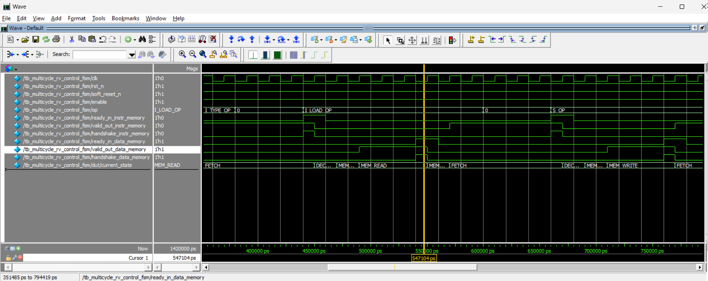
Waveform 1: FSM de control en Questa. Se muestra el momento en que un stall termina hasta que sucede el handshake de data memory.

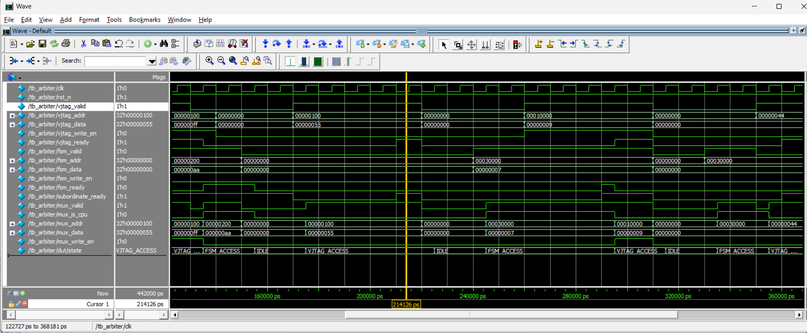
Waveform 2: árbitro en Questa. Se muestra el momento en que la FSM del árbitro pasa a Idle después de un handshake de mux_valid y subordinate_ready.

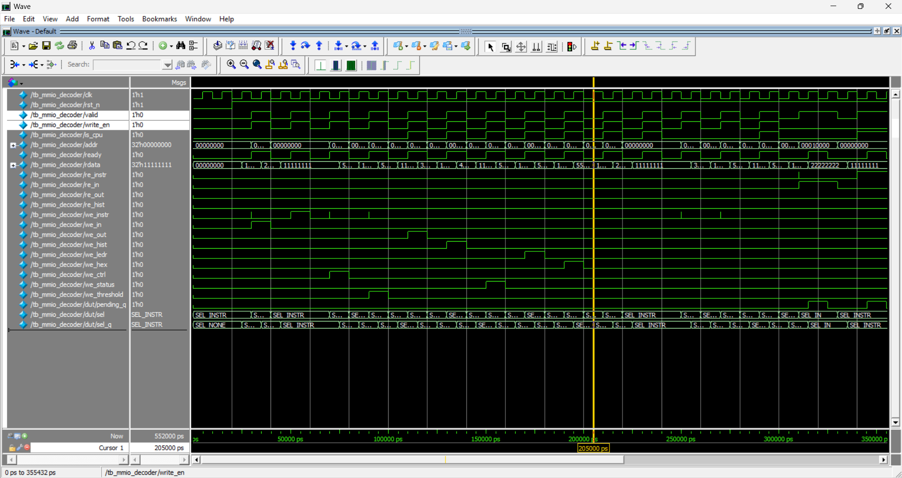
Waveform 3: decodificador MMIO en Questa. Se muestra el comportamiento de los chip selects (señales we, write enable) según la dirección actual. La primera en encenderse es la de instruction memory puesto que esta memoria incluye el inicio del rango de memoria mmio (la dirección 0.)

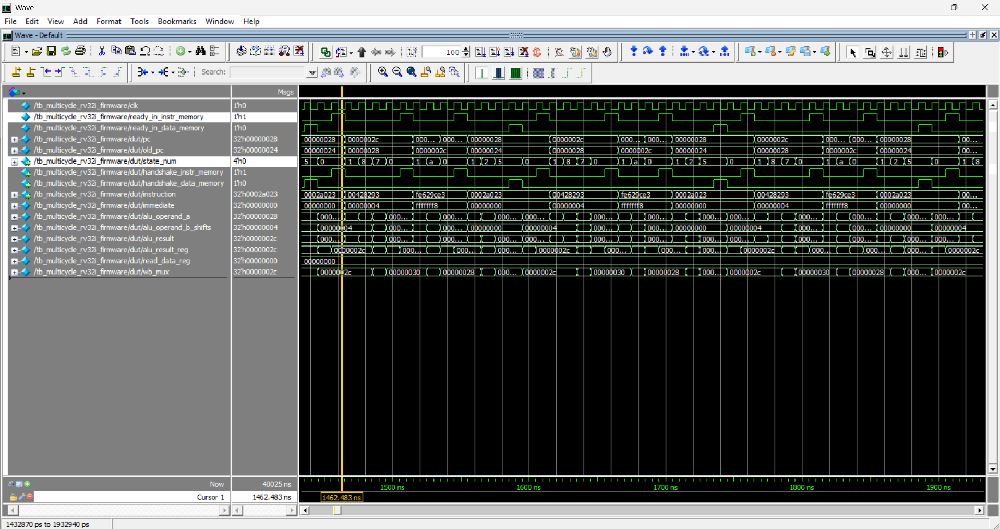
Waveform 4: firmware en Questa. Se muestra el programa firmware en un ciclo en PC == {0x24, 0x28, 0x2C}.
Los estados mostrados 0 (FETCH) y 5 (Memory Write) tienen stall hasta que ocurren los handshakes de instruction_memory y data_memory, respectivamente.


---

## 4. Prueba de sistema (`rv32i_top`)

Se integró la CPU con el árbitro, el decodificador MMIO, la RAM (M10K) y los registros de control en `src/rv32i_top.sv`. El Host (vJTAG simulado) carga `firmware.hex` y la imagen, escribe CTRL y espera `done`.

Comando: `make top` (en `sprint4/test/cocotb`), 64 píxeles. Corrida del 23 nov (dentro de `sprint4_unit_system.log`).

```
** TESTS=4 PASS=4 FAIL=0 SKIP=0                          428722.00           0.15    2842739.74  **
```

| Prueba | Qué verifica | Resultado |
|---|---|---|
| `test_fetch_secuencial` | Las primeras 10 búsquedas de instrucción son 0x0, 0x4, …, 0x24 (cada instrucción una sola vez y en orden) y no hay instrucción ilegal | PASS |
| `test_firmware_end_to_end` (TP-13) | Histograma de 256 bins e imagen binarizada exactos contra un modelo en Python; la suma del histograma es N; `STATUS = 0b10`; `HEX = N`; nada se escribe fuera de la imagen; ninguna instrucción ilegal. 64 píxeles, ~9280 ciclos hasta `done` | PASS |
| `test_firmware_with_bus_stalls` (TP-12) | Mismo resultado con el Host leyendo direcciones al azar durante la ejecución (1507 lecturas); la CPU espera por el bus y no pierde datos. ~9792 ciclos hasta `done` | PASS |
| `test_fetch_fuera_de_rango_lee_cero` (TP-18) | Un `jal x0, 0x2000` en la dirección 0 lleva el PC fuera de la RAM de instrucciones (0x0000–0x1FFF). La instrucción leída es 0 (RAZ), decodifica como ilegal y la CPU no se bloquea: las búsquedas fueron `0x0, 0x2000, 0x2004, 0x2008, …` | PASS |

### Qué se observó

- **Orden de búsqueda.** La traza de `test_fetch_secuencial` fue `0x0, 0x4, 0x8, 0xc, 0x10, 0x14, 0x18, 0x1c, 0x20, 0x24, 0x28, 0x2c, 0x24, 0x28`. Las primeras 10 son las que verifica la prueba. Después de `0x2c` (el `bne` del bucle `clear` de `firmware.s`) vuelve a `0x24`, que es lo esperado del salto hacia atrás.
- **Costo de los stalls.** Con el Host leyendo al azar, el firmware tardó ~9792 ciclos contra ~9280 sin ruido (~5,5 % más). Los ciclos se miden revisando `done` cada 64 ciclos, por lo que son aproximados (±64): el modelo exacto de la sección 8.2 da 9 232 ciclos sin ruido, y 9 280 es ese valor redondeado hacia arriba al múltiplo de 64 (⌈9 232 / 64⌉ × 64).
- **Velocidad.** Los ~9280 ciclos de 64 píxeles (modelo: 9 232) incluyen 3 920 ciclos fijos (arranque y limpieza del histograma) y 83 por píxel (sección 8.2). Con la imagen completa el término fijo pesa solo el 0,29 % (3 920 de 1 363 792).

### Cómo se redujo la imagen

La prueba no ejecuta `firmware.hex` tal cual: carga solo 64 píxeles y `shorten_loop` modifica dos palabras del firmware en la RAM de instrucciones para que el bucle termine tras 64 píxeles:

| Palabra original | Palabra en la prueba | Efecto |
|---|---|---|
| `addi t0, zero, 1` (0x14) | `addi a1, s0, 4*64` | a1 = fin de la imagen reducida. El `sw t0, 4(s4)` siguiente escribe 0 en STATUS en lugar de 1 (busy); no cambia el resultado porque `busy` ahora se calcula en hardware (`start && !done`) |
| `bne t0, s1, loop` | `bne t0, a1, loop` | El bucle termina en 0x10000 + 4*64 en vez de 0x20000 |

El resto del firmware (limpieza del histograma, histograma, binarización, escritura de HEX y de `STATUS.done`) se ejecuta sin cambios. El firmware original completo se simuló aparte con `FULL_IMAGE=1` (sección 4.1).

### 4.1 Imagen completa (`FULL_IMAGE=1`)

Comando (en `sprint4/test/cocotb`): `FULL_IMAGE=1 make top`. Corre `firmware.hex` sin modificar con los 16384 píxeles. Log: `docs/evidencia/final/sprint4_full_image.log` (23 nov).

```
** TESTS=4 PASS=4 FAIL=0 SKIP=0                        59391822.00          19.35    3069247.90  **
```

| Prueba | Resultado | Ciclos hasta `done` |
|---|---|---|
| `test_fetch_secuencial` | PASS | n/a (misma traza de búsquedas que con 64 píxeles) |
| `test_firmware_end_to_end` | PASS: 16384 píxeles, histograma e imagen exactos | ~1 363 840 |
| `test_firmware_with_bus_stalls` | PASS: 220 363 lecturas del Host | ~1 440 192 |
| `test_fetch_fuera_de_rango_lee_cero` | PASS (misma prueba que con 64 píxeles) | n/a |

- El modelo exacto de la sección 8.2 da 3 920 + 83 · 16 384 = 1 363 792 ciclos; ~1 363 840 es ese valor redondeado al múltiplo de 64 del sondeo. A 50 MHz son 27,276 ms (1 363 792 × 20 ns; cálculo a partir de los ciclos simulados, no una medición en la placa).
- Con el Host leyendo al azar el firmware tardó ~5,6 % más (1 440 192 contra 1 363 840 ciclos).
- Los ciclos se miden revisando `done` cada 64 ciclos (±64).

### Limitaciones de las pruebas

- En simulación la imagen de entrada es aleatoria con semilla fija (con un píxel justo en el umbral y otro justo debajo) y `THRESHOLD` es 100. En la placa se usó una imagen real de 128×128 con cuatro umbrales (sección 7).
- Las pruebas de JAL y JALR del repo del profesor verifican el destino del salto, no el valor de enlace (`rd = pc + 4`). El firmware solo usa `jal` implícito en `j halt`.

---

## 5. Errores encontrados al integrar

La prueba de sistema encontró dos errores de la CPU que las 29 pruebas del profesor no detectaban:

| Error | Síntoma observado | Causa | Corrección |
|---|---|---|---|
| En FETCH el ALU sumaba 4 a `old_pc` en lugar de `pc` | En la primera corrida de `make top` (3 pruebas en FAIL) cada instrucción se buscaba dos veces y el firmware no marcó `done` | `alu_src_a` caía en el `default` del `case` (01 = `old_pc`) en FETCH | `multicycle_rv_control_fsm.sv`: `FETCH: alu_src_a = 2'b00` (pc) |
| JALR no limpiaba el bit 0 del destino y usaba el registro de la instrucción anterior | Al corregir el error anterior, `test_rv32i.jalr` falló en la corrida del 15 nov: `JALR did not fetch expected PC 0x00000020` (la prueba salta con rs1 = 0x21) | JALR usaba un registro de una operación diferente que aún no había cambiado. El PC se escribía con `wb_mux` completo; el ISA exige `(rs1 + imm) & ~1` | Se añadió la señal forward_rs1 para adelantar el registro 1 directo del reg file a la ALU. Además se aplicó la máscara `multicycle_rv32i.sv`: `pc <= {wb_mux[31:1], 1'b0}` |

Un tercer error apareció al preparar el modo paso a paso (Avance 3), no por una prueba que fallara sino al revisar el diseño:

| Error | Causa | Corrección |
|---|---|---|
| `read_data_reg` se corrompía si la CPU se congelaba en `MEM_WB` | Capturaba `bus_rdata` en todos los ciclos, aun con `enable = 0`; al congelar la CPU se perdía el dato de un `lw` | `multicycle_rv32i.sv`: `else if (enable) read_data_reg <= read_data_data_memory;` |

Detectado por análisis, no por una prueba fallida; las pruebas existentes no congelan la CPU en medio de un `lw`. Tras este cambio y los de `state_num`/`cpu_hold` se repitieron todas las pruebas el 20 nov (secciones 2 a 4).

Sobre por qué las 29 pruebas aprobaban antes: con el primer error, el PC avanzaba desde `old_pc` y las pruebas solo comprueban que el PC esperado aparezca en la lista de búsquedas, no el orden ni la cantidad. Para JALR, la explicación (por análisis del diseño, no verificada reproduciendo el estado anterior) es que la CPU pasaba por 0x20 al recorrer direcciones, por lo que la prueba aprobaba sin que el salto fuera correcto.

Un cuarto error lo encontró `test_programs.xorshift` el 21 nov (falla también en el tag `v0.0.2-proj`):

| Error | Síntoma observado | Causa | Corrección |
|---|---|---|---|
| LUI con ciertos inmediatos daba un resultado incorrecto | `xorshift`: los números del CPU formaban una cadena xorshift válida, pero con semilla `0x678` en lugar de `0x12345678`; `lui s0, 0x12345` dejaba 0 | En LUI, `instr[31:12]` es el inmediato, pero el `alu_decoder` leía `instr[14:12]` y `instr[30]` como `funct3` y `funct7`. Con `0x12345`, `funct3 = 101` decodificaba SRL (0 >> imm = 0); con `0x0F0F1`, SLL; con `0xFFFFF`, SUB o SRA | `multicycle_rv_control_unit.sv`: `funct_3` y `funct_7[5]` se fuerzan a 0 cuando `op` es LUI (la ALU suma 0 + imm) |

La prueba `lui` del repo pasaba por casualidad: su inmediato `0xABCDE` da `funct3 = 110` (OR), y `0 OR imm = imm`. El firmware de la imagen usa inmediatos con esos bits en cero, por eso funcionaba en la placa. `run_lui` en `test_rv32i.py` ahora ejecuta un programa con cinco `lui` (`0xABCDE`, `0x12345`, `0x0F0F1`, `0xFFFFF`, `0x40001`). Tras el arreglo: 29/29 (pytest 30 passed) y `test_programs` 2/2, ambas el 21 nov. Las pruebas unitarias y de sistema (secciones 3 y 4) se repitieron el 21 nov después de este cambio y del filtro de `rv32i_top`: arbiter 8/8, mmio_decoder 7/7, ram 8/8, control_registers 10/10 y `top` 4/4 (con 64 píxeles y con `FULL_IMAGE=1`).

Después de las dos primeras correcciones se repitieron las 29 pruebas del profesor (29/29, dashboard 30 passed), las 4 unitarias (8, 7, 8 y 10 PASS) y el sistema (3/3), todas el 15 nov (repetidas el 20 nov; la entrega final las repite el 23 nov, sección 3.1).

---

## 6. Síntesis y timing (Quartus Prime 25.1 Lite)

Proyecto: `sprint4/quartus/top_level.qpf`, entidad top `top_level`, dispositivo 5CSXFC6D6F31C6, SDC `sprint3/sdc/timing_constraints.sdc` (reloj de 20 ns). Quartus 25.1std.0 Build 1129 10/21/2025 SC Lite Edition. Se compararon dos compilaciones completas, sin errores:

| Métrica | Sin SignalTap (19 nov; repetida el 21 nov con los mismos totales y Fmax) | Con SignalTap (23 nov, versión final) |
|---|---|---|
| Fitter Status | Successful | Successful (23 nov 16:00:19) |
| ALMs | 1 609 / 41 910 (4 %) | 2 173 / 41 910 (5 %) |
| Registros | 1 773 | 3 256 (3 100 tras la síntesis) |
| Pines | 58 / 499 | 58 / 499 (12 %) |
| Bits de memoria | 1 187 840 / 5 662 720 (21 %) | 1 810 432 / 5 662 720 (32 %) |
| Bloques RAM (M10K) | 143 / 553 (26 %) | 219 / 553 (40 %) |
| Bloques DSP / PLL | 0 / 0 | 0 / 0 |
| Slack setup `clk`, 85 °C (reloj de 20 ns) | 5,148 ns | 4,260 ns |
| Fmax `clk`, 85 °C, Slow 1100mV | 67,33 MHz | 63,53 MHz |
| Fmax `clk`, 0 °C | 68,79 MHz | 64,38 MHz |
| Fmax `altera_reserved_tck`, 85 °C | 106,21 MHz | 59,88 MHz |

Los Fmax de la columna del 23 nov salen de la tabla "Fmax Summary" de `top_level.sta.rpt` (63,53 MHz a 85 °C y 64,38 MHz a 0 °C para `clk`; 59,88 y 61,88 MHz para `altera_reserved_tck`) y coinciden con 1 / (20 ns − slack de setup).

Timing del 23 nov (todos los TNS en 0,000): setup `clk` 4,260 (85 °C), 4,468 (0 °C), 10,441 y 11,474 (modelos Fast); hold `clk` 0,317 (85 °C) y 0,297 (0 °C); `altera_reserved_tck` setup 8,316 y 8,586, hold 0,369 y 0,389. El reloj de 50 MHz de la placa cumple timing con margen en ambos casos.

La diferencia entre las dos columnas (+564 ALMs, +1 483 registros, +76 M10K, +622 592 bits) se reparte así: la instancia de SignalTap (`sld_signaltap`, 439,8 ALMs y 1 420 registros, más el crecimiento de `sld_hub`, +29,6 ALMs y +34 registros) explica 469,4 de los 564 ALMs y 1 454 de los 1 483 registros, y toda la diferencia de M10K y de bits (8K muestras × 76 bits = 622 592 bits = 76 bloques); los 94,6 ALMs y 29 registros restantes son variación del resto del diseño entre las dos compilaciones (RTL del 19 al 23 nov y empaquetado del fitter; ver `evidencia_atributos.md`, secciones 1.4.4 y 1.4.5). Los 3 256 registros del ajuste contra los 3 100 de la síntesis son 156 registros que el fitter duplica por enrutabilidad (123 en el banco de registros), igual al número de nodos "Duplicated" de la tabla "Fitter Netlist Optimizations" del `.fit.rpt`. Otros datos del fitter (23 nov): 389 de 4 191 LABs (9 %), 2 386 ALUT de lógica más 1 008 ALUT de enrutamiento, uso medio de interconexión 4,6 % (pico 43,1 %) y 2 242 560 bits de M10K ocupados (los 1 810 432 de la tabla son los bits usados). Advertencias: en el fitter solo `LogicLock` requiere licencia de pago (no se usa); en la síntesis, latch inferido sobre `i` en `rv_register_file.sv`, `tap_handshake_instr` asignado y nunca leído, y un aviso de conectividad de jerarquías. El Timing Analyzer no reporta advertencias. Flujo completo en 2 min 12 s (síntesis 29 s, fitter 1 min 26 s). El `top_level.sof` se generó el 23 nov 2026 16:00:29 (usercode/checksum `0x05610DE4`); los dos núcleos de SignalTap aparecen como `Licensed` en el reporte del ensamblador. La comparación con Sprint 3 y la elección de herramientas están en `docs/evidencia_atributos.md`.

Archivos de la compilación del 23 nov en `docs/evidencia/final/`: `top_level.fit.rpt`, `.map.rpt`, `.flow.rpt`, `.sta.rpt`, `.fit.summary`, `.map.summary` y `.sta.summary`. Las tablas por módulo, la correlación con el RTL, el camino crítico (`cp_peor_camino.rpt`, `cp_20_peores.rpt`, `cp_hold_peor.rpt`, `cp_fmax.rpt`, los `cp_real_*.rpt` por grupo y los `cp_exc_*.rpt` con excepciones, del 24 nov, de la misma base de datos) y la comparación con las dos compilaciones de Sprint 3 están en `docs/evidencia_atributos.md`.

---

## 7. Pruebas en la placa (DE10-Standard)

Flujo: se programa la FPGA, se abre `jtag_server.tcl` en Windows (`quartus_stp`, puerto 2540) y `pixel_image_app.py` (cliente en WSL) carga `firmware.hex` y la imagen por vJTAG, arranca el CPU, espera `STATUS.done` y lee el histograma y la imagen de salida, que compara contra un modelo en Python. Imagen de entrada de 128×128 (16384 píxeles).

| # | Prueba | Resultado |
|---|---|---|
| 1 | Reset (KEY[0]) | Se usó en cada re-arranque. Prueba aislada el 24 nov: HEX y LEDR pasan a 0 (sección 7.3) |
| 2 | Corrida completa, umbral 128 | `Programa: 34/34`; `Imagen: 16384/16384 en 30.6 s`; `CPU iniciado (umbral=128)`; `Imagen de salida: 16384/16384 en 38.6 s`; `Histograma: 256/256 en 0.8 s`; `OK: histograma e imagen binarizada coinciden con lo esperado.` |
| 3 | Umbrales extremos y otro valor | 0, 255 y 64: los tres `OK` |
| 4 | Re-arranque sin reprogramar | OK |
| 5 | Modo paso a paso y regreso a modo libre | OK (22 nov). Repetido el 24 nov con fotos de cada paso (sección 7.1) |
| 6 | Mapa de memoria y permisos del Host (Tabla 2) por consola `jtag_fpga.py` | Cumple: RAM de instrucciones y de entrada R/W; RAM de salida, histograma y STATUS solo lectura; LEDR, HEX, CTRL y THRESHOLD R/W; fuera de mapa RAZ/WI |
| 7 | Lectura de la RAM de entrada tras la corrida (muestras de píxeles) | 0x11F28 = 249, 0x12EBC = 249, 0x13E50 = 172, 0x15D78 = 246, 0x16D0C = 139, 0x17CA0 = 188, 0x18C34 = 219, 0x19BC8 = 213, 0x1FFFC = 0: todas coinciden con la imagen enviada |
| 8 | Vistas SW[2:1] | Ver abajo y secciones 7.1 y 7.2 (fotos de las cuatro vistas) |
| 9 | Modo libre con fotos del estado final (24 nov) | Sección 7.2: PC `0x84`, `done` encendido, HEX = `0x4000` |

- **Tiempos.** La carga de la imagen por vJTAG tardó 30,6 s en la corrida documentada (entre 11,8 s y 51,4 s en otras corridas) y la lectura de la imagen de salida 38,6 s: es una palabra de 32 bits por transacción JTAG. El CPU tarda 1 363 792 ciclos según el modelo de la sección 8.2 (27,276 ms a 50 MHz, calculado de la simulación, no medido en la placa), así que el tiempo de la prueba lo domina el Host.
- **Fallo recurrente del servidor.** Dos veces el servidor respondió `JTAG server rejected write: ERROR`; se resolvió reiniciando `jtag_server.tcl`.
- **Vista SW[2:1] = 00.** HEX muestra el registro 0x40004 (termina en `4000`, valor que escribe el firmware) y LEDR el registro 0x40000. El firmware nunca escribe LEDR, por eso queda en 0: los LEDR en esta vista no muestran el avance de la corrida.
- **Vistas 01, 10 y 11.** HEX muestra PC[23:0], instrucción[23:0] o instrucción[31:8]; LEDR muestra `{step_mode, done, busy, illegal, 2'b00, cpu_state}`. Al terminar: PC 0x84 y LEDR[8] = `done` encendido.
- **Modo paso a paso (TP-11).** SW[0] = 1 y cada pulsación de KEY[1] deja correr la FSM hasta que `cpu_state` cambia. Las secuencias observadas para `lui`/`addi` fueron 0 → 1 → 8 → 7 (cuatro estados por instrucción; a 50 MHz son 5 ciclos porque FETCH dura 2, sección 8) y para `sw` 0 → 1 → 2 → 5. El PC mostrado ya está incrementado (se actualiza en FETCH), por eso va una instrucción adelantado respecto de la instrucción mostrada. `lui` y `addi` pasan por EXECUTE_I (estado 8), no por EXECUTE_R (6).
- **Estado al terminar.** Con `done = 1` la condición `cpu_enable = start && !done` congela el CPU: `pc = 0x84` e instrucción `005A2223h` (`sw` a STATUS). El `j halt` de 0x84 nunca se busca.

### 7.1 Modo paso a paso con fotos (24 nov 2026)

**Procedimiento.**

1. Con el servidor `jtag_server.tcl` abierto, se ejecutó `pixel_image_app.py` con la imagen `Kingsoul.jpg`. El script escribe `CTRL = 0`, carga `firmware.hex`, lo lee de vuelta y lo compara palabra por palabra (si no coincide aborta), carga la imagen y el umbral, escribe `CTRL = 1` (`start`) y espera `STATUS.done`.
2. Con SW[0] = 1 la CPU queda congelada (`cpu_hold = 1`) hasta que se pulsa KEY[1] (suposición: SW[0] ya estaba en 1 mientras corría el script; la CPU esperó en el PC 0 hasta la primera pulsación y el script terminó por tiempo agotado, lo que concuerda con que la salida guardada de ese día no incluya la línea `OK`). Se usó SW[2:1] = 01 (HEX = PC y LEDR = `{step_mode, done, busy, illegal, 2'b00, cpu_state}`), 10 (HEX = instrucción[23:0]) y 11 (HEX = instrucción[31:8]).
3. Se pulsó KEY[1] una vez por estado y se fotografió la placa después de cada pulsación (y las tres vistas en el estado DECODE de cada instrucción). La primera foto, antes de avanzar, es el reset con KEY[0] (sección 7.3).

**Lectura de los LEDR.** LEDR[9] = `step_mode`, LEDR[8] = `done`, LEDR[7] = `busy`, LEDR[6] = `illegal`, LEDR[5:4] = 0 y LEDR[3:0] = `cpu_state`. En las fotos 02 a 10 están encendidos LEDR[9] (SW[0] = 1) y LEDR[7] (`busy`, porque `start = 1` y `done = 0`); LEDR[8] y LEDR[6] siguen apagados, es decir, `done = 0` e `illegal = 0`. Los estados se leen de los cuatro LEDR de la derecha (las fotos son de un teléfono con poca luz, por lo que los LEDR se identifican por su posición en la fila).

| N.º | Foto | Lectura (HEX y LEDR) | Interpretación |
|---|---|---|---|
| 01 | 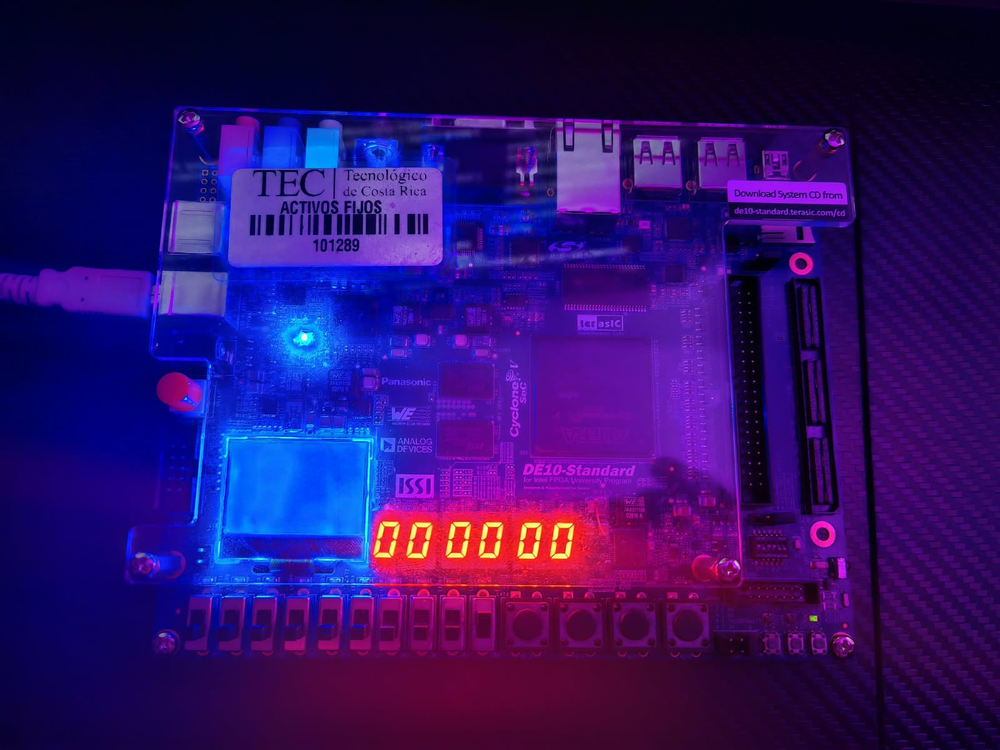 | HEX = `000000` tras pulsar KEY[0] (según lo observado, LEDR[9] queda encendido por SW[0] = 1; el resto de LEDR en 0) | Reset con KEY[0] en paso a paso (sección 7.3): HEX y LEDR en 0, salvo `step_mode` |
| 02 | 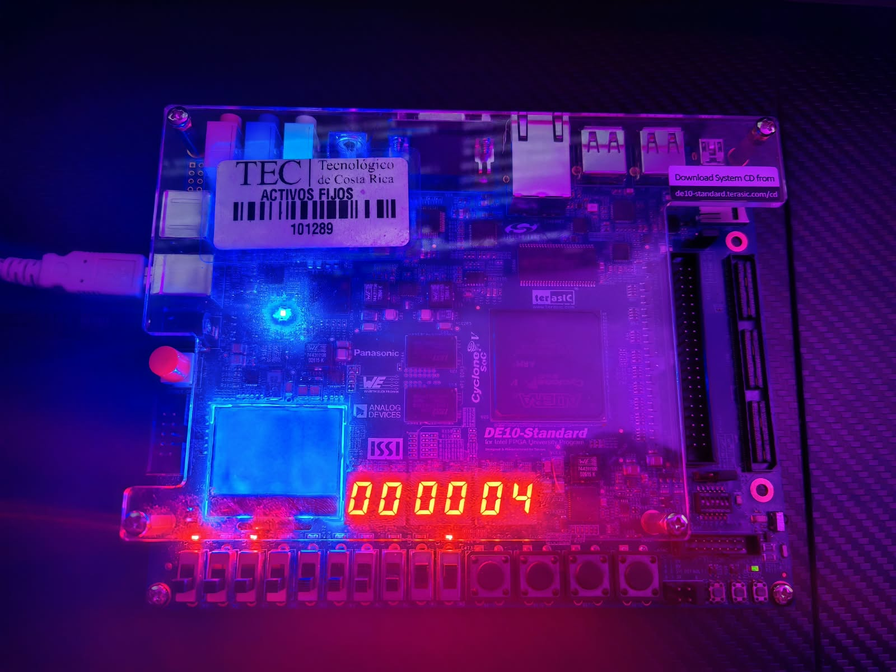 | SW[2:1] = 01: HEX = `000004`; LEDR[9], LEDR[7] y LEDR[0] encendidos (estado `0001`) | Estado 1, DECODE, de la primera instrucción. El PC ya vale 4 porque FETCH lo incrementó: apunta a la siguiente instrucción |
| 03 | 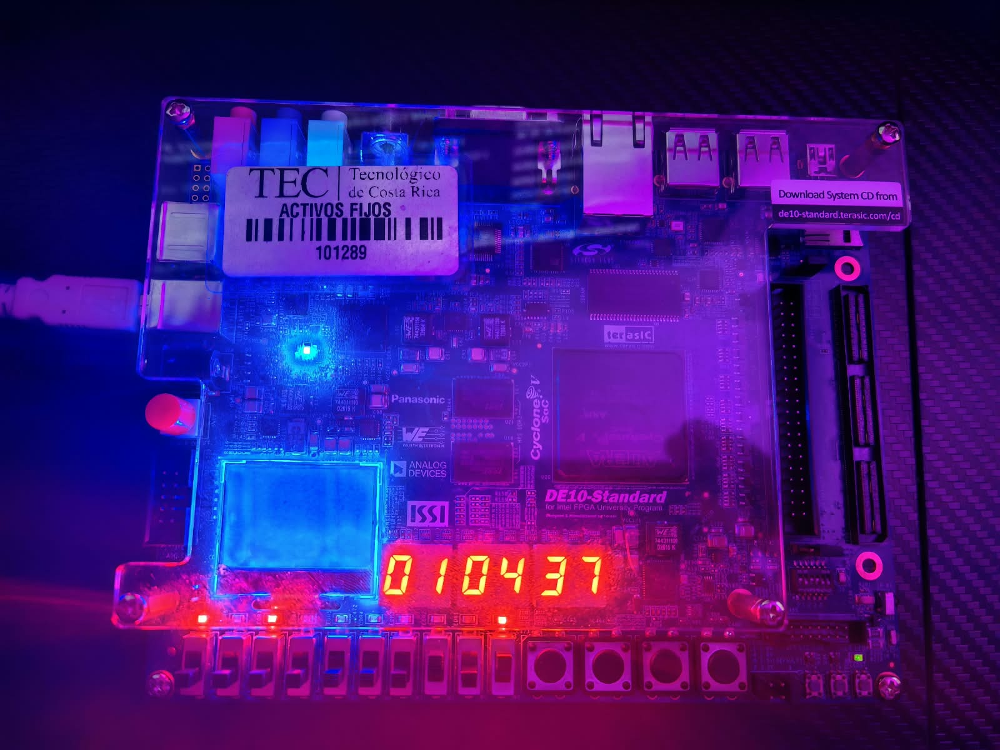 | SW[2:1] = 10: HEX = `010437`; mismos LEDR (estado 1) | Instrucción[23:0] de la primera instrucción: `0x00010437` |
| 04 | 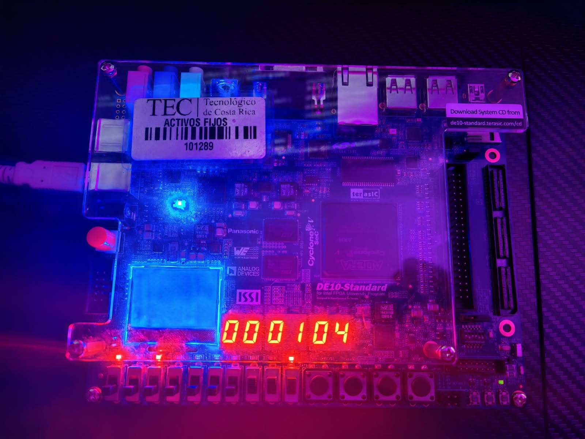 | SW[2:1] = 11: HEX = `000104`; mismos LEDR (estado 1) | Instrucción[31:8] de la misma instrucción |
| 05 | 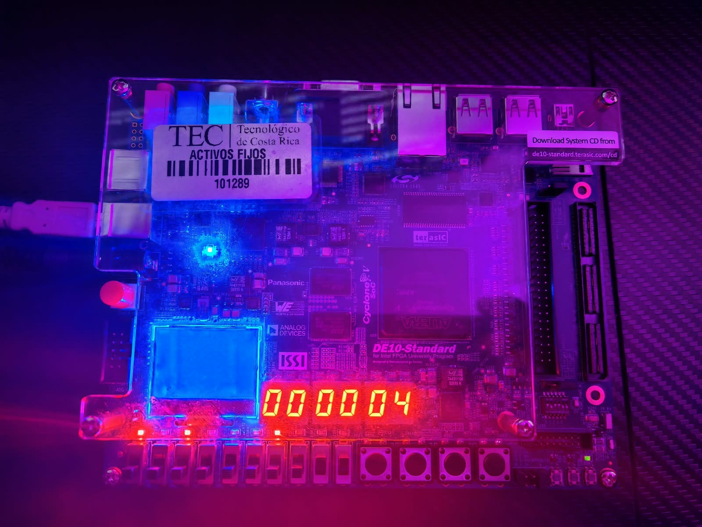 | SW[2:1] = 01: HEX = `000004`; LEDR[9], LEDR[7] y LEDR[3] (estado `1000`) | Estado 8, EXECUTE_I: `lui` usa la ALU con el operando A en 0 y el inmediato tipo U |
| 06 | 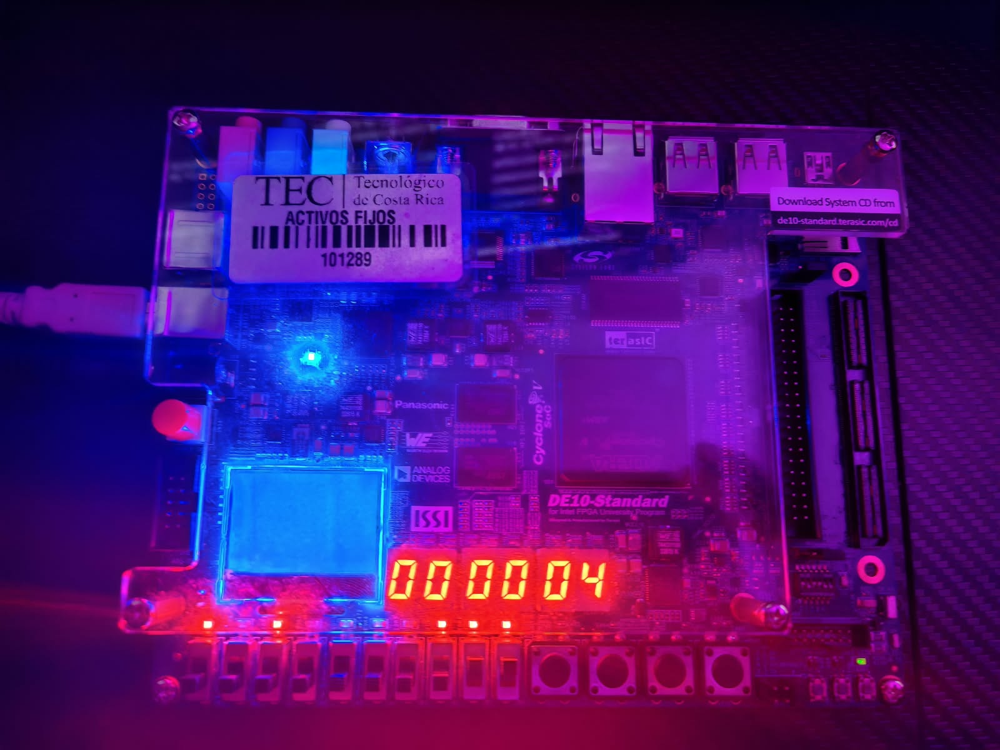 | HEX = `000004`; LEDR[9], LEDR[7] y LEDR[2:0] (estado `0111`) | Estado 7, ALU_WB: se escribe el resultado en `rd` |
| 07 | 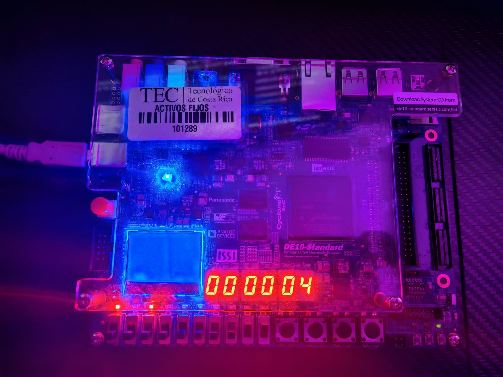 | HEX = `000004`; solo LEDR[9] y LEDR[7] (estado `0000`) | Estado 0, FETCH, de la segunda instrucción: el PC ya apunta a 0x04, la dirección que se va a buscar |
| 08 | 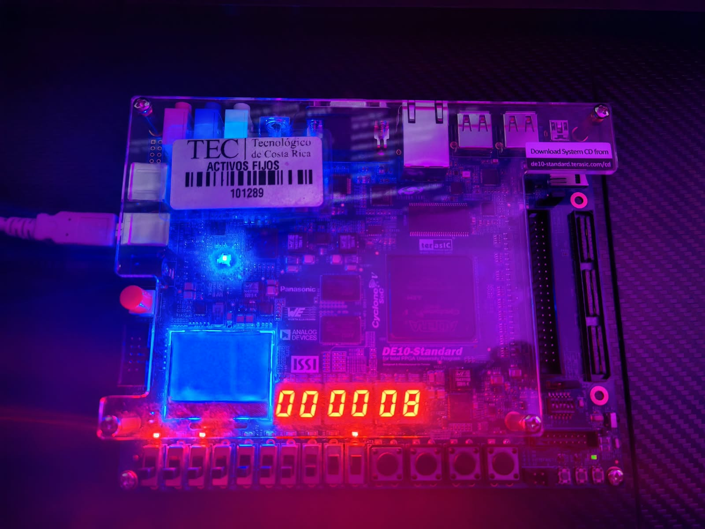 | HEX = `000008`; LEDR[9], LEDR[7] y LEDR[0] (estado `0001`) | Estado 1, DECODE, de la segunda instrucción; el FETCH terminó y el PC pasó a 8 |
| 09 | 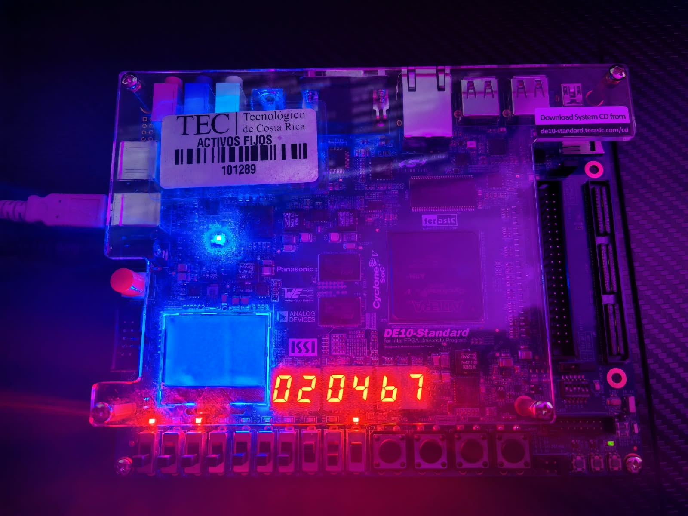 | SW[2:1] = 10: HEX = `0204B7`; mismos LEDR (estado 1) | Instrucción[23:0] de la segunda instrucción: `0x000204B7` |
| 10 | 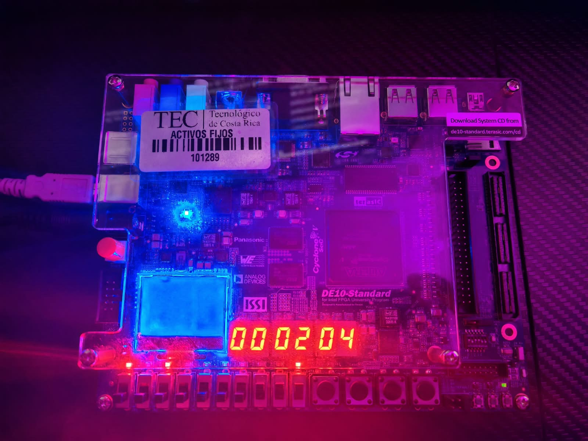 | SW[2:1] = 11: HEX = `000204`; mismos LEDR (estado 1) | Instrucción[31:8] de la segunda instrucción |

**Decodificación manual de las instrucciones fotografiadas.**

| Instrucción | Opcode | Campos | Significado |
|---|---|---|---|
| `0x00010437` | `0110111` (LUI) | `rd = 8` (s0), `imm[31:12] = 0x00010` | `lui s0, 0x10`: s0 = `0x10000`, la base de la RAM de entrada |
| `0x000204B7` | `0110111` (LUI) | `rd = 9` (s1), `imm[31:12] = 0x00020` | `lui s1, 0x20`: s1 = `0x20000`, la base de la RAM de salida |

Las dos coinciden con las dos primeras instrucciones de `firmware.hex` que muestra la captura A de SignalTap (sección 8): son las bases de la imagen de entrada y de salida que el firmware carga primero.

**Consistencia interna de las fotos.** La instrucción[31:8] y la instrucción[23:0] de cada instrucción comparten los bits [23:8]: `0x0104` en `000104` y `010437`, y `0x0204` en `000204` y `0204B7`. Las tres vistas se leen de la misma instrucción y no se contradicen.

**Secuencia de estados observada.** Primera instrucción: 1 → 8 → 7 → 0, y a continuación la segunda en 1 (fotos 02, 05, 06, 07 y 08). Es el camino de `lui` del diagrama de la FSM (`architecture.md`, sección 2): DECODE → EXECUTE_I → ALU_WB → FETCH → DECODE. No pasa por EXECUTE_R (6), porque `lui` se ejecuta en EXECUTE_I con el operando A en 0.

**Qué muestra el PC.** El PC vale 4 en las fotos 02 a 07 (desde el DECODE de la instrucción de 0x00 hasta el FETCH de la instrucción de 0x04) y 8 en la foto 08. El PC se incrementa en el handshake de FETCH, por eso en DECODE ya apunta a la instrucción siguiente. La foto 07 lo confirma: en FETCH el PC ya vale 4 antes de que llegue la instrucción de esa dirección.

### 7.2 Modo libre con fotos (24 nov 2026)

**Procedimiento.**

1. Con SW[0] = 0 (la CPU corre a 50 MHz), se pulsó KEY[0] para empezar limpio y se fotografió la placa.
2. Se ejecutó `pixel_image_app.py` (misma imagen) con el servidor abierto.
3. Con la CPU ya detenida se fotografió cada vista de SW[2:1] (00, 01, 10 y 11). La CPU tarda ~27 ms en terminar (cálculo de la sección 4.1), por lo que no es posible fotografiar el avance durante la corrida; solo se fotografía el estado final.

| N.º | Foto | Lectura (HEX y LEDR) | Interpretación |
|---|---|---|---|
| normal_00 | 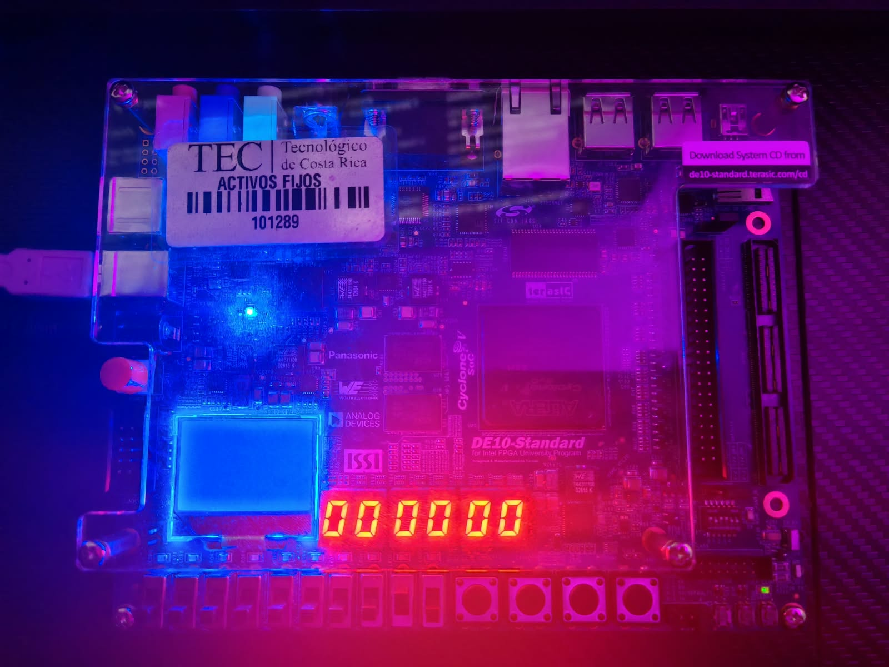 | HEX = `000000`; LEDR apagados | Estado tras el reset con KEY[0], antes de la corrida (sección 7.3) |
| normal_01 | 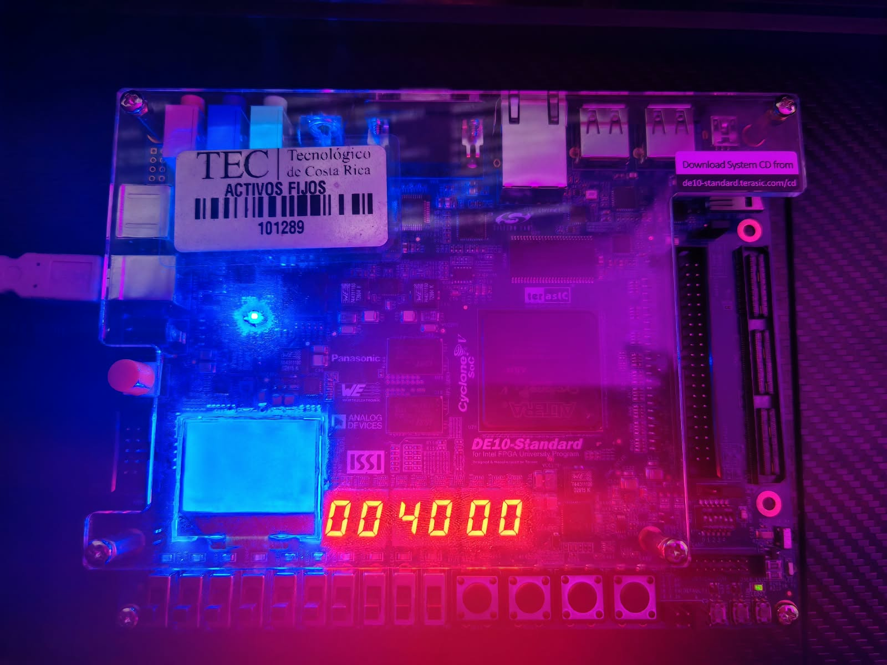 | SW[2:1] = 00: HEX = `004000`; LEDR apagados | Registro HEX (0x40004) = 0x4000 = 16384 = N: el firmware escribe ahí el número de píxeles procesados. LEDR (registro 0x40000) en 0 porque el firmware nunca lo escribe |
| normal_02 | 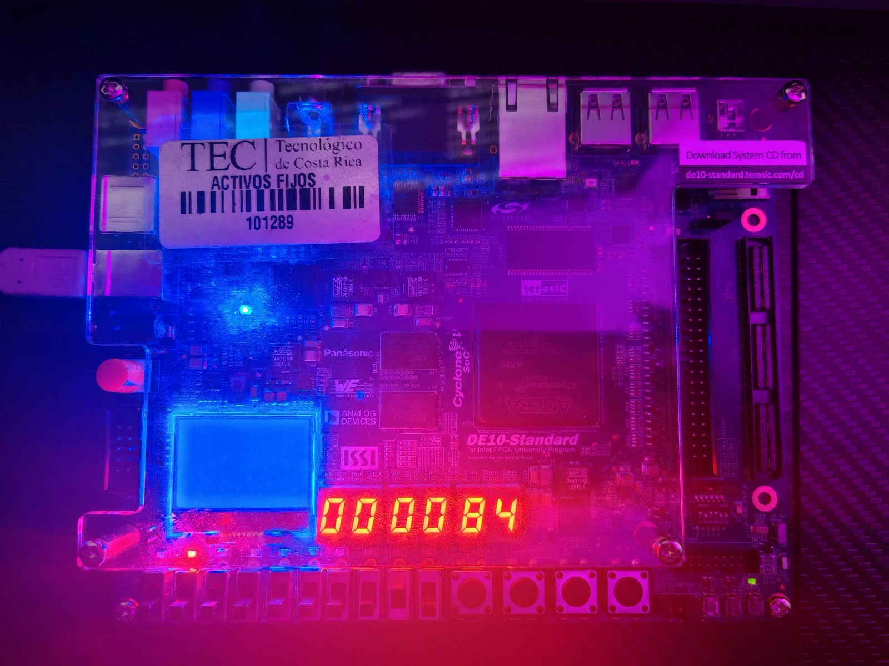 | SW[2:1] = 01: HEX = `000084`; LEDR[8] (`done`) encendido | PC = 0x84 y `done = 1`; LEDR[9] (`step_mode`) y LEDR[7] (`busy`) apagados, y LEDR[3:0] apagados (estado 0) |
| normal_03 | 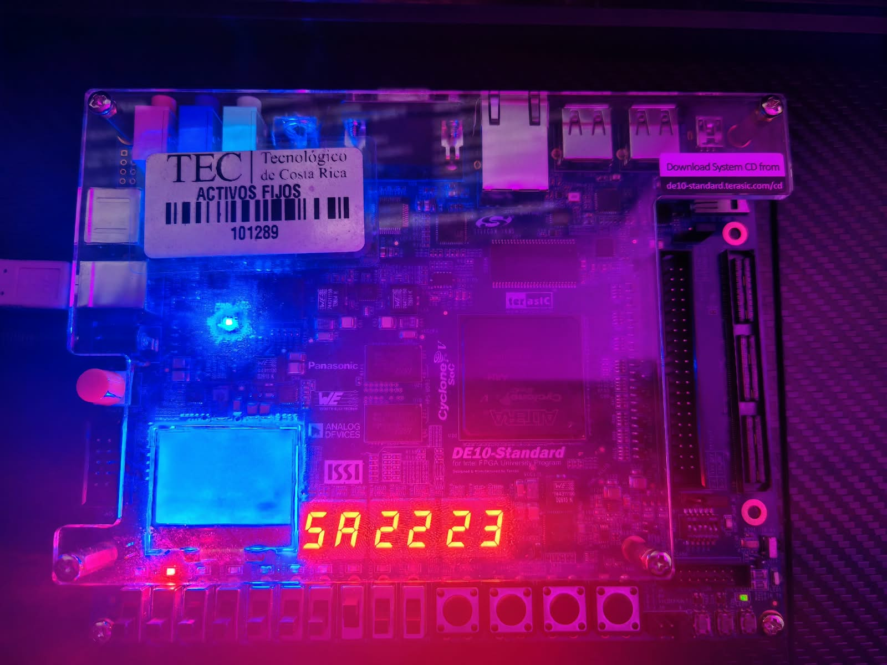 | SW[2:1] = 10: HEX = `5A2223`; LEDR[8] encendido | Instrucción[23:0] = `0x5A2223` |
| normal_04 | 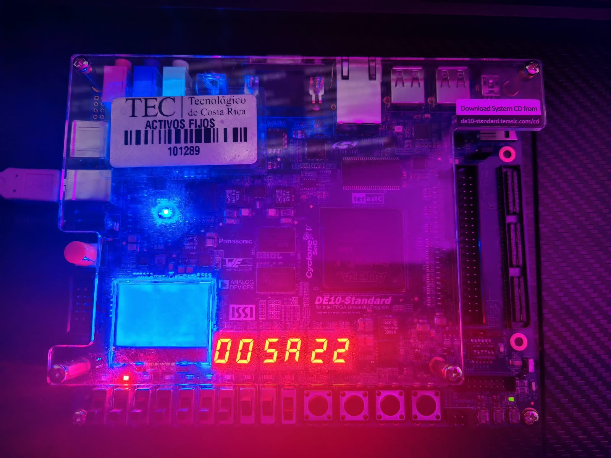 | SW[2:1] = 11: HEX = `005A22`; LEDR[8] encendido | Instrucción[31:8] = `0x005A22`; junto con la foto anterior: instrucción completa `0x005A2223` (los bits [23:8] = `0x5A22` coinciden en ambas) |

**Decodificación manual de `0x005A2223`.** Opcode `0100011` (S, `sw`), funct3 = `010` (palabra), `rs1 = 20` (s4), `rs2 = 5` (t0) e inmediato 4: `sw t0, 4(s4)`. s4 contiene la base de CTRL (0x50000), así que la dirección es STATUS (0x50004), y t0 vale 2 (`addi t0, zero, 2` = `0x00200293`, que aparece en la captura B de SignalTap): el firmware escribe `STATUS = 0b10`, es decir, `done`.

**Qué demuestran las fotos.**

- **La CPU terminó en la placa sin ayuda del Host.** `done = 1` (LEDR[8]), `busy = 0` (LEDR[7] apagado) y la última instrucción es la escritura a STATUS.
- **La CPU quedó congelada.** El PC se queda en 0x84 (la instrucción de 0x80 más 4) y no avanza a 0x88: la fotografía se tomó segundos después de terminar y sigue en el mismo valor, igual que en la captura B de SignalTap. Es la condición `cpu_enable = start && !done` en acción; el `j halt` nunca se busca.
- **Se procesaron los 16384 píxeles.** HEX = `0x4000` = 16384. En la simulación la prueba exige `HEX = N` (sección 4); en la placa es el mismo valor para la imagen de 128×128.
- **Estado de la FSM al terminar.** LEDR[3:0] apagados: la FSM quedó en FETCH (estado 0). El `sw` a STATUS pasa por MEM_WRITE, el handshake lleva la FSM a FETCH y en ese mismo flanco `done` sube y apaga la CPU, de modo que se congela ya en FETCH (deducido del RTL).

### 7.3 Reset con KEY[0] (24 nov 2026)

- **Observado en la placa.** Con la CPU en paso a paso (SW[0] = 1), al pulsar KEY[0] los HEX y los LEDR pasaron a 0, salvo LEDR[9] (`step_mode`), que quedó encendido. La foto de ese reset es la `01_reset_key0_todo_en_cero` de la sección 7.1 (HEX = `000000`). La foto del reset en modo libre (SW[0] = 0) es `normal_00` de la sección 7.2: HEX = `000000` y LEDR apagados.

 

- **Por qué LEDR[9] no se apaga.** LEDR[9] en las vistas de depuración es `step_mode`, que es SW[0] pasado por un sincronizador de 2 etapas; el reset lo pone en 0 y a los dos ciclos de soltar KEY[0] vuelve a copiar la posición del interruptor. No indica que el reset falló.
- **Qué reinicia según el RTL.** `key_sync` activa `rst_n` de forma asíncrona y lo libera de forma síncrona. Con `rst_n = 0` se reinician: la FSM (a FETCH), el PC (a 0), los registros de control (`start`, `done`, THRESHOLD, LEDR y HEX), el banco de registros, los registros del datapath y la lógica del paso a paso. Por eso `busy = start && !done` pasa a 0, la CPU deja de pedir buses y los displays muestran 0 en la vista 00. En las vistas de depuración se vería PC = 0 y estado 0.
- **Qué no reinicia según el RTL.** Las memorias (`ram.sv`) no tienen reset sobre sus arreglos: el firmware, la imagen, el histograma y la imagen de salida siguen en la RAM. Esto se deduce del código y no se verificó en la placa.
- **No se verificó.** No se leyó `CTRL` por vJTAG después del reset para confirmar `start = 0`, ni se leyó la RAM para confirmar que el firmware sigue cargado.

---

## 8. Captura en hardware (SignalTap, TP-15 y AC 12)

Instancia `sprint4/quartus/stp_rv32i.stp` (`ENABLE_SIGNALTAP ON` en el `.qsf`): reloj `CLOCK_50` (50 MHz), 8K muestras, disparo secuencial, calificador de almacenamiento Continuous, 76 bits: `cpu_state[3:0]`, `pc[31:0]`, `instruction[31:0]`, `busy`, `done`, `illegal`, `valid`/`ready` del bus de instrucciones y del bus de datos (`tap_*`) y `handshake_instr`. Parámetros compilados (`top_level.flow.rpt` y `.jdi`): `SLD_DATA_BITS=76`, `SLD_SAMPLE_DEPTH=8192`, `SLD_STORAGE_QUALIFIER_MODE=OFF` (modo continuo), disparo básico de 1 nivel y parada al llenar el buffer. Posición de disparo cerca del final del buffer (~88 % de muestras antes del disparo y ~12 % después). Los buses se muestran comprimidos en hexadecimal.

| Captura | Archivos | Qué muestra |
|---|---|---|
| A: inicio | `docs/evidencia/signaltap_inicio.png`, `signaltap_inicio_zoom.png`, `signaltap_inicio.csv` | Arranque de la ejecución. Con el zoom (0 a 28 muestras): estados `0h`, `1h`, `8h`, `7h` repetidos (FETCH, DECODE, EXECUTE_I, ALU_WB), PC avanzando 4, 8, …, 0x18 y las instrucciones `00010437h` (`lui s0,0x10`) hasta `00100293h` |
| B: fin | `docs/evidencia/signaltap_fin.png`, `signaltap_fin.csv` | Del -20 al +44 de muestras alrededor del final: PC 0x78 → 0x80 → 0x84, instrucciones `00A9A223h` (`sw a0,4(s3)`, HEX), `00200293h` (`addi t0,zero,2`) y `005A2223h` (`sw` STATUS), estado `5h` (MEM_WRITE), `done` sube, `busy` baja y todo queda plano |

Datos de los CSV (período de 20 ns por muestra): 8193 filas por captura. En la captura A solo hay datos válidos desde t = 143 380 ns (1025 muestras): las 7168 anteriores salen como `X` porque la captura se llena después del disparo y la parte anterior de este buffer no se capturó. La captura B tiene datos válidos en todas las filas.

### Capturas (imágenes)

**A, arranque (disparo en `busy`, Rising Edge).** Vista completa de la captura:

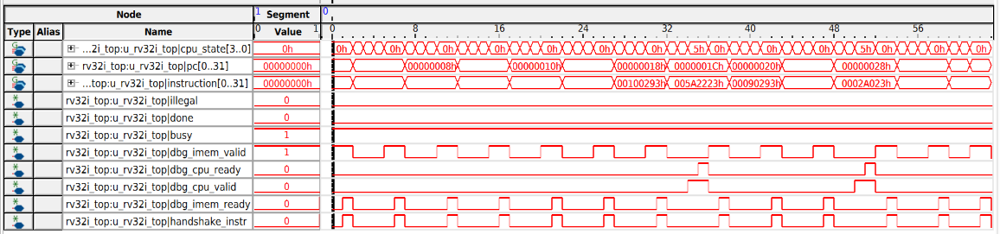

Zoom de 0 a 28 muestras: se ven los estados 0, 1, 8 y 7 repetidos, el PC avanzando de 4 en 4 y las instrucciones `00010437h` a `00100293h`:

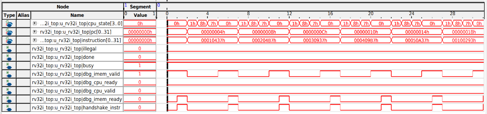

**B, fin (disparo en `done`, Rising Edge).** Alrededor del `sw` a STATUS: PC 0x78 → 0x80 → 0x84, `done` sube, `busy` baja y todo queda plano:

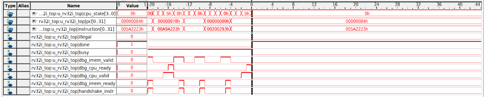

### 8.1 Lectura de las capturas a partir de los CSV

`signaltap_inicio.csv` y `signaltap_fin.csv` se analizaron con un script de Python local que no se versiona. Todos los valores salen de las columnas de los CSV (no hay valores escritos a mano): la instrucción se desensambla de la columna `instruction`, cada muestra es de 20 ns (`CLOCK_50`) y las filas con `X` (captura A antes del disparo) se descartan. El PC es el valor del registro, que ya está incrementado (dirección de la instrucción + 4). El conteo se puede repetir en una hoja de cálculo: una instrucción completa dura las muestras desde el inicio de un FETCH (estado 0) hasta el inicio del siguiente, y la última, parcial, se omite.

**Captura A: arranque (disparo en `busy`, Rising Edge).** La primera muestra válida es t = 143 380 ns de la columna de tiempo del CSV.

- Cinco `lui` y `li t0,1`: seis instrucciones de 5 ciclos (FETCH 2, DECODE, EXECUTE_I, ALU_WB). `imem_valid` dura los dos ciclos de FETCH e `imem_ready` solo el segundo; ese segundo ciclo es el handshake (`handshake_instr`).
- `sw t0,4(s4)` y `sw zero,0(t0)` duran 6 ciclos (estados 0, 0, 1, 2, 5, 5). Solo en ellas se levanta `cpu_valid` (2 ciclos) y `cpu_ready` aparece en el segundo.
- Entre ellas están `mv t0,s2` y `addi t1,s2,1024` (5 ciclos cada una), que preparan la limpieza del histograma, y la primera iteración de la limpieza (`sw zero,0(t0)`, `addi t0,t0,4` y `bne t0,t1`: 6 + 5 + 4 = 15 ciclos), que se repite 256 veces.

**Captura B: una iteración del bucle por píxel.** La iteración analizada empieza en t = 71 780 ns del CSV de la captura B.

- Las 15 instrucciones del bucle suman 83 ciclos (tabla de 8.2): dos `lw` de 8 ciclos, tres `sw` de 6, nueve instrucciones ALU de 5 y un `bne` de 4 (16 + 18 + 45 + 4 = 83).
- En cada `lw`, `cpu_valid` dura 3 ciclos y `cpu_ready` sube en el tercero; en cada `sw`, `cpu_valid` dura 2 y `cpu_ready` sube en el segundo. Es la latencia de la lectura de la RAM más la concesión del bus de datos.
- `busy` está en 1 y `done` en 0 durante toda la iteración.

**Captura B: fin de la ejecución (disparo en `done`, Rising Edge).**

- Se ven el último `bne t0,s1` (no tomado, 4 ciclos), `li t0,2` y `sw t0,4(s4)`, que escribe `STATUS = 0b10`.
- El handshake de datos del `sw` ocurre en la muestra 46 (`cpu_valid` = 1 y `cpu_ready` = 1); en la muestra 47 (t = 143 380 ns, el disparo) `done` sube y `busy` baja. Desde ahí el estado queda en 0 (FETCH) con `imem_valid` y `cpu_valid` en 0 y el PC en 0x84: no hay más peticiones y el `j halt` (0x84) no se busca. La CPU se detiene por `cpu_enable = start && !done` y no por el bucle del firmware.

### 8.2 Ciclos por instrucción: teoría contra observación (TP-21 y TP-22)

**Fundamento.** La FSM de `architecture.md` (sección 4) recorre los estados de la tabla siguiente. FETCH dura 2 ciclos porque la RAM de instrucciones genera `imem_ready <= imem_valid && !imem_ready` (`ram.sv`): `ready` llega un ciclo después de `valid`. En el bus de datos, MEM_WRITE dura 2 ciclos (concesión registrada del árbitro más `ready`) y MEM_READ 3 (concesión, latencia de 1 ciclo de la M10K y `ready`).

| Clase | Instrucciones observadas | Estados observados | Ciclos teóricos | Ciclos observados | Instrucciones en A + B | Coincidencias |
|---|---|---|---|---|---|---|
| ALU, `lui`, `li`, `mv` | `add`, `addi`, `andi`, `slli`, `slt`, `lui`, `li`, `mv` | 0-0-1-8-7 (inmediatas) y 0-0-1-6-7 (`add`, `slt`) | FETCH 2 + DECODE 1 + EXECUTE 1 + ALU_WB 1 = 5 | 5 | 73 + 776 = 849 | 849 / 849 |
| Salto condicional | `bne` | 0-0-1-10 | 2 + 1 + BEQ 1 = 4 | 4 | 65 + 87 = 152 | 152 / 152 |
| Almacenamiento | `sw` | 0-0-1-2-5-5 | 2 + 1 + MEM_ADR 1 + MEM_WRITE 2 = 6 | 6 | 66 + 260 = 326 | 326 / 326 |
| Carga | `lw` | 0-0-1-2-3-3-3-4 | 2 + 1 + MEM_ADR 1 + MEM_READ 3 + MEM_WB 1 = 8 | 8 | 0 + 172 = 172 | 172 / 172 |
| `jal`, `jalr` | ninguna (el firmware solo tiene `j halt`, que nunca se busca) | 0-0-1-9-7 (deducido del RTL) | 2 + 1 + JAL 1 + ALU_WB 1 = 5 | no observado | 0 | n/a |
| **Total** | | | | | **1 499** | **1 499 / 1 499** |

El conteo por clase y por captura está en la columna "Instrucciones en A + B" de la tabla anterior. Las 1 499 son las instrucciones completas de ambas capturas (204 en A y 1 295 en B). No hubo ninguna instrucción con una duración distinta de la teórica.

**Ciclos de una iteración del bucle por píxel.**

| Tramo | Instrucciones | Ciclos |
|---|---|---|
| Histograma | `lw` (píxel) 8, `slli` 5, `add` 5, `lw` (contador) 8, `addi` 5, `sw` 6 | 37 |
| Binarización | `slt` 5, `addi` 5, `andi` 5, `sw` (píxel de salida) 6 | 21 |
| Avance y HEX | 3 × `addi` 15, `sw` (HEX) 6, `bne` 4 | 25 |
| **Iteración** | 15 instrucciones | **83** |

En la captura B se completan 87 `bne` del bucle y los 86 intervalos entre `bne` consecutivos valen exactamente 83 ciclos; entre los 86 `lw t3,0(t0)` completos, los 85 intervalos también valen 83. En la captura A se completan 65 iteraciones de la limpieza del histograma y los 64 intervalos entre ellas valen exactamente 15 ciclos (`sw` 6 + `addi` 5 + `bne` 4).

**Modelo de ciclos de toda la ejecución** (de `busy` ↑ a `done` ↑), con los ciclos de la tabla anterior:

| Tramo | Instrucciones | Ciclos |
|---|---|---|
| Prólogo | 5 `lui` (25), `addi` (5), `sw` (6) | 36 |
| Preparación de la limpieza | `mv`, `addi` | 10 |
| Limpieza del histograma | 256 × 15 | 3 840 |
| Umbral y preparación del bucle | `lw` (8), 3 `mv` (15) | 23 |
| Bucle por píxel | N × 83 | 83 · N |
| Cierre | `addi` (5), `sw` a STATUS (6) | 11 |
| **Total** | | **3 920 + 83 · N** |

| Prueba | N | Modelo (ciclos) | Observado (sondeo de `done` cada 64 ciclos) | Consistencia |
|---|---|---|---|---|
| `test_firmware_end_to_end` | 64 | 9 232 | ~9 280 | 9 280 = ⌈9 232 / 64⌉ × 64 |
| `test_firmware_end_to_end` | 16 384 | 1 363 792 | ~1 363 840 | 1 363 840 = ⌈1 363 792 / 64⌉ × 64 |
| `test_firmware_with_bus_stalls` | 64 | 9 232 + extra | ~9 792 | extra entre 497 y 560 (observado 512 ±64) |
| `test_firmware_with_bus_stalls` | 16 384 | 1 363 792 + extra | ~1 440 192 | extra entre 76 337 y 76 400 (observado 76 352 ±64) |

Las cuatro filas son consistentes con el modelo dentro de la resolución del sondeo (64 ciclos). En el Avance 3 este documento ajustaba el término fijo como 3 968; ese valor es 3 920 redondeado al múltiplo de 64 del sondeo (⌈3 920 / 64⌉ × 64), y el valor exacto es 3 920.

**Otras cifras que salen del modelo.** Para N = 16 384 el firmware ejecuta 246 543 instrucciones (9 + 768 + 4 + 15 · 16 384 + 2) en 1 363 792 ciclos: CPI = 5,532; el bucle solo da 83 / 15 = 5,533. A 50 MHz son 27,276 ms (calculado, no medido en la placa). El CPI de 5,5 es el costo en ciclos de la decisión multiciclo; su justificación está en `architecture.md`.

**Costo de las colisiones con el Host.** Con el Host leyendo al azar el firmware tarda 76 352 ciclos más en 16 384 píxeles (+5,60 %; 220 363 lecturas) y 512 más en 64 píxeles (+5,52 %; 1 507 lecturas). Son 0,3465 y 0,3397 ciclos extra por lectura del Host (±0,04 en 64 píxeles por el sondeo). Orden de magnitud esperado (suposición del modelo): la CPU pide el bus de datos 12 ciclos de cada 83 (2 `lw` × 3 + 3 `sw` × 2), y si una lectura del Host coincide, la CPU espera como máximo unos 3 ciclos, de modo que el costo por lectura no supera 12 / 83 × 3 ≈ 0,43 ciclos; el valor medido (0,34) es del mismo orden y queda por debajo de esa cota, y es casi igual con 64 y con 16 384 píxeles.

### Qué demuestran

- **FSM:** la secuencia 0 → 1 → 8 → 7 de las instrucciones inmediatas y 0 → 1 → 2 → 5 de `sw`, tal como en la FSM de `architecture.md` y en el modo paso a paso.
- **Bus PC e instrucción decodificada:** cada PC coincide con la instrucción de `firmware.hex` de esa dirección.
- **valid/ready:** el bus de instrucciones entrega una instrucción cada 2 ciclos (`ready` alterna), por la latencia de 1 ciclo de las M10K.
- **`done`:** sube al ejecutarse el `sw` a STATUS y el CPU se congela (sección 7).
- **Ciclos (sección 8.2):** 1 499 de 1 499 instrucciones duran los ciclos teóricos de la FSM y el bucle por píxel dura exactamente 83 ciclos en 86 intervalos consecutivos.
- **Disparo de A (`busy` en Rising Edge).** `busy = start && !done` sube cuando el Host escribe `CTRL = 1`. La primera muestra válida de A (t = 143 380 ns) es justo esa: PC = 0 y estado 0. Es decir, la CPU arranca en FETCH desde la dirección 0 en el mismo instante en que `busy` sube, como exige AC 7, y la captura contiene el comienzo exacto de la ejecución (las muestras anteriores salen como `X`, sección 8).
- **Disparo de B (`done` en Rising Edge).** Se dispara en el momento en que el firmware escribe `STATUS = 0b10`. Con ~12 % de las 8192 muestras después del disparo (unas mil muestras, ~20 µs; suposición, según la posición de disparo de la configuración), el PC, la instrucción y el estado no cambian (todo queda "plano"): la CPU permanece congelada y no hay más peticiones. Ese resultado no depende del `j halt`, que no aparece.
- **Por qué dos disparos distintos.** Con 8192 muestras a 50 MHz el buffer cubre solo ~164 µs. La ejecución completa dura unos 27 ms (~1,36 millones de ciclos), así que una sola captura no puede mostrar el inicio y el final; por eso hay una captura en cada extremo.

### Limitaciones

- Condiciones de disparo: la captura A (inicio) usó `busy` con Rising Edge y la captura B (fin) usó `done` con Rising Edge. El calificador de almacenamiento quedó en modo continuo.
- No hay captura de un stall real por colisión con el Host: para eso habría que agregar `valid`/`ready` del vJTAG al `.stp` y recompilar. La espera por el bus se verificó en simulación con `test_firmware_with_bus_stalls` (TP-12). Una captura con `cpu_valid = 1` y `cpu_ready = 0` solo mostraría el ciclo normal de espera de 1 ciclo de la lectura y no aporta.
- Cada captura cubre 8 192 muestras (163,84 µs). La sección 8.2 analiza 1 499 de las 246 543 instrucciones de la corrida completa (0,6 %); la regularidad del bucle (86 intervalos idénticos de 83 ciclos) sustenta que las demás iteraciones son iguales (suposición: no se capturaron).

---

## 9. Discusión

Esta sección interpreta cada grupo de resultados: qué muestran, por qué salieron así y qué no demuestran.

### 9.1 Corrección funcional del procesador (secciones 1, 2 y 4)

- **Repo del profesor.** 29/29 casos y 29/29 bins de cobertura (un acierto por instrucción) sobre `rv32i_cpu`, igual que con el mock del profesor. Cubren las 28 instrucciones de la Tabla 1 más `illegal`. El caso `lui` pasó de un inmediato a cinco; el aumento de 7144 a 7704 ns simulados es solo ese programa más largo.
- **Programas completos.** `factorial` (recursivo, 0 a 13) y `xorshift` (16 números y 9 estadísticas con y sin signo) coinciden con Python. Son más exigentes que las pruebas por instrucción porque encadenan cientos de instrucciones, usan la pila (`lw`/`sw`), saltos y llamadas, y fue `xorshift` el que expuso el error de LUI (9.4). Tardan 183 175 y 38 275 ns simulados.
- **Sistema.** Con el firmware real, el histograma de 256 bins y la imagen binarizada coinciden exactamente con el modelo Python, `STATUS = 0b10`, `HEX = N`, no se escribe fuera de la imagen y no hay instrucciones ilegales. Que valga igual con 64 y con 16384 píxeles indica que el resultado no depende del tamaño.
- **Fetch en orden.** La traza 0x0, 0x4, …, 0x2c, 0x24, 0x28 muestra que cada instrucción se busca una vez y que el `bne` de 0x2c regresa a 0x24: el salto hacia atrás del bucle de limpieza es correcto.
- **Búsqueda fuera de rango (TP-18).** Con el PC en 0x2000 la CPU lee 0, lo decodifica como ilegal y sigue buscando 0x2004, 0x2008…: cumple Read-As-Zero sin bloquearse, que es lo que pide la Tabla 2 para el bus de instrucciones.
- **Lo que no demuestran.** Las pruebas de `jal` y `jalr` del profesor verifican el destino del salto, no el enlace `rd = pc + 4`; el firmware solo usa `jal` en `j halt`. El valor de enlace de `jal` y `jalr` no está verificado por ninguna prueba.

### 9.2 Enabler (TP-10)

Con `enable = 0` los 29 casos terminan en timeout a 300 ciclos y ninguna instrucción se completa; el trigésimo fallo de pytest es el caso de cobertura, que falla por falta de datos. Es el resultado esperado: demuestra que la FSM no avanza ni emite `valid` apagada. No prueba por sí solo que los cuatro `valid`/`ready` valgan 0; eso se apoya en la construcción (cada salida pasa por un AND con el enabler, `architecture.md` sección 5) y en que `done` apaga la CPU en la placa. No se repitió el 23 nov porque el enabler no cambió después del 20 nov (suposición: no se modificó el RTL del enabler posterior a esa fecha).

### 9.3 Pruebas unitarias (sección 3)

- **`arbiter` 8/8.** Verifican la prioridad fija al Host, el backpressure (el bus se congela mientras la CPU no recibe `ready`), que la CPU conserva el bus hasta completar y que el reset regresa a reposo. La prueba aleatoria contra un modelo de referencia cubre combinaciones que las dirigidas no alcanzan. Aparece dos veces en el log porque `make all` lo corre dos veces; ambos pasan.
- **`mmio_decoder` 7/7.** Confirman los permisos de la Tabla 2 por maestro (una escritura sin permiso se ignora sin bloquear el bus), RAZ en direcciones sin mapa y que con `valid = 0` no hay selección.
- **`ram` 8/8.** Primera y última palabra de cada memoria, independencia entre memorias y latencia de 1 ciclo. `test_imem_ready_pattern` confirma que el puerto de instrucciones entrega una instrucción cada 2 ciclos (`ready` alterna 1, 0, 1, 0). Es la causa de que FETCH dure 2 ciclos (9.7).
- **`control_registers` 10/10.** Reset, anchos de LEDR/HEX/THRESHOLD, `start`/`busy`/`done`, re-armado y que una escritura a STATUS con la CPU inactiva se ignora.
- **Alcance.** Las pruebas unitarias son dirigidas más una aleatoria (árbitro); no hay verificación formal ni cobertura de líneas o ramas del RTL, solo la cobertura funcional por instrucción del repo del profesor.

### 9.4 Errores encontrados y su significado (sección 5)

- **FETCH sumaba a `old_pc` y JALR no limpiaba el bit 0.** Los dos pasaban las 29 pruebas del profesor porque estas solo comprueban que el PC esperado aparezca entre las búsquedas, no el orden ni la cantidad; la prueba de sistema, que exige un único fetch por instrucción, los expuso. Lección: una prueba que acepta "aparece en la lista" es débil; por eso se agregó `test_fetch_secuencial`.
- **`read_data_reg` y la CPU congelada.** Detectado por análisis y no por una prueba, porque ninguna prueba congela la CPU a medio `lw`. Quedó corregido (`else if (enable)`), pero **ninguna prueba automatizada lo cubre**; solo la prueba en la placa en modo paso a paso (sección 7) lo ejercita de forma indirecta.
- **LUI.** El error dependía de los bits 14:12 y 30 del inmediato. El `lui` del profesor (`0xABCDE`) pasaba por casualidad (funct3 = OR y 0 OR imm = imm), y el firmware de la imagen usa inmediatos con esos bits en cero, por lo que habría funcionado en la placa aunque el error siguiera. Solo `xorshift` (semilla `0x12345678`) lo reveló. Conclusión: un programa real encontró lo que 29 pruebas por instrucción no.
- **Costo de los errores.** Los cuatro se encontraron antes de la entrega y se corrigieron con cambios de una o dos líneas; después de cada uno se repitieron todas las suites. En esta entrega las suites corren con el RTL final.

### 9.5 Rendimiento (secciones 4 y 4.1)

- **Modelo exacto.** El rendimiento sigue `T(N) = 3 920 + 83·N` ciclos (sección 8.2), deducido contando los ciclos de cada instrucción del firmware con la tabla observada en SignalTap (4, 5, 6 y 8 ciclos). Para N = 64 da 9 232 y para N = 16 384 da 1 363 792, que cocotb reporta como ~9 280 y ~1 363 840 porque revisa `done` cada 64 ciclos. Del total, 3 840 ciclos son la limpieza del histograma (256 iteraciones de 15), 80 son arranque y cierre y 83 por píxel son el bucle (37 del histograma, 21 de la binarización y 25 de avance y HEX). A 50 MHz son 27,276 ms (cálculo, no medición).
- **Costo de las colisiones con el Host.** Con el Host leyendo al azar el firmware tarda 5,5 % más con 64 píxeles (+512 ciclos con 1507 lecturas) y 5,6 % más con 16384 (+76 352 ciclos con 220 363 lecturas), ambos ±64 por el sondeo. Son 0,34 y 0,35 ciclos extra por lectura del Host (el Host lee a ~0,15 lecturas por ciclo), por debajo de la cota de ≈ 0,43 (la CPU usa el bus de datos 12 de cada 83 ciclos; suposición de la cota, sección 8.2). Que la proporción sea igual con 64 y 16384 píxeles indica que el costo escala linealmente con la presión del Host. Es la evidencia de que el handshake `valid`/`ready` retiene la transacción: el resultado fue exacto en todos los casos.
- **Arquitectura multiciclo.** La FSM gasta 4 a 8 ciclos por instrucción (CPI medio de 5,53 en el firmware) y el procesador es lento frente a un acelerador dedicado; se aceptó a cambio de reprogramabilidad (sección 9.6). Para Sprint 3 solo se puede acotar: `fsm.sv` recorre 6 estados por píxel, así que necesita al menos 6 ciclos por píxel, y los 83 de Sprint 4 son como máximo 13,8 veces más (83 / 6; cota teórica, el tiempo de Sprint 3 no se midió). Con un firmware que solo binarizara, el cálculo da 43 ciclos por píxel (8 + 21 + 10 + 4), como máximo 7,2 veces la cota (suposición: no se ejecutó ese firmware).

### 9.6 Síntesis y timing (sección 6 y `evidencia_atributos.md`)

- **Procesador contra acelerador (sin SignalTap).** Las cuatro compilaciones disponibles son S3-a (25 oct, sin SignalTap), S3-b (26 oct, con SignalTap), S4-a (19 nov, sin) y S4-b (23 nov, con). Sin SignalTap, S3-a → S4-a: +565 ALMs (1 044 → 1 609, +54,1 %), +68 registros (+4,0 %), +15 M10K (128 → 143) y Fmax 81,34 → 67,33 MHz (−14,01 MHz, −17,2 %); con SignalTap, S3-b → S4-b: +608 ALMs (+38,8 %) y 82,03 → 63,53 MHz (−18,50 MHz, −22,6 %). Tres bloques explican el aumento: banco de registros (+511,1 ALMs), ALU (+278,3) y datapath/control (+242,6); el decodificador baja 223,5 porque en Sprint 3 contenía el mux de lectura del banco de registros MMIO. Los bits de memoria cuadran exactamente: 2 × 524 288 (entrada y salida) + 2 × 65 536 (RAM de instrucciones, dos copias) + 8 192 (histograma) = 1 187 840. Detalle, teoría y camino crítico medido en `evidencia_atributos.md`.
- **Corrección respecto del Avance 3.** Los 1 044 ALMs de Sprint 3 son del `fit.summary` del 25 oct (sin SignalTap) y los 82,03 MHz son del `sta.rpt` del 26 oct (con SignalTap): son dos compilaciones distintas, y comparar el área de una con la Fmax de la otra daba −14,70 MHz (−18 %) en lugar de −14,01 MHz (−17,2 %). La retroalimentación de Sprint 3 ya había señalado que los reportes versionados no coincidían entre sí. Por eso la comparación se hace por parejas con y sin SignalTap.
- **Margen de reloj.** Con 63,53 MHz (con SignalTap) o 67,33 MHz (sin) contra los 50 MHz de la placa hay 27 % o 34,7 % de margen (4,260 o 5,148 ns de slack en 20 ns). Todos los TNS son 0,000 y el hold mínimo de `clk` es positivo en los cuatro modelos de cada compilación: +0,160 ns (modelo Fast, 0 °C) en la final con SignalTap y +0,158 ns en la del 19 nov sin SignalTap, así que no hay violaciones. El peor camino es el de `clk` a 85 °C, como es normal. El camino crítico se midió el 24 nov con `scripts/critical_path.tcl` (`docs/evidencia/final/cp_*.rpt`): nace en `instruction[3]`, atraviesa la ALU y el decodificador MMIO y termina en el write enable de una M10K de `mem_out` (15,908 ns de datos en 12 niveles de LUT, 58 % de ruteo, holgura 4,260 ns). Es un camino que el funcionamiento no activa (la dirección de un `sw` sale de `alu_result_reg`). Para ver qué hay debajo, el mismo script mide la peor holgura por grupo: CPU hacia `pc` 4,677 ns (65,26 MHz; ruta estructural por la lectura directa del banco), CPU hacia la M10K 4,501 ns (64,52 MHz; misma familia estructural) y host hacia la M10K 9,851 ns (98,53 MHz; único camino funcional del grupo). Con dos excepciones de ruta falsa solo de análisis (ALU hacia fuera de la CPU y lectura directa del banco hacia `pc`; no están en el SDC) la peor holgura es 4,989 ns (66,62 MHz) y es `instruction[3]` → `pc[9]` en 12 niveles (14,724 ns), un camino que tampoco se activa porque `instruction` solo cambia al entrar a DECODE, donde `pc_write` vale 0. El límite real de la CPU no se midió: el reporte da 63,53 MHz y, con esas excepciones y ese argumento, se acota en ≥ 66,83 MHz (suposición); en ambos casos queda por encima de los 50 MHz de la placa (`evidencia_atributos.md`, sección 1.5).
- **Costo de SignalTap.** En S4: +469,4 ALMs y +1 454 registros directamente atribuibles a `sld_signaltap` y `sld_hub`, +76 M10K y +622 592 bits (8192 muestras × 76 bits = 622 592 bits = 76 bloques de 8 192 bits, que confirma que el costo de memoria es solo la instancia); la diferencia con el total (+564 ALMs, +1 483 registros) es variación del resto del diseño. La Fmax baja 3,80 MHz (−5,6 %) entre S4-a y S4-b, pero esa diferencia no es solo de SignalTap: el arreglo de LUI, posterior a S4-a, añadió al camino crítico un nivel de 0,802 ns de los 0,888 ns de diferencia de periodo (`evidencia_atributos.md`, sección 1.5; suposición: no hay una compilación del RTL final sin SignalTap para separarlos). El reloj `altera_reserved_tck` baja de 106,21 a 59,88 MHz porque la lógica de SignalTap cuelga del dominio JTAG; sigue por encima de la frecuencia a la que el USB-Blaster maneja el JTAG (suposición, no medido).
- **Advertencias.** El latch inferido sobre `i` en `rv_register_file.sv` es una variable de bucle y no almacena estado funcional (suposición, no verificada en el RTL); la asignación sin uso de `tap_handshake_instr` es esperada porque solo existe para SignalTap. Quedan documentadas y no afectan los resultados de simulación ni de placa.
- **Compilaciones del procesador.** S4-a es la comparable con Sprint 3 (sin instrumentación) y S4-b la que se programó para las capturas. Entre los reportes entregados no hay una compilación sin SignalTap con el RTL final: el arreglo de LUI (`0089c94`) y el filtro de búsqueda de `rv32i_top` (`0782064`), ambos del 21 nov a las 22:54, son posteriores a S4-a, por lo que S4-a es del RTL anterior a esos cambios; la diferencia residual de 94,6 ALMs entre S4-a y S4-b incluye ese efecto y la variación del fitter (hasta ±10 % por módulo, `evidencia_atributos.md` 1.4.4).

### 9.7 Pruebas en la placa (sección 7)

- **Corrección en hardware.** Los cuatro umbrales (0, 64, 128 y 255) dieron `OK`. Los extremos son los más informativos: con 0 toda la salida debe ser 255 y con 255 solo los píxeles de valor 255, por lo que se verifica el `≥` de la comparación. El re-arranque sin reprogramar confirma que `done` se limpia al bajar CTRL[0] y que el firmware se reejecuta desde 0.
- **Tabla 2.** Los permisos del Host por consola coinciden con la Tabla 2. Los permisos de la CPU (escribir histograma, salida, STATUS, LEDR y HEX; no escribir CTRL ni THRESHOLD ni la RAM de entrada) se verifican por el resultado correcto del firmware y por las pruebas unitarias; no se probó en la placa una escritura de la CPU prohibida.
- **Tiempos.** Cargar 16384 píxeles tomó 30,6 s (~1,9 ms por palabra) y leerlos 38,6 s (~2,4 ms por palabra), unas 1100 veces más que lo que tarda la CPU (27,3 ms). El cuello de botella es el JTAG (una palabra de 32 bits por transacción, más el cliente en WSL y el servidor en Windows) y no el procesador. La variación entre 11,8 y 51,4 s es del transporte (suposición: carga del equipo y de la red WSL, no medida).
- **LEDR en la vista 00.** El firmware nunca escribe LEDR, así que se queda en 0; no es un fallo. HEX termina en `4000` porque el firmware escribe ahí su resultado final. Las demás vistas sí muestran la FSM, el PC y la instrucción.
- **PC adelantado.** El PC mostrado va una instrucción adelante porque se incrementa en FETCH; coincide con la captura SignalTap, donde el PC ya vale 4 cuando la instrucción es la de 0x0.
- **Reset (KEY[0], sección 7.3).** Con KEY[0] los HEX y los LEDR pasan a 0 y LEDR[9] sigue reflejando SW[0], que es lo que se espera: el reset reinicia FSM, PC y registros de control, pero el modo paso a paso se vuelve a leer del interruptor. La prueba confirma el estado visible tras el reset (PC 0, estado 0, `start = 0`, `busy = 0`, `done = 0` implican HEX y LEDR en 0 en la vista 00). Lo que no confirma es que las memorias conserven el firmware (se deduce del RTL, sin verificación en la placa) ni que `CTRL` valga 0 al leerlo por vJTAG. El reset tiene foto en paso a paso (`01_reset_key0_todo_en_cero`) y en modo libre (`normal_00`).
- **Paso a paso con fotos (sección 7.1).** La secuencia 1 → 8 → 7 → 0 → 1, con los LEDR fotografiados en cada estado, coincide con el camino de `lui` en el diagrama de la FSM y con la secuencia que muestra SignalTap (9.8). El PC vale 4 durante toda la primera instrucción porque se incrementa en FETCH, y pasa a 8 al terminar el FETCH de la segunda. Que cada pulsación de KEY[1] avance exactamente un estado, y no uno más ni uno menos, comprueba el diseño de `cpu_hold`: el paso deja correr la FSM hasta que `cpu_state` cambia, no un solo ciclo, porque un ciclo no basta para completar un FETCH (que dura 2 ciclos, 9.8). Las tres vistas (PC, instrucción[23:0] e instrucción[31:8]) son coherentes entre sí (comparten los bits [23:8]) y las dos instrucciones decodificadas a mano (`lui s0, 0x10` y `lui s1, 0x20`) son las bases de la RAM de entrada y de salida, las que el firmware carga primero. `illegal` (LEDR[6]) permaneció apagado y `busy` (LEDR[7]) encendido en todos los pasos.
- **Lo que el paso a paso no demuestra.** Solo se fotografiaron las dos primeras instrucciones (ambas `lui`); las secuencias de `sw` (0 → 1 → 2 → 5) y de `lw` con espera de `ready` se observaron el 22 nov sin fotos en el repositorio. Tampoco prueba la velocidad: en paso a paso un estado de 2 ciclos (FETCH) cuesta una pulsación igual que uno de 1 ciclo. Las fotos son de un teléfono con poca luz y los estados se leen por la posición de los LEDR.
- **Modo libre con fotos (sección 7.2).** `done = 1`, `busy = 0`, PC = 0x84 e instrucción `0x005A2223` (`sw t0, 4(s4)` a STATUS) son la huella de una ejecución completa con el firmware real: el PC no avanza más allá del `sw`, la CPU quedó congelada, y HEX = `0x4000` = 16384 confirma que el firmware recorrió todos los píxeles. Los tres métodos coinciden en el final: la simulación (`STATUS = 0b10` y `HEX = N`, sección 4), SignalTap (captura B) y las fotos. La foto no prueba por sí sola que el histograma y la imagen sean correctos: eso lo comprueba la comparación del script contra el modelo Python (filas 2 y 3 de la tabla de la sección 7, 22 y 23 nov).
- **Log de la corrida del 24 nov.** La salida de la sesión de las fotos no se guardó. Se repitió la corrida en modo libre (SW[0] = 0, misma imagen `Kingsoul.jpg`) con la salida guardada en `docs/evidencia/pixel_image_app_24nov.log` (16 755 líneas, casi todas respuestas `INFO` de vJTAG). Termina con `Imagen de salida: 16384/16384 en 17.4s`, `Histograma: 256/256 en 0.3s` y `OK: histograma e imagen binarizada coinciden con lo esperado.`, sin `AVISO`. Es una corrida posterior a las fotos, no la misma, pero usa el mismo firmware e imagen. Que la CPU terminó en las fotos se prueba por el estado de la placa (`done` y PC 0x84).
- **Fallo del servidor.** Dos errores `JTAG server rejected write: ERROR` se resolvieron reiniciando `jtag_server.tcl`. No se investigó la causa; no afectó a ningún resultado (cada corrida se repitió completa).

### 9.8 SignalTap (sección 8)

- **Ciclos por instrucción (sección 8.2).** Las 1 499 instrucciones completas de ambas capturas duran 4 (`bne`), 5 (ALU, `lui`, `li`, `mv`), 6 (`sw`) u 8 ciclos (`lw`), exactamente los que da la FSM; no hay excepciones. FETCH dura 2 ciclos porque la M10K entrega la instrucción un ciclo después de `valid` (`imem_ready` alterna). Por eso en el paso a paso se ven cuatro estados por instrucción simple y a 50 MHz son cinco ciclos. Teoría y observación coinciden en todas las clases.
- **PC e instrucción.** El PC pasa de 0 a 4 al terminar el primer FETCH y la instrucción `00010437h` (`lui s0, 0x10`) aparece en el mismo ciclo; la siguiente (`000204B7h`, `lui s1, 0x20`) sigue el mismo patrón. Las instrucciones capturadas coinciden con las de `firmware.hex` en esas direcciones.
- **Final de la ejecución.** En la captura B el PC llega a 0x84 con la instrucción `005A2223h` (`sw` a STATUS) en estado 5 (MEM_WRITE); `done` sube, `busy` baja y todo se queda plano. Que el PC no avance a 0x88 ni se vea el `j halt` confirma que la CPU se congela con `cpu_enable = start && !done` y no por el bucle del firmware.
- **Qué no se vio.** No hay captura de una colisión con el Host (cpu `valid` = 1 con `ready` = 0 por arbitraje), porque el vJTAG no está en el `.stp`; la colisión se verifica solo por simulación (9.5). Tampoco hay captura de una instrucción ilegal. La falla inyectada del diagnóstico la aplica el profesor en la defensa (enunciado, secciones 7 y 8) y no forma parte del AC 12 (sección 9.10).
- **Disparos y por qué se eligieron (sección 8).** A usa `busy` en Rising Edge, que marca el arranque exacto de la ejecución; B usa `done` en Rising Edge, que marca el fin. Con 8192 muestras (~164 µs) y una ejecución de ~27 ms, ninguna captura abarca la corrida completa: cada una enfoca un extremo. La primera muestra válida de A (PC 0, estado 0) coincide con el instante del disparo y confirma que la CPU arranca en FETCH desde la dirección 0 cuando `busy` sube.
- **Qué aportan frente a las fotos.** SignalTap resuelve ciclo a ciclo (20 ns) lo que el paso a paso muestra estado a estado: los 2 ciclos del FETCH no se distinguen en las fotos (una pulsación por estado) pero sí en la captura. Las fotos, en cambio, solo necesitan la placa y no el analizador lógico. Son evidencias complementarias de las mismas instrucciones.
- **Tres métodos, mismos eventos.**

| Evento | Simulación | SignalTap | Fotos de la placa |
|---|---|---|---|
| Primera instrucción: `0x00010437` (`lui s0, 0x10`), PC pasa a 4 | Traza de búsquedas 0x0, 0x4, … (sección 4) | Captura A: estados 0, 1, 8, 7 y PC 4 | Fotos 02 a 04 (7.1): estado 1, PC `000004`, instrucción `010437` y `000104` |
| Segunda instrucción: `0x000204B7` (`lui s1, 0x20`), PC pasa a 8 | Idem | Captura A: PC 8 | Fotos 08 a 10 (7.1): PC `000008`, instrucción `0204B7` y `000204` |
| Camino de `lui`: DECODE, EXECUTE_I, ALU_WB, FETCH | Diagrama de la FSM | Captura A: 1, 8, 7, 0 | Fotos 05 a 07 (7.1): estados 8, 7 y 0 |
| Última instrucción: `0x005A2223` (`sw` a STATUS) en PC 0x84, `done` sube y la CPU se congela | `STATUS = 0b10`, `HEX = N` (sección 4) | Captura B | Fotos `normal_02` a `normal_04` (7.2): PC `000084`, `5A2223`, `005A22`, LEDR[8] encendido |

- **Calidad de la captura.** En A las primeras 7168 filas son `X` porque se capturó con el disparo cerca del final del buffer; no afecta la interpretación, que usa las 1025 muestras válidas.

### 9.9 Suites de sprints anteriores (sección 3.1)

- Sprint 0 (2/2), Sprint 1 (6/6 y 5/6) y Sprint 2 (todas) pasan con el entorno actual. El SKIP de Sprint 1 con WIDTH=32 es por diseño: `test_table2_constants` solo aplica con WIDTH=8.
- **Sprint 1, prueba 3.2.** No corre por una incompatibilidad del test con cocotb 2.1.0 (`cocotb.binary`). Es un problema del entorno y del test, no del RTL; se documenta y no se oculta. Consecuencia: la inyección de `X` de Sprint 1 no se repitió en esta entrega y queda respaldada solo por su evidencia original.
- **Sprint 3.** El log no trae líneas `TESTS=`, por lo que no se usa como evidencia de esta entrega; no se investigó la causa.
- **Primer intento del `arbiter`.** El error de `libcocotbvpi_verilator.so` es de la ruta de librerías de esa primera invocación; el `make` siguiente corrió el mismo diseño y pasó 8/8.

### 9.10 Cumplimiento de los criterios del enunciado

| Criterio | Resultado | Evidencia |
|---|---|---|
| AC 1, subconjunto de 28 instrucciones (Tabla 1) y `lw`/`sw` por palabra | Cumple | Testbench del profesor 29/29 y 29/29 bins de cobertura (las 28 instrucciones de la Tabla 1 más `illegal`, sección 9.1); el firmware accede a los píxeles solo con `lw`/`sw` de palabra |
| AC 2, `lui` y pseudoinstrucciones | Cumple | Cinco inmediatos en `run_lui` y firmware que lo usa para las cinco bases del mapa MMIO; las pseudoinstrucciones `li`, `mv` y `j` del firmware se ensamblan a `addi` y `jal` (instrucciones nativas) |
| AC 3, dos buses independientes | Cumple por construcción y por prueba (`test_host_and_cpu_instr_ports_coexist`) | El bus de instrucciones no pasa por el árbitro |
| AC 4, modo paso a paso | Cumple en la placa | Sección 7.1 (fotos de cada estado) y TP-11; no hay prueba automática que ejercite `cpu_hold` (suposición: el testbench de `rv32i_top` lo deja sin conectar, como indica `architecture.md`, sección 9) |
| AC 5, RAM de instrucciones: Host R/W, CPU solo lectura (WI) | Cumple | `mmio_decoder` 7/7 (permisos por maestro) y consola en la placa (el Host lee y escribe la RAM de instrucciones); la escritura prohibida de la CPU no se probó en la placa (9.7) |
| AC 6, partición de datos y RAZ/WI | Cumple | `mmio_decoder` 7/7, TP-18 y mapa de la Tabla 2 en la placa (sección 7, fila 6) |
| AC 7, arranque y fin | Cumple | `start`, `done` y apagado de peticiones, en simulación, en la placa y en SignalTap (captura B) |
| AC 8, firmware ASM | Cumple | `firmware.s` (34 palabras, un píxel por palabra, solo `lw`/`sw`) calcula el histograma y la binarización exactos (secciones 4 y 7) |
| AC 9, Python vía vJTAG | Cumple | `pixel_image_app.py` sobre `jtag_server.tcl` carga el firmware (`Programa: 34/34`) y la imagen, arranca, espera `done`, descarga la salida y el histograma, los compara con el modelo y los muestra con matplotlib (sección 7) |
| AC 10, pruebas del profesor | Cumple | 29/29 y 2/2 |
| AC 11, extremo a extremo | Cumple en simulación (64 y 16384 píxeles, con y sin stalls) y en la placa | Secciones 4 y 7 |
| AC 12, SignalTap a 50 MHz | Cumple | `cpu_state`, PC, instrucción, `valid`/`ready` de ambos buses y `done` capturados a 50 MHz (secciones 8, 8.1 y 8.2). El diagnóstico de una falla inyectada lo aplica el profesor en la defensa y no es parte del AC 12 |
| AC 13, evidencia de atributos | Cumple | `evidencia_atributos.md` (DI y HI) |

### 9.11 Limitaciones y amenazas a la validez

- **Imagen de simulación.** Es aleatoria con semilla fija y un único umbral (100); en la placa se usó una imagen real de 128×128 con cuatro umbrales, de modo que la cobertura se complementa. No se probó una imagen de otro tamaño ni otra distribución de histograma (por ejemplo todos los píxeles iguales).
- **Una sola placa y una sola sesión.** Los resultados en hardware son de una DE10-Standard y no se repitieron en otra; la Fmax es del modelo de timing de Quartus, no una medición a distintas temperaturas.
- **Mediciones de ciclos.** Se obtienen revisando `done` cada 64 ciclos (±64), y la velocidad en la placa es un cálculo a partir de la simulación; no se midió con un contador de hardware. El modelo exacto de la sección 8.2 se validó contra SignalTap en 1 499 instrucciones, no contra la duración total en la placa.
- **Ruta de tiempo agotado.** `pixel_image_app.py` rellena de blanco los píxeles sin procesar si se agota el tiempo (commit e828fc3); esta entrega no tiene una corrida de la placa que ejercite esa ruta.
- **Cobertura de pruebas.** No hay prueba automática del congelamiento a media transacción (`read_data_reg`), del valor de enlace de `jal`/`jalr`, ni de que la CPU no pueda escribir CTRL/THRESHOLD en la placa; quedan cubiertas por análisis y por el resultado correcto de la ejecución completa.
- **Comparación con Sprint 3.** La procedencia de los reportes de Sprint 3 se resolvió con sus fechas internas y con `git log`: son dos compilaciones (25 oct sin SignalTap, 26 oct con SignalTap) y se comparan por parejas (9.6). El tiempo de Sprint 3 no se midió: solo hay una cota teórica de 6 ciclos por píxel (9.5).
- **Evidencia fotográfica.** Las fotos del 24 nov son de un teléfono con poca luz; los estados se leen por la posición de los LEDR y en la foto 01 (reset en paso a paso) el estado de LEDR[9] se toma de lo observado en la placa, porque con esa luz no se distingue bien. Solo se fotografiaron dos instrucciones en paso a paso y el estado final en modo libre. La salida de la sesión de las fotos no se guardó; hay un log de una corrida posterior en modo libre (9.7).

### 9.12 Conclusión

El procesador RV32I multiciclo cumple los criterios verificables: pasa las 29 pruebas y los 2 programas del profesor, las pruebas unitarias y de sistema (con la imagen completa y con colisiones), y produce el histograma y la imagen binarizada exactos en la placa con cuatro umbrales. Cuesta 54,1 % más ALMs y 17,2 % menos Fmax que el acelerador de Sprint 3 (compilaciones sin SignalTap), pero cumple los 50 MHz con 34,7 % de margen (27 % con SignalTap) y permite cambiar el algoritmo sin resintetizar; su límite de velocidad en la práctica es el JTAG del Host y no la CPU. SignalTap confirma en hardware la secuencia de estados, el PC, las instrucciones, la latencia de 2 ciclos del FETCH, los 4, 5, 6 y 8 ciclos de las 1 499 instrucciones capturadas (todas iguales a la teoría), los 83 ciclos por píxel y el apagado de la CPU al marcar `done`. Las fotos de la placa del 24 nov (paso a paso, modo libre y reset) coinciden con esas mismas instrucciones, estados y valores finales, de modo que simulación, SignalTap y placa cuentan la misma historia. Las limitaciones y amenazas a la validez están en 9.11 y en la sección 10.

---

## 10. Limitaciones y alcance

| Tema | Detalle |
|---|---|
| Ejecución de GitHub Actions en verde | Hecho para el PR #82 a `dev` (4 checks en verde: detect-changes, open-source-verification, repo-artifact-validation y style-check): https://github.com/itsbybp/group7_ce3201_s2_g1_2026/actions/runs/45310486302 |
| Pruebas Questa (`test/sv`) | Demostraciones de Sprint 4 corridas el 25 nov, con 0 errores (sección 3.2); las de sprints anteriores, por evidencia local |
| Sprint 1, prueba 3.2 | Rota por `cocotb.binary` en cocotb 2.1.0 (sección 3.1) |
| Sprint 3, log cocotb | Sin línea `TESTS=` |
| Reset (KEY[0]) | Hecho el 24 nov (sección 7.3) |
| Log de `pixel_image_app.py` del 24 nov | Hecho: `docs/evidencia/pixel_image_app_24nov.log` (corrida en modo libre, termina con `OK`) |
| Falla inyectada y captura SignalTap | No se hizo ensayo propio. La falla la inyecta el profesor en la defensa (enunciado, secciones 7 y 8) y no es un entregable; para diagnosticarla se cuenta con las capturas A y B, la tabla de ciclos por instrucción (8.2) y el modo paso a paso (7.1) |
| Defensa (2 al 5 dic) | Diagnóstico individual con SignalTap |