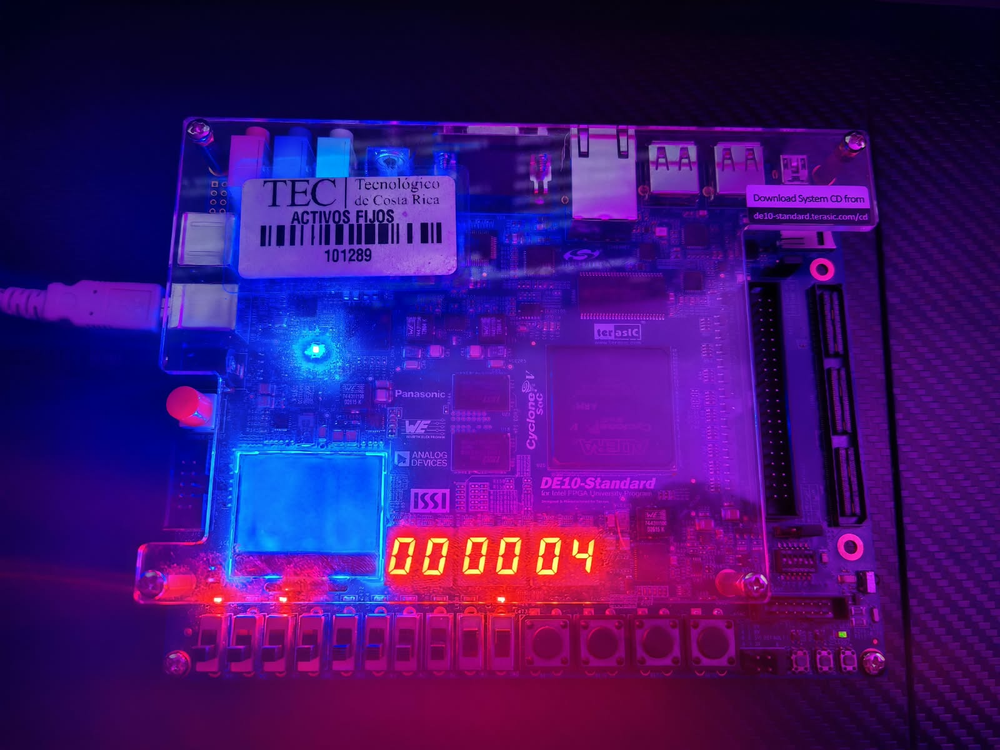
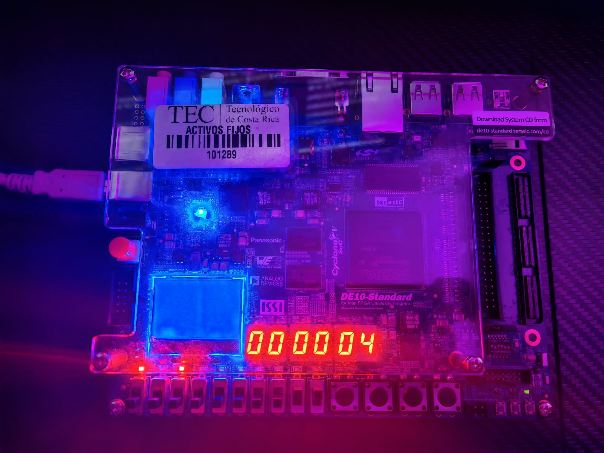
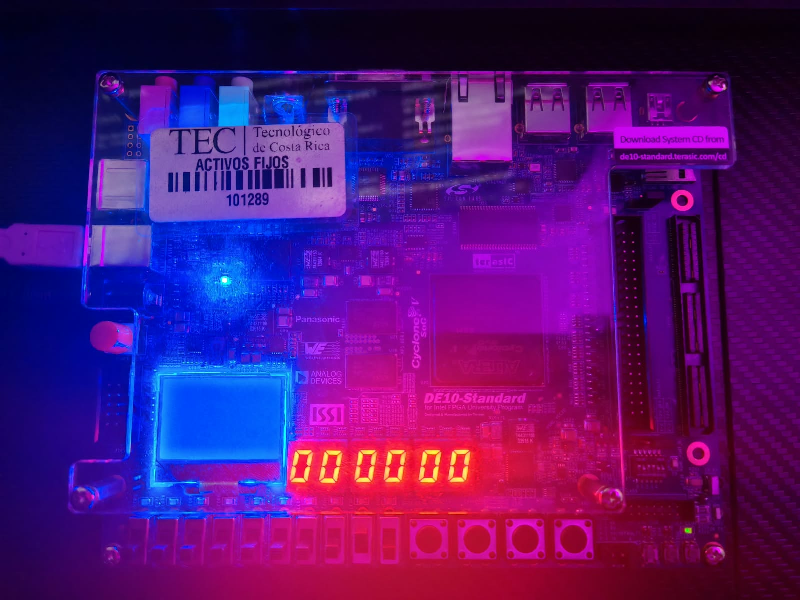

# Plan de pruebas: Sprint 4 (Procesador RV32I multiciclo)

## 1. Alcance

Este plan cubre:

- La verificación del procesador con el repo de pruebas del profesor (Epic 4, pruebas de núcleo).
- Las pruebas unitarias heredadas de Sprint 3 que se adaptan al Sprint 4.
- Las pruebas nuevas de Sprint 4: enabler, modo paso a paso, mapa MMIO y end-to-end.
- La síntesis y las mediciones en hardware.

Estrategia: cada prueba tiene un criterio de aceptación cuantitativo que sale de la teoría del diseño (por ejemplo, los ciclos de cada instrucción se derivan de la FSM antes de medirlos, sección 3.2) y se compara con lo observado. La matriz de la sección 3.1 relaciona cada AC del enunciado con sus pruebas.

## 2. Herramientas

| Herramienta | Uso | Estado |
|---|---|---|
| Cocotb 2.1.0 + Verilator 5.053 (devel) | Repo del profesor (`rv32i_cocotb_template`) | Ejecutada (pasan 29/29) |
| Cocotb + Verilator | Validación con el mock CPU del profesor | Ejecutado |
| Cocotb + Verilator | Pruebas unitarias y de sistema de Sprint 4 (`sprint4/test/cocotb`) | Ejecutadas |
| Questa (`.do`) | Pruebas unitarias de Sprint 3 | No se re-ejecuta en Sprint 4 (no corre en WSL); se conserva la evidencia de Sprint 3 |
| Quartus Prime 25.1 Lite | Síntesis, reportes `.map.rpt`, `.fit.summary` y `.sta.rpt` | Ejecutada el 19 y el 23 nov |
| SignalTap | Captura de FSM y bus en hardware | Ejecutada el 23 nov (capturas A y B) |
| DE10-Standard + `jtag_server.tcl` + `pixel_image_app.py` | Pruebas en la placa | Ejecutadas el 22, 23 y 24 nov (fotos del 24 nov) |
| Análisis de los CSV de SignalTap (script local de Python, no versionado) | Ciclos por instrucción: muestras entre dos inicios de FETCH consecutivos | Ejecutado el 24 nov (`results.md`, 8.1 y 8.2) |

### 2.1 Justificación de las herramientas con hallazgos del proyecto (HI)

| Herramienta | Hallazgo concreto del proyecto | Qué no habría dado otra herramienta |
|---|---|---|
| Cocotb + Verilator | La primera corrida de `make top` dio 3 FAIL: FETCH sumaba 4 a `old_pc` y cada instrucción se buscaba dos veces, con 29/29 del profesor en verde; `test_programs.xorshift` reveló el error de LUI; la imagen completa (1,36 M ciclos) corre en 19,35 s reales | Modelos de referencia en Python comparados palabra por palabra y una corrida completa en segundos, repetible en el CI en cada PR |
| Questa (`.do`) | Valida las suites de Sprints 0 a 3 y produce las formas de onda `.wlf` que exige el enunciado. La retroalimentación de Sprint 3 mostró transcripciones de `ram` y `control_registers` anteriores al último cambio del RTL | Formas de onda; no corre en WSL |
| SignalTap | FETCH dura 2 ciclos; 1 499 de 1 499 instrucciones duran 4, 5, 6 u 8 ciclos; el bucle por píxel dura 83; la CPU se detiene por `cpu_enable` y no por el `j halt` | La simulación no prueba el bitstream real y las fotos del paso a paso no distinguen los 2 ciclos de FETCH |
| Quartus (`.map.rpt`, `.fit.rpt`, `.sta.rpt`) y Timing Analyzer (`cp_*.rpt`) | RAM de instrucciones duplicada (2 × 7 M10K), 156 registros duplicados, costo de SignalTap, caída de Fmax de 81,34 a 67,33 MHz y camino crítico (peor camino instrucción → ALU → decodificador MMIO → write enable de la M10K, y peor camino por grupo de origen o destino) | Única fuente de ALMs, M10K, Fmax y rutas |
| Modo paso a paso y vJTAG | Cada pulsación avanzó un estado; cuatro umbrales (0, 64, 128, 255) dieron `OK` | Depuración en la placa sin recompilar |

Detalle y límites de cada herramienta: `evidencia_atributos.md`, sección 2.

### 2.2 Qué nivel de prueba detecta cada defecto

| Defecto | Pruebas del profesor (29) | Sistema y programas | SignalTap y placa |
|---|---|---|---|
| FETCH suma a `old_pc` | No | Sí (`make top`, 3 FAIL) | n/a |
| JALR sin limpiar el bit 0 | Sí, una vez corregido FETCH | n/a | n/a |
| LUI con bits del inmediato como `funct3`/`funct7` | No (el caso usa `0xABCDE`, que da OR) | Sí (`xorshift`) | n/a |
| `read_data_reg` se corrompe con la CPU congelada en `MEM_WB` | No | No | Hallado por análisis; solo el paso a paso lo ejerce |
| FETCH de 2 ciclos | No | `test_imem_ready_pattern` y ciclos de `done` | Sí, ciclo a ciclo |

Ningún nivel basta por sí solo. TP-10 sirve de control negativo: con `enable = 0` los 29 casos deben fallar por timeout, lo que demuestra que las pruebas pueden fallar.

### 2.3 Uso de IA y control humano

Se usó Claude (Anthropic) en chats de claude.ai como apoyo en la sintaxis y/o razonamiento de firmware, consola, módulos de Epic 2, pruebas cocotb y documentación; el CPU lo escribió Esteban Campos. La IA no hizo commits ni ejecutó el simulador del CPU real, Quartus, SignalTap ni la placa: lo ejecutó el equipo (la IA solo corrió modelos propios en Python y el análisis de los CSV y reportes). Reglas aplicadas (R1 a R8 de `evidencia_atributos.md`, sección 3.2): ninguna cifra sin fuente, todo supuesto marcado, la IA declara lo que no pudo ejecutar, no valida su propio trabajo y el humano hace los commits.

Control humano, con tres de las nueve salidas corregidas o rechazadas (`evidencia_atributos.md`, 3.4):

- Un plan de 4 commits para `firmware.s` que la IA propuso fue descartado por Byron: quedaron 2 commits (`24ccc76` y `134213d`).
- Una revisión estática del CPU no vio que JALR dejaba el bit 0 sin limpiar: lo detectó el caso `jalr` del profesor y se corrigió con `pc <= {wb_mux[31:1], 1'b0}`.
- Un borrador con "4 a 5 ciclos por instrucción" fue contradicho por SignalTap: la tabla correcta es de 4 a 8 ciclos (`results.md`, 8.2).

La correlación entre prompts, salidas de la IA, commits y resultados está en `evidencia_atributos.md`, sección 3.3.

## 3. Matriz de pruebas

| ID | Prueba | Alcance | Herramienta | Comando | Criterio de aceptación | Estado |
|---|---|---|---|---|---|---|
| TP-01 | Prueba del repo | Mock CPU del profesor | Cocotb + Verilator | `make test_cpu` | 29/29 PASS | Ejecutada en Avance 1: 29/29 |
| TP-02 | Validación con el repo | `rv32i_cpu` (diseño del equipo) | Cocotb + Verilator | `make test_cpu SV_FILELIST=files.f TOPLEVEL=rv32i_cpu` | 29/29 PASS | Ejecutada el 23 nov: 29/29 (el caso `lui` prueba cinco inmediatos) |
| TP-03 | Árbitro | `arbiter` | Cocotb | `make arbiter` | Prioridad del Host, backpressure y CPU conserva el bus | Ejecutada el 23 nov: 8/8 |
| TP-04 | Contador | `counter` | Questa | `run_counter.do` | ERRORS=0, WARNINGS=0 | No se re-ejecuta en Sprint 4 (ejecutada en Sprint 3) |
| TP-05 | FSM de Sprint 3 | `fsm` | Questa | `run_fsm.do` | ERRORS=0, WARNINGS=0 | No se re-ejecuta en Sprint 4 (ejecutada en Sprint 3) |
| TP-06 | Decodificador MMIO | `mmio_decoder` | Cocotb | `make mmio_decoder` | Chip selects según Tabla 2, RAZ/WI | Ejecutada el 23 nov: 7/7 |
| TP-07 | RAM | `ram` | Cocotb | `make ram` | Lectura de 1 ciclo y puertos independientes | Ejecutada el 23 nov: 8/8 |
| TP-08 | Registros de control | `control_registers` | Cocotb | `make control_registers` | Escritura y lectura de CTRL, STATUS, LEDR, HEX, THRESHOLD; sin `we` no modifica | Ejecutada el 23 nov: 10/10 |
| TP-09 | Banco de registros x0–x31 | `rv_register_file` (reemplaza a `memory_mapped_register_file`; `architecture.md`, sección 14, fila 1) | Cocotb, de forma indirecta | `make test_cpu` y `make test_programs` con `SV_FILELIST=files.f TOPLEVEL=rv32i_cpu` | x0 siempre 0; dos lecturas y una escritura por ciclo | Cubierto de forma indirecta por TP-02 y TP-17 (sin prueba unitaria propia). La prueba Questa de Sprint 3 es del módulo anterior y no se re-ejecuta |
| TP-10 | Enabler | `rv32i_cpu` con `enable = 0` | Cocotb | `make test_cpu SV_FILELIST=files_enable.f TOPLEVEL=rv32i_cpu_enable` | Con `enable = 0` ninguna instrucción se completa (todas las pruebas terminan por timeout) | Ejecutada el 20 nov: 29/29 casos con timeout a 300 ciclos (pytest 30 failed), 0 instrucciones completadas |
| TP-11 | Modo pulse | `rv32i_cpu` con pulse | Hardware (DE10-Standard) | SW[0] y KEY[1] | Cada pulsación de KEY[1] avanza la FSM hasta el siguiente estado | Ejecutada el 22 nov en la placa: OK. Secuencias 0 → 1 → 8 → 7 (`lui`/`addi`) y 0 → 1 → 2 → 5 (`sw`); paso a paso → modo libre OK (`results.md`, sección 7). Repetida el 24 nov con fotos de cada estado: 1 → 8 → 7 → 0 → 1 en las dos primeras instrucciones (`lui`), con PC `0x04` y `0x08` (`results.md`, sección 7.1) |
| TP-12 | Stalls de bus | `rv32i_top` con el Host leyendo al azar | Cocotb | `make top` (`test_firmware_with_bus_stalls`) | La CPU espera y no pierde datos; el resultado es exacto y el costo extra es ≤ 0,43 ciclos por lectura del Host (suposición, sección 3.2) | Ejecutada el 23 nov: PASS con 64 píxeles (1507 lecturas, ~9792 ciclos) y con 16384 píxeles (220 363 lecturas, ~1 440 192 ciclos) |
| TP-13 | End-to-end | CPU, árbitro, RAM y MMIO con `firmware.hex` y una imagen reducida | Cocotb | `make top` (`test_firmware_end_to_end`) | Histograma e imagen de salida exactos; ciclos = 3 920 + 83·N (±64 por el sondeo) | Ejecutada el 23 nov: PASS con 64 píxeles (~9280 ciclos; bucle reducido, ver `results.md`) y con la imagen completa de 16384 píxeles, firmware sin modificar (~1 363 840 ciclos, `FULL_IMAGE=1`) |
| TP-14 | Síntesis | Top de Sprint 4 | Quartus | Compilación del `.qpf` | Flow Status: Successful; Fmax ≥ 50 MHz (periodo de 20 ns), TNS = 0 y hold ≥ 0; reportes `.map.rpt` y `.sta.rpt`; camino crítico con `critical_path.tcl` | Ejecutada el 19 nov (sin SignalTap: 1609 ALMs, Fmax 67,33 MHz) y el 23 nov (con SignalTap: Fitter Successful, 2173 ALMs, 219 M10K, Fmax 63,53 MHz); ver `results.md`, sección 6. Camino crítico medido el 24 nov: 15,908 ns de datos, 12 niveles de LUT, holgura 4,260 ns; por grupo: CPU → `pc` 4,677 ns, CPU → M10K 4,501 ns y host → M10K 9,851 ns; con dos excepciones de análisis, 4,989 ns (`evidencia_atributos.md`, sección 1.5) |
| TP-15 | Captura en hardware | FSM, PC, instrucción, `valid`/`ready`, `done` | SignalTap | `stp_rv32i.stp`, `CLOCK_50`, 8K muestras, disparo en el inicio (A) y en el fin (B) | Captura a 50 MHz guardada en `results.md`; el arranque (PC 0, estados 0, 1, 8, 7) y el fin (`done` sube, PC 0x84, CPU congelada) coinciden con la FSM | Ejecutada el 23 nov: A (`signaltap_inicio*.png/csv`) y B (`signaltap_fin.png/csv`); ver `results.md`, sección 8 |
| TP-16 | Carga por vJTAG y ejecución en la placa | `jtag_server.tcl` y `pixel_image_app.py` con `firmware.hex` y una imagen | Hardware + Python | Programar la FPGA, abrir `jtag_server.tcl` y ejecutar `pixel_image_app.py` | Histograma e imagen de salida correctos; `STATUS.done` en la placa | Ejecutada el 22 y 23 nov: `OK` con umbrales 0, 64, 128 y 255 (imagen 128×128), re-arranque y permisos de la Tabla 2 (`results.md`, sección 7) |
| TP-17 | Programas completos | `rv32i_cpu`: factorial recursivo y xorshift32 con estadísticas | Cocotb + Verilator | `make test_programs SV_FILELIST=files.f TOPLEVEL=rv32i_cpu` | 2/2 PASS, resultados iguales a Python | Ejecutada el 23 nov: 2/2 (en `v0.0.2-proj`: 1/2, `xorshift` fallaba por LUI; ver `results.md`, sección 5) |
| TP-18 | Búsqueda fuera de rango | `rv32i_top`: PC fuera de la RAM de instrucciones (0x0000–0x1FFF) | Cocotb | `make top` (`test_fetch_fuera_de_rango_lee_cero`) | La instrucción leída es 0 (RAZ), decodifica como ilegal y la CPU no se bloquea (AC 5, Tabla 2) | Ejecutada el 23 nov: PASS (búsquedas `0x0, 0x2000, 0x2004, …`) |
| TP-19 | Modo libre en la placa con fotos | `top_level` con `firmware.hex` y una imagen, SW[0] = 0 | Hardware (DE10-Standard) + Python | Reset con KEY[0], `pixel_image_app.py` y fotografiar las vistas SW[2:1] = 00, 01, 10 y 11 | `done` (LEDR[8]) encendido, PC `0x84`, instrucción `0x005A2223`, HEX (vista 00) = `0x4000` = 16384; la CPU queda congelada | Ejecutada el 24 nov: OK; fotos en `docs/evidencia/modo_normal/` (`results.md`, sección 7.2) |
| TP-20 | Reset con KEY[0] | `top_level` | Hardware (DE10-Standard) | Pulsar KEY[0] con la CPU detenida o en paso a paso | HEX y LEDR en 0; LEDR[9] solo refleja SW[0] | Ejecutada el 24 nov: OK; fotos `normal_00` (modo libre) y `01_reset_key0_todo_en_cero` (paso a paso) (`results.md`, sección 7.3) |
| TP-21 | Ciclos por instrucción en hardware | FSM del CPU en la placa | SignalTap + análisis de los CSV | Contar, en los CSV de TP-15, las muestras entre dos inicios de FETCH consecutivos (20 ns por muestra) | Cada instrucción completa dura los ciclos que da la FSM: tipo I y R 5, `bne` 4, `sw` 6, `lw` 8 (sección 3.2) | Ejecutada el 24 nov: 1 499 de 1 499 coinciden (`results.md`, 8.2) |
| TP-22 | Modelo de rendimiento del firmware | `firmware.hex` sobre `rv32i_top` | Cocotb (`make top`) y SignalTap | TP-13 y TP-21 | Ciclos de `busy` a `done` = 3 920 + 83·N dentro de la resolución del sondeo (64 ciclos); el bucle por píxel dura exactamente 83 | Ejecutada el 24 nov: 9 232 (observado ~9 280) y 1 363 792 (~1 363 840); 86 intervalos consecutivos de 83 ciclos (`results.md`, 8.2) |

### 3.1 Trazabilidad AC → pruebas

| AC | Pruebas |
|---|---|
| 1, 2 | TP-02, TP-17, TP-13 |
| 3 | TP-12, TP-18, TP-21 |
| 4 | TP-11 |
| 5, 6 | TP-06, TP-07, TP-16, TP-18 |
| 7 | TP-08, TP-10, TP-13, TP-15 |
| 8, 9 | TP-13, TP-16, TP-22 |
| 10 | TP-01, TP-02, TP-17 |
| 11 | TP-12, TP-13, TP-18 |
| 12 | TP-15, TP-21 |
| 13 | TP-14 |

### 3.2 Valores esperados (teoría) y observados

Los esperados se derivan del RTL antes de medir. FETCH dura 2 ciclos porque `imem_ready` sube un ciclo después de `valid` (M10K síncrona); MEM_WRITE dura 2 (concesión del árbitro y `ready`) y MEM_READ 3 (concesión, latencia de la M10K y `ready`).

| Magnitud | Esperado (derivación) | Observado | Fuente |
|---|---|---|---|
| Instrucción tipo I o R | FETCH 2 + DECODE 1 + EXECUTE 1 + ALU_WB 1 = 5 | 849 de 849 con 5 ciclos | `results.md`, 8.2 |
| `bne` | 2 + 1 + BEQ 1 = 4 | 152 de 152 | 8.2 |
| `sw` | 2 + 1 + MEM_ADR 1 + MEM_WRITE 2 = 6 | 326 de 326 | 8.2 |
| `lw` | 2 + 1 + MEM_ADR 1 + MEM_READ 3 + MEM_WB 1 = 8 | 172 de 172 | 8.2 |
| Iteración del bucle por píxel | 37 (histograma) + 21 (binarización) + 25 (avance y HEX) = 83 | 86 intervalos consecutivos de 83 | 8.2 |
| Limpieza del histograma | 256 × (6 + 5 + 4) = 3 840 | 64 intervalos consecutivos de 15 (65 iteraciones capturadas) | 8.2 |
| T(64) | 3 920 + 83 · 64 = 9 232 | ~9 280 = ⌈9 232 / 64⌉ × 64 | 4 |
| T(16 384) | 3 920 + 83 · 16 384 = 1 363 792 (27,276 ms a 50 MHz) | ~1 363 840 = ⌈1 363 792 / 64⌉ × 64 | 4.1 |
| Costo por lectura del Host | ≤ 12 / 83 × 3 ≈ 0,43 ciclos (suposición: la CPU pide el bus de datos 12 de cada 83 ciclos y espera como máximo 3) | 0,34 (64 píxeles) y 0,35 (16 384 píxeles) | 8.2 |
| Histograma e imagen de salida | Cada bin y cada píxel igual al modelo de Python | Exactos con 64 y 16 384 píxeles, y en la placa con 4 umbrales | 4 y 7 |
| Bits de memoria | 2 × 524 288 + 2 × 65 536 + 8 192 = 1 187 840 | 1 187 840 | `evidencia_atributos.md`, 1.4.3 |
| Registros del banco | 31 × 32 = 992 | 992 (1 115 con duplicados del fitter) | `evidencia_atributos.md`, 1.4.2 |
| Fmax | ≥ 50 MHz | 67,33 MHz sin SignalTap y 63,53 MHz con SignalTap (reporte); el peor camino no se activa en funcionamiento y el límite real de la CPU no se midió: con excepciones de análisis y lectura del RTL, ≥ 66,83 MHz (suposición) | `results.md`, 6; `evidencia_atributos.md`, 1.5 |

## 4. Evidencia del Avance 1

Ejecución del repo con el procesador propio, `TP-02`:

```
TESTS=29 PASS=28 FAIL=1 SKIP=0
FAILED cocotb/test_dashboard.py::test_cocotb_case[jalr]
```

Archivos en `docs/evidencia/avance1/`:

- `avance1_cocotb.log`: salida de consola completa.
- `coverage.json`: bins cubiertos y conteo de hits.
- `dashboard_cpu.html`: resultado por prueba y cobertura por instrucción.

## 5. Evidencia del Avance 2

Ejecución del repo con el procesador propio, `TP-02` (tras corregir FETCH y JALR, ver `results.md`):

```
TESTS=29 PASS=29 FAIL=0 SKIP=0
```

Pytest: 30 passed. Cobertura: 29/29 bins (100 %), según `coverage.json`.

Archivos en `docs/evidencia/avance2/`:

- `avance2_cocotb.log`: salida de consola completa.
- `coverage.json`: bins cubiertos y conteo de hits.
- `dashboard_cpu.html`: resultado por prueba y cobertura por instrucción.
- `avance2_unit_system.log`: salida de `make all` en `sprint4/test/cocotb` (4 pruebas unitarias y prueba de sistema).

## 6. Evidencia del Avance 3

Archivos en `docs/evidencia/avance3/`:

- `avance3_full_image.log`: `FULL_IMAGE=1 make top` (corrida de ese avance, 16384 píxeles).
- `avance3_enabler.log`: prueba del enabler (29 timeouts esperados, pytest 30 failed).
- `avance3_unit_system.log`: `make all` (4 pruebas unitarias y prueba de sistema).
- `avance3_cocotb.log`, `coverage.json`, `dashboard_cpu.html`: corrida normal de TP-02 (29/29, pytest 30 passed) después del cambio de CPU.
- `avance3_programs.log`: `make test_programs` sobre `rv32i_cpu` (2/2 PASS, TP-17), después del arreglo de LUI.
- Reportes de Quartus: `top_level.fit.summary`, `top_level.map.rpt`, `top_level.sta.rpt` y, del 24 nov, `cp_peor_camino.rpt`, `cp_20_peores.rpt`, `cp_hold_peor.rpt`, `cp_fmax.rpt`, `cp_real_cpu.rpt`, `cp_real_bus_cpu.rpt`, `cp_real_bus_host.rpt`, `cp_real_resto.rpt`, `cp_exc_peor_camino.rpt` y `cp_exc_5_peores.rpt` (`docs/evidencia/final/`).

## 7. Evidencia de la entrega final

Archivos en `docs/evidencia/final/` (corrida del 23 nov desde la raíz del repo):

- `sprint0_cocotb.log` a `sprint3_cocotb.log`: suites cocotb de los sprints anteriores (en Sprint 1 la prueba 3.2 no corre por `cocotb.binary`; el log de Sprint 3 no trae línea `TESTS=`).
- `sprint4_unit_system.log`: `make all` (8, 7, 8, 10 y 4 PASS).
- `sprint4_full_image.log`: `FULL_IMAGE=1 make top` (4/4 PASS, 16384 píxeles).
- `sprint4_test_cpu.log` y `sprint4_test_programs.log`: repo del profesor sobre `rv32i_cpu` (29/29 y 2/2).
- `top_level.fit.summary`, `top_level.map.summary`, `top_level.sta.summary`: Quartus con SignalTap (23 nov).

Archivos en `docs/evidencia/`: `signaltap_inicio.png`, `signaltap_inicio_zoom.png`, `signaltap_fin.png` y los CSV `signaltap_inicio.csv` y `signaltap_fin.csv`. Instancia: `sprint4/quartus/stp_rv32i.stp`.

Fotos de la placa del 24 nov: `docs/evidencia/paso_a_paso/` (10 fotos, `01_` a `10_`) y `docs/evidencia/modo_normal/` (5 fotos, `normal_00_` a `normal_04_`), descritas en `results.md`, secciones 7.1 a 7.3.

### Procedimientos en la placa y capturas

**TP-11, modo paso a paso.**

1. Programar la FPGA con el `.sof` y abrir `jtag_server.tcl` en Windows.
2. Poner SW[0] = 1 y SW[2:1] = 01 (HEX = PC, LEDR = `{step_mode, done, busy, illegal, 2'b00, cpu_state}`).
3. Ejecutar `pixel_image_app.py <imagen> -c` para cargar firmware e imagen y escribir `start`.
4. Pulsar KEY[1] una vez por estado y anotar HEX y LEDR[3:0]; en DECODE pasar a SW[2:1] = 10 y 11 para leer la instrucción.
5. Criterio: cada pulsación avanza exactamente un estado; `lui` recorre 1 → 8 → 7 → 0; el PC ya está incrementado en DECODE; las instrucciones coinciden con `firmware.hex` (`0x00010437` y `0x000204B7`).

| DECODE, PC `0x04` | EXECUTE_I (estado 8) | ALU_WB (estado 7) | FETCH (estado 0, PC `0x04`) |
|---|---|---|---|
|  |  |  |  |

**TP-19, modo libre.**

1. Poner SW[0] = 0 y pulsar KEY[0]; fotografiar.
2. Ejecutar `pixel_image_app.py <imagen> -c` (la CPU corre a 50 MHz y termina en ~27 ms).
3. Fotografiar las vistas SW[2:1] = 00, 01, 10 y 11.
4. Criterio: HEX (vista 00) = `004000`; PC = `000084` con LEDR[8] (`done`) encendido; instrucción `0x005A2223` (`sw t0, 4(s4)` a STATUS).

| Vista 00 (registro HEX) | Vista 01 (PC, `done`) | Vista 10 (instr[23:0]) | Vista 11 (instr[31:8]) |
|---|---|---|---|
|  |  |  |  |

**TP-20, reset.** Con la CPU detenida o en paso a paso, pulsar KEY[0]. Criterio: HEX y LEDR en 0 (en las vistas de depuración se vería PC 0 y estado 0); LEDR[9] solo refleja SW[0].



**TP-15, SignalTap.**

1. Compilar con `ENABLE_SIGNALTAP ON` (instancia `stp_rv32i.stp`, `CLOCK_50`, 8192 muestras, 76 bits, almacenamiento continuo) y programar el `.sof` de la compilación del 23 nov.
2. Captura A (inicio): condición de disparo `busy` en Rising Edge. Armar el analizador y ejecutar `pixel_image_app.py`.
3. Captura B (fin): condición de disparo `done` en Rising Edge. Armar y ejecutar de nuevo.
4. Guardar las imágenes y exportar los CSV a `docs/evidencia/`.
5. Criterio: A muestra el arranque (PC 0, estados 0, 1, 8, 7) y B muestra `done` subiendo con el PC en `0x84` y la CPU congelada.
6. Análisis (TP-21): con los CSV exportados, contar las muestras de cada instrucción completa (de un inicio de FETCH al siguiente) y compararlas con los ciclos de la sección 3.2.


## 8. Estado final

Corrida de GitHub Actions del PR #82 en verde (4 checks): https://github.com/itsbybp/group7_ce3201_s2_g1_2026/pull/82/checks. La falla inyectada la aplica el profesor en la defensa (enunciado, secciones 7 y 8; `features.md` 15.2) y no es parte del AC 12.