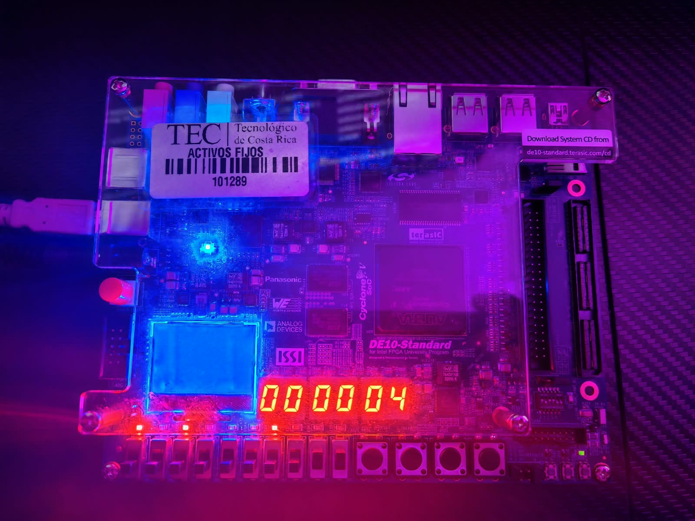
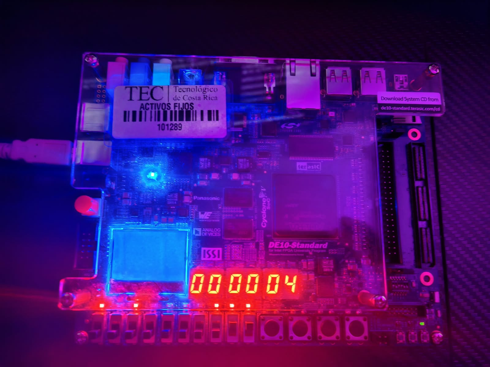
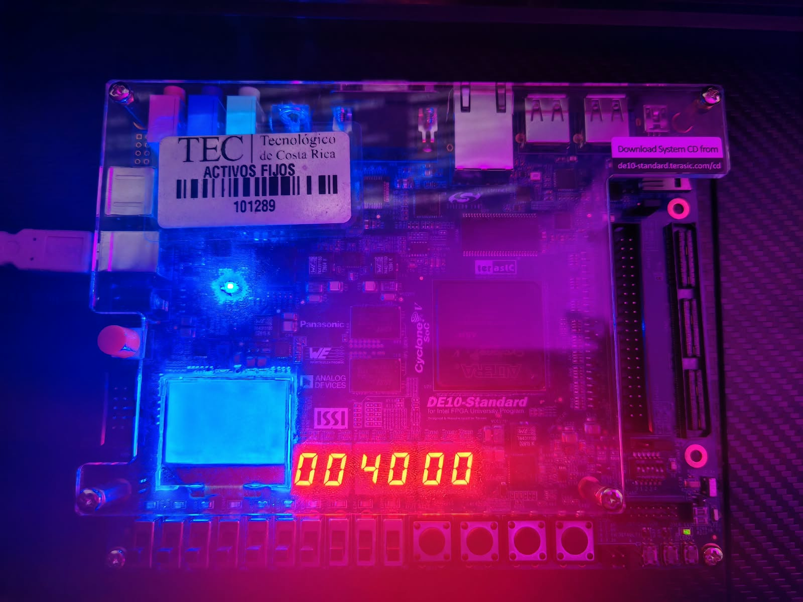
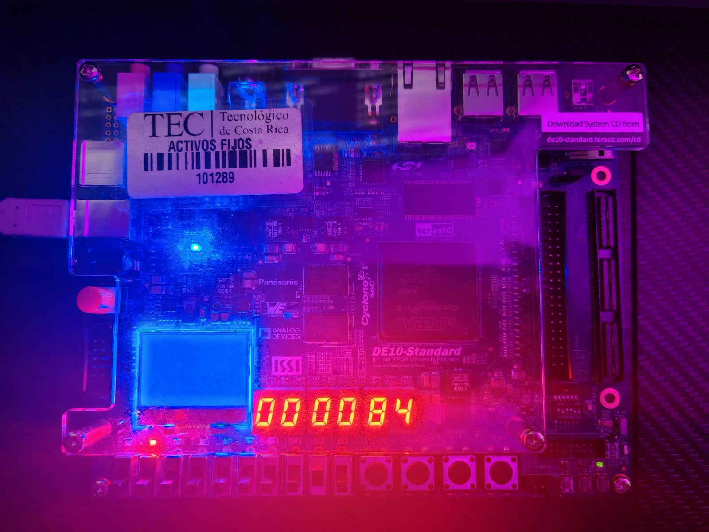
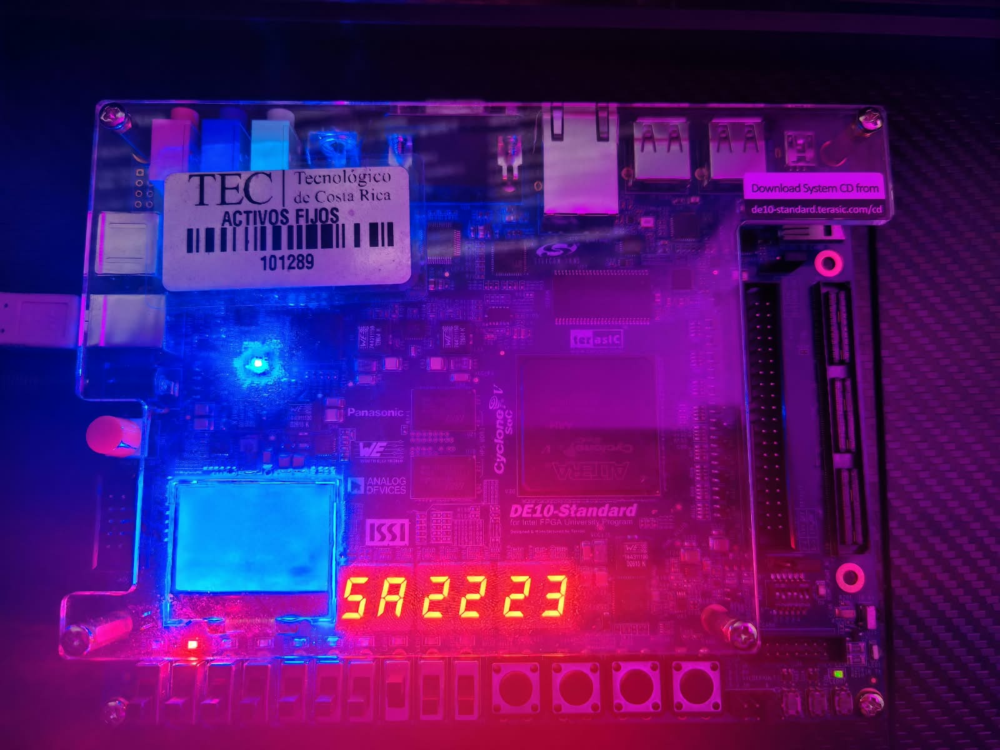
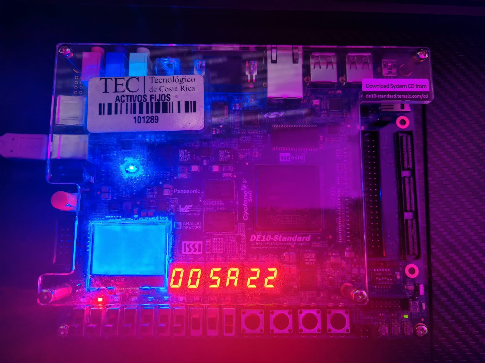
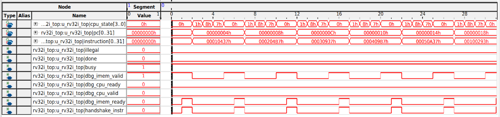
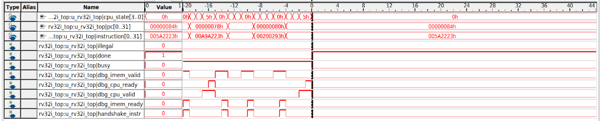

# Plan de pruebas: Sprint 4 (Procesador RV32I multiciclo)

## 1. Alcance

Este plan cubre:

- La verificación del procesador con el repo de pruebas del profesor (Epic 4, pruebas de núcleo).
- Las pruebas unitarias heredadas de Sprint 3 que se adaptan al Sprint 4.
- Las pruebas nuevas de Sprint 4: enabler, modo paso a paso, mapa MMIO y end-to-end.
- La síntesis y las mediciones en hardware.

## 2. Herramientas

| Herramienta | Uso | Estado |
|---|---|---|
| Cocotb 2.1.0 + Verilator 5.053 (devel) | Repo del profesor (`rv32i_cocotb_template`) | Ejecutada (pasan 29/29) |
| Cocotb + Verilator | Validación con el mock CPU del profesor | Ejecutado |
| Cocotb + Verilator | Pruebas unitarias y de sistema de Sprint 4 (`sprint4/test/cocotb`) | Ejecutadas |
| Questa (`.do`) | Pruebas unitarias de Sprint 3 | No se re-ejecuta en Sprint 4 (no corre en WSL); se conserva la evidencia de Sprint 3 |
| Quartus Prime 25.1 Lite | Síntesis, reportes `.map.rpt`, `.fit.summary` y `.sta.rpt` | Ejecutada el 19 y el 23 nov |
| SignalTap | Captura de FSM y bus en hardware | Ejecutada el 23 nov (capturas A y B) |
| DE10-Standard + `jtag_server.tcl` + `pixel_image_app.py` | Pruebas en la placa | Ejecutadas el 22, 23 y 24 nov (fotos del 24 nov) |

## 3. Matriz de pruebas

| ID | Prueba | Alcance | Herramienta | Comando | Criterio de aceptación | Estado |
|---|---|---|---|---|---|---|
| TP-01 | Prueba del repo | Mock CPU del profesor | Cocotb + Verilator | `make test_cpu` | 29/29 PASS | Ejecutada en Avance 1: 29/29 |
| TP-02 | Validación con el repo | `rv32i_cpu` (diseño del equipo) | Cocotb + Verilator | `make test_cpu SV_FILELIST=files.f TOPLEVEL=rv32i_cpu` | 29/29 PASS | Ejecutada el 23 nov: 29/29 (el caso `lui` prueba cinco inmediatos) |
| TP-03 | Árbitro | `arbiter` | Cocotb | `make arbiter` | Prioridad del Host, backpressure y CPU conserva el bus | Ejecutada el 23 nov: 8/8 |
| TP-04 | Contador | `counter` | Questa | `run_counter.do` | ERRORS=0, WARNINGS=0 | No se re-ejecuta en Sprint 4 (ejecutada en Sprint 3) |
| TP-05 | FSM de Sprint 3 | `fsm` | Questa | `run_fsm.do` | ERRORS=0, WARNINGS=0 | No se re-ejecuta en Sprint 4 (ejecutada en Sprint 3) |
| TP-06 | Decodificador MMIO | `mmio_decoder` | Cocotb | `make mmio_decoder` | Chip selects según Tabla 2, RAZ/WI | Ejecutada el 23 nov: 7/7 |
| TP-07 | RAM | `ram` | Cocotb | `make ram` | Lectura de 1 ciclo y puertos independientes | Ejecutada el 23 nov: 8/8 |
| TP-08 | Registros de control | `control_registers` | Cocotb | `make control_registers` | Escritura y lectura de CTRL, STATUS, LEDR, HEX, THRESHOLD; sin `we` no modifica | Ejecutada el 23 nov: 10/10 |
| TP-09 | Reg file x0–x31 | `memory_mapped_register_file` | Questa | `run_memory_mapped_register_file.do` | x0 siempre 0; escritura y reset | No se re-ejecuta en Sprint 4 |
| TP-10 | Enabler | `rv32i_cpu` con `enable = 0` | Cocotb | `make test_cpu SV_FILELIST=files_enable.f TOPLEVEL=rv32i_cpu_enable` | Con `enable = 0` ninguna instrucción se completa (todas las pruebas terminan por timeout) | Ejecutada el 20 nov: 29/29 casos con timeout a 300 ciclos (pytest 30 failed), 0 instrucciones completadas |
| TP-11 | Modo pulse | `rv32i_cpu` con pulse | Hardware (DE10-Standard) | SW[0] y KEY[1] | Cada pulsación de KEY[1] avanza la FSM hasta el siguiente estado | Ejecutada el 22 nov en la placa: OK. Secuencias 0 → 1 → 8 → 7 (`lui`/`addi`) y 0 → 1 → 2 → 5 (`sw`); paso a paso → modo libre OK (`results.md`, sección 7). Repetida el 24 nov con fotos de cada estado: 1 → 8 → 7 → 0 → 1 en las dos primeras instrucciones (`lui`), con PC `0x04` y `0x08` (`results.md`, sección 7.1) |
| TP-12 | Stalls de bus | `rv32i_top` con el Host leyendo al azar | Cocotb | `make top` (`test_firmware_with_bus_stalls`) | La CPU espera y no pierde datos | Ejecutada el 23 nov: PASS con 64 píxeles (1507 lecturas, ~9792 ciclos) y con 16384 píxeles (220 363 lecturas, ~1 440 192 ciclos) |
| TP-13 | End-to-end | CPU, árbitro, RAM y MMIO con `firmware.hex` y una imagen reducida | Cocotb | `make top` (`test_firmware_end_to_end`) | Histograma e imagen de salida exactos | Ejecutada el 23 nov: PASS con 64 píxeles (~9280 ciclos; bucle reducido, ver `results.md`) y con la imagen completa de 16384 píxeles, firmware sin modificar (~1 363 840 ciclos, `FULL_IMAGE=1`) |
| TP-14 | Síntesis | Top de Sprint 4 | Quartus | Compilación del `.qpf` | Flow Status: Successful; reportes `.map.rpt` y `.sta.rpt` | Ejecutada el 19 nov (sin SignalTap: 1609 ALMs, Fmax 67,33 MHz) y el 23 nov (con SignalTap: Fitter Successful, 2173 ALMs, 219 M10K, Fmax 63,53 MHz); ver `results.md`, sección 6 |
| TP-15 | Captura en hardware | FSM, PC, instrucción, `valid`/`ready`, `done` | SignalTap | `stp_rv32i.stp`, `CLOCK_50`, 8K muestras, disparo en el inicio (A) y en el fin (B) | Captura a 50 MHz guardada en `results.md` | Ejecutada el 23 nov: A (`signaltap_inicio*.png/csv`) y B (`signaltap_fin.png/csv`); ver `results.md`, sección 8 |
| TP-16 | Carga por vJTAG y ejecución en la placa | `jtag_server.tcl` y `pixel_image_app.py` con `firmware.hex` y una imagen | Hardware + Python | Programar la FPGA, abrir `jtag_server.tcl` y ejecutar `pixel_image_app.py` | Histograma e imagen de salida correctos; `STATUS.done` en la placa | Ejecutada el 22 y 23 nov: `OK` con umbrales 0, 64, 128 y 255 (imagen 128×128), re-arranque y permisos de la Tabla 2 (`results.md`, sección 7) |
| TP-17 | Programas completos | `rv32i_cpu`: factorial recursivo y xorshift32 con estadísticas | Cocotb + Verilator | `make test_programs SV_FILELIST=files.f TOPLEVEL=rv32i_cpu` | 2/2 PASS, resultados iguales a Python | Ejecutada el 23 nov: 2/2 (en `v0.0.2-proj`: 1/2, `xorshift` fallaba por LUI; ver `results.md`, sección 5) |
| TP-18 | Búsqueda fuera de rango | `rv32i_top`: PC fuera de la RAM de instrucciones (0x0000–0x1FFF) | Cocotb | `make top` (`test_fetch_fuera_de_rango_lee_cero`) | La instrucción leída es 0 (RAZ), decodifica como ilegal y la CPU no se bloquea (AC 5, Tabla 2) | Ejecutada el 23 nov: PASS (búsquedas `0x0, 0x2000, 0x2004, …`) |
| TP-19 | Modo libre en la placa con fotos | `top_level` con `firmware.hex` y una imagen, SW[0] = 0 | Hardware (DE10-Standard) + Python | Reset con KEY[0], `pixel_image_app.py` y fotografiar las vistas SW[2:1] = 00, 01, 10 y 11 | `done` (LEDR[8]) encendido, PC `0x84`, instrucción `0x005A2223`, HEX (vista 00) = `0x4000` = 16384; la CPU queda congelada | Ejecutada el 24 nov: OK; fotos en `docs/evidencia/modo_normal/` (`results.md`, sección 7.2) |
| TP-20 | Reset con KEY[0] | `top_level` | Hardware (DE10-Standard) | Pulsar KEY[0] con la CPU detenida o en paso a paso | HEX y LEDR en 0; LEDR[9] solo refleja SW[0] | Ejecutada el 24 nov: OK; fotos `normal_00` (modo libre) y `01_reset_key0_todo_en_cero` (paso a paso) (`results.md`, sección 7.3) |

## 4. Evidencia del Avance 1

Ejecución del repo con el procesador propio, `TP-02`:

```
TESTS=29 PASS=28 FAIL=1 SKIP=0
FAILED cocotb/test_dashboard.py::test_cocotb_case[jalr]
```

Archivos en `docs/evidencia/avance1/`:

- `avance1_cocotb.log`: salida de consola completa.
- `coverage.json`: bins cubiertos y conteo de hits.
- `dashboard_cpu.html`: resultado por prueba y cobertura por instrucción.

## 5. Evidencia del Avance 2

Ejecución del repo con el procesador propio, `TP-02` (tras corregir FETCH y JALR, ver `results.md`):

```
TESTS=29 PASS=29 FAIL=0 SKIP=0
```

Pytest: 30 passed. Cobertura: 29/29 bins (100 %), según `coverage.json`.

Archivos en `docs/evidencia/avance2/`:

- `avance2_cocotb.log`: salida de consola completa.
- `coverage.json`: bins cubiertos y conteo de hits.
- `dashboard_cpu.html`: resultado por prueba y cobertura por instrucción.
- `avance2_unit_system.log`: salida de `make all` en `sprint4/test/cocotb` (4 pruebas unitarias y prueba de sistema).

## 6. Evidencia del Avance 3

Archivos en `docs/evidencia/avance3/`:

- `avance3_full_image.log`: `FULL_IMAGE=1 make top` (corrida de ese avance, 16384 píxeles).
- `avance3_enabler.log`: prueba del enabler (29 timeouts esperados, pytest 30 failed).
- `avance3_unit_system.log`: `make all` (4 pruebas unitarias y prueba de sistema).
- `avance3_cocotb.log`, `coverage.json`, `dashboard_cpu.html`: corrida normal de TP-02 (29/29, pytest 30 passed) después del cambio de CPU.
- `avance3_programs.log`: `make test_programs` sobre `rv32i_cpu` (2/2 PASS, TP-17), después del arreglo de LUI.
- Reportes de Quartus: `top_level.fit.summary`, `top_level.map.rpt`, `top_level.sta.rpt`.

## 7. Evidencia de la entrega final

Archivos en `docs/evidencia/final/` (corrida del 23 nov desde la raíz del repo):

- `sprint0_cocotb.log` a `sprint3_cocotb.log`: suites cocotb de los sprints anteriores (en Sprint 1 la prueba 3.2 no corre por `cocotb.binary`; el log de Sprint 3 no trae línea `TESTS=`).
- `sprint4_unit_system.log`: `make all` (8, 7, 8, 10 y 4 PASS).
- `sprint4_full_image.log`: `FULL_IMAGE=1 make top` (4/4 PASS, 16384 píxeles).
- `sprint4_test_cpu.log` y `sprint4_test_programs.log`: repo del profesor sobre `rv32i_cpu` (29/29 y 2/2).
- `top_level.fit.summary`, `top_level.map.summary`, `top_level.sta.summary`: Quartus con SignalTap (23 nov).

Archivos en `docs/evidencia/`: `signaltap_inicio.png`, `signaltap_inicio_zoom.png`, `signaltap_fin.png` y los CSV `signaltap_inicio.csv` y `signaltap_fin.csv`. Instancia: `sprint4/quartus/stp_rv32i.stp`.

Fotos de la placa del 24 nov: `docs/evidencia/paso_a_paso/` (10 fotos, `01_` a `10_`) y `docs/evidencia/modo_normal/` (5 fotos, `normal_00_` a `normal_04_`), descritas en `results.md`, secciones 7.1 a 7.3.

### Procedimientos en la placa y capturas

**TP-11, modo paso a paso.**

1. Programar la FPGA con el `.sof` y abrir `jtag_server.tcl` en Windows.
2. Poner SW[0] = 1 y SW[2:1] = 01 (HEX = PC, LEDR = `{step_mode, done, busy, illegal, 2'b00, cpu_state}`).
3. Ejecutar `pixel_image_app.py <imagen> -c` para cargar firmware e imagen y escribir `start`.
4. Pulsar KEY[1] una vez por estado y anotar HEX y LEDR[3:0]; en DECODE pasar a SW[2:1] = 10 y 11 para leer la instrucción.
5. Criterio: cada pulsación avanza exactamente un estado; `lui` recorre 1 → 8 → 7 → 0; el PC ya está incrementado en DECODE; las instrucciones coinciden con `firmware.hex` (`0x00010437` y `0x000204B7`).

| DECODE, PC `0x04` | EXECUTE_I (estado 8) | ALU_WB (estado 7) | FETCH (estado 0, PC `0x04`) |
|---|---|---|---|
|  |  |  |  |

**TP-19, modo libre.**

1. Poner SW[0] = 0 y pulsar KEY[0]; fotografiar.
2. Ejecutar `pixel_image_app.py <imagen> -c` (la CPU corre a 50 MHz y termina en ~27 ms).
3. Fotografiar las vistas SW[2:1] = 00, 01, 10 y 11.
4. Criterio: HEX (vista 00) = `004000`; PC = `000084` con LEDR[8] (`done`) encendido; instrucción `0x005A2223` (`sw t0, 4(s4)` a STATUS).

| Vista 00 (registro HEX) | Vista 01 (PC, `done`) | Vista 10 (instr[23:0]) | Vista 11 (instr[31:8]) |
|---|---|---|---|
|  |  |  |  |

**TP-20, reset.** Con la CPU detenida o en paso a paso, pulsar KEY[0]. Criterio: HEX y LEDR en 0 (en las vistas de depuración se vería PC 0 y estado 0); LEDR[9] solo refleja SW[0].


**TP-15, SignalTap.**

1. Compilar con `ENABLE_SIGNALTAP ON` (instancia `stp_rv32i.stp`, `CLOCK_50`, 8192 muestras, 76 bits, almacenamiento continuo) y programar el `.sof` de la compilación del 23 nov.
2. Captura A (inicio): condición de disparo `busy` en Rising Edge. Armar el analizador y ejecutar `pixel_image_app.py`.
3. Captura B (fin): condición de disparo `done` en Rising Edge. Armar y ejecutar de nuevo.
4. Guardar las imágenes y exportar los CSV a `docs/evidencia/`.
5. Criterio: A muestra el arranque (PC 0, estados 0, 1, 8, 7) y B muestra `done` subiendo con el PC en `0x84` y la CPU congelada.





## 8. Pendientes

Corrida de GitHub Actions del PR #82 en verde (4 checks): https://github.com/itsbybp/group7_ce3201_s2_g1_2026/actions/runs/45310486302. Faltan waves de simulación, la captura de SignalTap con una falla inyectada (`features.md` 15.2) para la defensa, pruebas Questa en una máquina con Questa y confirmación del criterio de arbitraje con el profesor (ver `results.md`, sección 10).